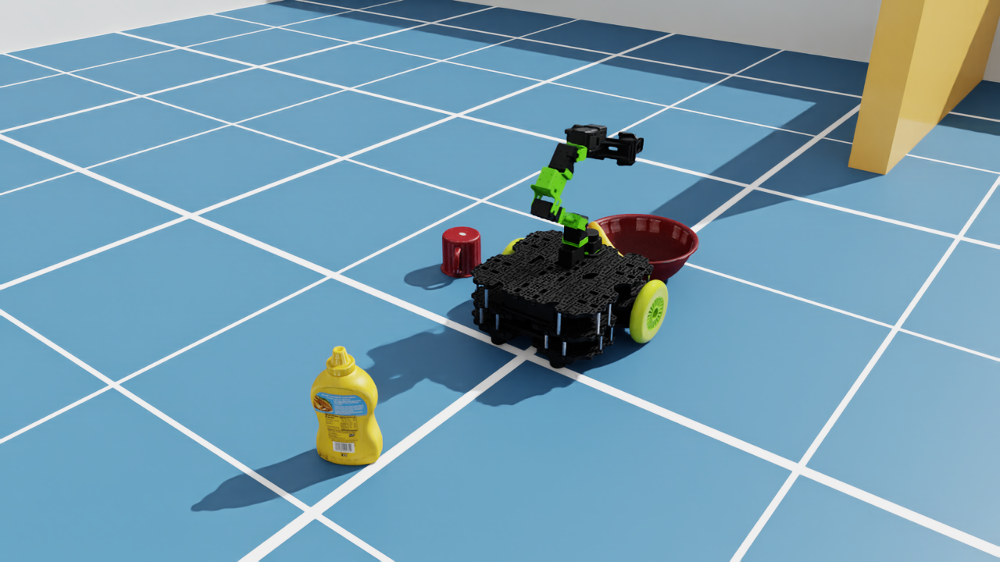
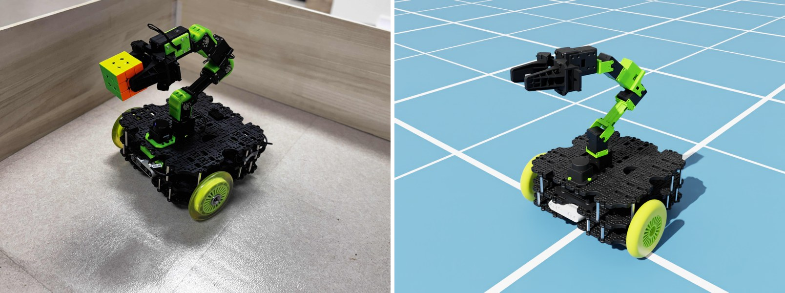

# TurtleBot3 Lime × Isaac Sim 6.2 — 入門チュートリアル

[English](README.md) · **日本語**

**📖 チュートリアル（日本語）: https://an-robotics.github.io/turtlebot3-lime-isaac-sim/ja/**

1 台のロボット **TurtleBot3 Lime** を使って、NVIDIA **Isaac Sim 6.2** を一歩ずつ学びます。TurtleBot3 Lime は、差動二輪の台車、グリッパー付きの 6 自由度アーム、RealSense D435、2D LiDAR を備えたモバイルマニピュレーターです。チュートリアルは NVIDIA の Isaac Sim チュートリアルと同じ構成です。ほとんどのチュートリアルで **GUI** の手順と **スタンドアロン Python スクリプト** の両方を用意し、結果を動画か画像で示します。**ROS 2 Jazzy**（Nav2、MoveIt 2、YOLO）は Isaac Sim と並んで Docker コンテナの中で動きます。





*左：実機の TurtleBot3 Lime（写真：[Momoi Open Source](https://github.com/momoiorg-repository)）。右：Isaac Sim 上の Lime。実機と同じ色に塗っています（チュートリアル 03）。*

## 対象読者

- **Isaac Sim がはじめての人。** Isaac Sim、Omniverse、USD の経験は不要です。
- **Linux のターミナルを使え、Python を読める人。** コマンドを実行し、スクリプトを読み、その中の値を変えます。
- **ROS 2：基本を知っていると役立ちます。** チュートリアルは使う ROS 2 の用語を説明しますが、ROS 2 のプログラミングを基礎から教えるものではありません。ROS 2 がはじめてなら、公式の [Jazzy 入門チュートリアル](https://docs.ros.org/en/jazzy/Tutorials/Beginner-CLI-Tools.html)（英語）も並行して進めてください。
- **NVIDIA RTX GPU を搭載した Linux PC が必要です**（[動作環境](#動作環境)を参照）。

チュートリアル 00〜10 は初級、11〜16 は中級〜上級です。すべて合わせて約 9 時間かかります。
[詳しくはウェブサイトへ](https://an-robotics.github.io/turtlebot3-lime-isaac-sim/ja/#who-is-this-for)。

## クイックスタート

```bash
git clone https://github.com/an-robotics/turtlebot3-lime-isaac-sim.git
cd turtlebot3-lime-isaac-sim

./scripts/setup_isaacsim.sh          # Isaac Sim 6.2 (pip) into .venv/  (~24 GB)
./docker/run_ros.sh true             # build + start the ROS 2 Jazzy container (first time ~15 min)

# terminal 1
source scripts/isaac_env.sh          # every terminal that runs Isaac Sim
python isaac/00_check_setup.py --headless       # publishes /clock for 60 s

# terminal 2
./docker/run_ros.sh ros2 topic echo /clock --once
```

`setup_isaacsim.sh` は Isaac Sim 6.2 を pip で `.venv/` にインストールします（約 24 GB）。`run_ros.sh true` は ROS 2 Jazzy のコンテナをビルドして起動します（初回は約 15 分）。Isaac Sim を動かすターミナルでは毎回 `source scripts/isaac_env.sh` を実行します。`00_check_setup.py` は `/clock` を 60 秒間パブリッシュし、2 つ目のターミナルでそれを受信できればセットアップは完了です。

続きは[チュートリアル](https://an-robotics.github.io/turtlebot3-lime-isaac-sim/ja/)へ。

## チュートリアル

| # | チュートリアル | スクリプト |
|---|---|---|
| 00 | セットアップ | `isaac/00_check_setup.py` |
| 01 | Isaac Sim の基本と Hello World | `isaac/01_hello_world.py` |
| 02 | TurtleBot3 Lime のインポート (URDF → USD) | `isaac/02_import_urdf.py` |
| 03 | ロボットの調整（ドライブ、摩擦、ソルバー）と調整前後の比較 | `isaac/03_tune_robot.py`, `isaac/03_before_after.py` |
| 04 | Python でロボットを動かす（Articulation API） | `isaac/04_hello_robot.py` |
| 05 | はじめての Action Graph（キーボードで運転） | `isaac/05_action_graph.py` |
| 06 | ROS 2 の `/cmd_vel` で走らせる（Action Graph） | `isaac/06_ros2_drive.py` |
| 07 | オドメトリ、TF、ジョイント状態、RViz | `isaac/07_odom_tf.py` + `ros2 launch lime_isaac_bringup view_robot.launch.py` |
| 08 | カメラ：RealSense D435 の RGB、深度、camera_info | `isaac/08_camera.py` |
| 09 | LiDAR（RTX LiDAR で再現した LDS-01）と IMU | `isaac/09_lidar_imu.py` + `ros2 launch lime_isaac_bringup view_sensors.launch.py` |
| 10 | YOLO で物体検出（ROS 2 ノード、Ultralytics） | `isaac/10_yolo.py` + `ros2 launch lime_yolo yolo.launch.py` |
| 11 | Nav2 でナビゲーション（シーンから作る地図、AMCL、ゴール） | `isaac/11_make_map.py`, `isaac/11_nav2.py` + `ros2 launch lime_isaac_bringup navigation.launch.py` |
| 12 | MoveIt 2 でアームを制御（トピック経由の ros2_control） | `isaac/12_moveit.py` + `ros2 launch lime_isaac_moveit moveit.launch.py` |
| 13 | ピック＆プレース（YOLO + 深度、MoveIt 2、Nav2） | `isaac/13_all_together.py` + `ros2 launch lime_isaac_bringup lime_full.launch.py` |
| 14 | SLAM で自分の地図を作る（slam_toolbox） | `isaac/14_slam.py` + `ros2 launch lime_isaac_bringup slam.launch.py` |
| 15 | ビヘイビアツリー（Nav2 のツリー、py_trees による巡回） | `isaac/15_behavior_tree.py` + `ros2 launch lime_isaac_bringup navigation.launch.py` + `ros2 run lime_isaac_bringup patrol` |
| 16 | 総仕上げ：部屋を片付ける（3 本のバナナを探し、確かめ、ピック＆プレース） | `isaac/16_tidy_room.py` + `ros2 launch lime_isaac_bringup tidy.launch.py` + `ros2 run lime_isaac_bringup tidy` |

どのスクリプトも `--headless`、`--test`（自動チェック。`PASS`/`FAIL` を表示）、`--record NAME`（ウェブサイトで使っている動画と画像を保存）を受け付けます。`tools/run_all_checks.sh` はすべてのチェックを実行します。

## リポジトリの構成

```text
isaac/                 Isaac Sim のスタンドアロンスクリプト（チュートリアルごとに 1 本、共通部品は common/）
assets/urdf/           Isaac Sim 用の TurtleBot3 Lime URDF（xacro から生成）
assets/usd/            インポートしたロボットの USD と調整済みロボット（turtlebot3_lime_tuned.usda）
ros2_ws/src/           ROS 2 Jazzy ワークスペース（Humble から移植した TurtleBot3 Lime パッケージを同梱）
docker/                ROS 2 Jazzy コンテナ（Nav2、MoveIt 2、ros2_control、YOLO、py_trees）
scripts/               セットアップと環境設定のスクリプト
my_stages/             GUI タブで作った自分のステージ（File ▸ Save As。git の管理対象外）
docs/                  チュートリアルのウェブサイト（MkDocs Material、GitHub Pages で公開。日本語版は *.ja.md）
```

## 動作環境

Ubuntu 24.04、VRAM 12 GB 以上の NVIDIA RTX GPU（検証環境：RTX 5080 16 GB、ドライバー 580）、約 40 GB の空きディスク、Docker。Ubuntu 22.04 は未検証です。

**なぜ Humble ではなく Jazzy なのか？** Isaac Sim 6.2 が ROS 2 Humble をサポートするのは Ubuntu 22.04 だけで、Ubuntu 24.04 では Jazzy をサポートします。そこで TurtleBot3 Lime のパッケージ（`humble-devel`）を、このリポジトリで Jazzy に移植しています。

## クレジットとライセンス

Apache-2.0。TurtleBot3 Lime の description と MoveIt の設定は [ROBOTIS-JAPAN-GIT/turtlebot3_lime](https://github.com/ROBOTIS-JAPAN-GIT/turtlebot3_lime)（Apache-2.0）から取り込んでいます。このプロジェクトは [Turtlebot3_Lime_IsaacSim_Humble](https://github.com/momoiorg-repository/Turtlebot3_Lime_IsaacSim_Humble) の後継で、Isaac Sim 6.2 に対応しています。詳しくは [NOTICE](NOTICE) を参照してください。
