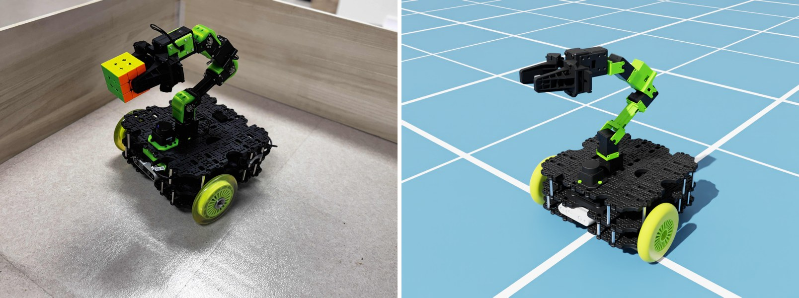

# TurtleBot3 Lime × Isaac Sim 6.2 { #turtlebot3-lime-isaac-sim-62 }

**NVIDIA Isaac Sim 6.2** を、1 台のロボットで一歩ずつ学びます。そのロボットが **TurtleBot3 Lime** です。差動二輪の台車、グリッパー付きの 6 自由度アーム、Intel RealSense D435 カメラ、2D LiDAR を備えたモバイルマニピュレーターです。

このチュートリアルは、NVIDIA 公式の Isaac Sim チュートリアルの構成に沿っています。どのステップでも Lime を使い、どのステップも **Isaac Sim をはじめて開く人**向けに書いています。

## 実機とデジタルツイン { #the-real-robot-and-its-twin }

<figure class="result" markdown>
{ .full }
<figcaption>左：実機の TurtleBot3 Lime（写真：Momoi Open Source）。右：Isaac Sim でシミュレーションした Lime。このチュートリアルで、実機の ROS パッケージから作ります。URDF、ジョイント、センサー、トピック名は実機と同じで、色も実機に合わせています（チュートリアル 03）。</figcaption>
</figure>

**TurtleBot3 Lime** は、ROBOTIS Japan のモバイルマニピュレーターです。大きな車輪を付けた TurtleBot3 の台車、グリッパー付きの 6 ジョイントのアーム（Dynamixel XM430 サーボ、3D プリントのライムグリーンのブラケット）、前面の Intel RealSense D435 カメラ、上部の LDS 2D LiDAR で構成されています。このチュートリアルの ROS 側はすべて実機のトピック名とフレーム名を使っているので、シミュレーションで作ったものを実機にそのまま持っていけることを目指しています。

<figure class="result" markdown>
<video controls autoplay loop muted playsinline>
  <source src="../assets/video/tutorial16_tidy.mp4" type="video/mp4">
</video>
<figcaption>最後のチュートリアル：Lime が部屋を片付けます。Nav2 が見回り地点から見回り地点へとロボットを走らせ、深度カメラが床の上にあるものを見つけ、YOLO がバナナをマグカップやボトルと見分け、MoveIt が 3 本のバナナをすべて拾ってボウルに入れ、ビヘイビアツリーが次に何をするかを決めます。すべて Isaac Sim 6.2 でシミュレーションし、ROS 2 Jazzy から制御しています。</figcaption>
</figure>

## 対象読者 { #who-is-this-for }

- **Isaac Sim がはじめての人。** Isaac Sim、Omniverse、USD を知らなくてもかまいません。各チュートリアルで、そこで使う考え方を説明します。
- **Linux のターミナルを使えて、Python を読める人。** コマンドを実行し、スクリプトを読み、その中の値を変更します。プログラムを一から書く必要はありません。
- **ROS 2：基本を知っていると役立ちます。** チュートリアル 06 以降では、Isaac Sim が ROS 2 と通信します。チュートリアルでは使う ROS 2 の用語を説明しますが（[10 分でわかる ROS 2](tutorials/06-ros2-drive.md#ros-2-in-10-minutes)）、ROS 2 のプログラミングを基礎から教えるものではありません。ROS 2 がはじめてなら、チュートリアル 06 の前か並行して公式の [Jazzy の初心者向けチュートリアル（コマンドラインツール編）](https://docs.ros.org/en/jazzy/Tutorials/Beginner-CLI-Tools.html)を、チュートリアル 13〜16 の Python のミッションを変更する前に[クライアントライブラリ編のチュートリアル](https://docs.ros.org/en/jazzy/Tutorials/Beginner-Client-Libraries.html)をやっておいてください。どちらも、このプロジェクトの ROS 2 コンテナの中でも実行できます。
- **NVIDIA RTX GPU を搭載した Linux PC が必要です**（[必要なもの](#what-you-need)を参照）。このチュートリアルでは Windows と macOS は扱いません。

各パートは、その前のパートを土台にしています。

| パート | チュートリアル | レベル | 時間（各ページの目安より） |
|---|---|---|---|
| はじめに、ロボットの準備、OmniGraph | 00〜05 | 初級（物理の調整を行う 03 がいちばん難しい） | 約 1 時間 45 分、加えてセットアップに 30〜60 分（ほとんどはダウンロード） |
| ROS 2、センサー、YOLO | 06〜10 | 初級 | 約 2 時間 |
| Nav2、MoveIt 2、ピック＆プレース、SLAM | 11〜14 | 中級 | 約 2 時間 30 分 |
| ビヘイビアツリー、部屋の片付け | 15〜16 | 中級 → 上級 | 約 1 時間 45 分 |

合計で約 9 時間です。いろいろ試してみる時間は含みません。

## 各チュートリアルの進め方 { #how-each-tutorial-works }

01 以降の各チュートリアルは、結果の動画か画像から始まります。ほとんどのチュートリアル（02、03、05〜09、11〜14）では、同じことを 2 通りの方法で行えます。

=== "GUI"

    Isaac Sim の画面をクリックして操作します。*どこに何があるか*、*それが何を意味するか*を学ぶのに最適です。

=== "Python (standalone)"

    `isaac/` にあるスクリプトを 1 つ実行します。どのスクリプトも、次のフラグを受け付けます。

    | フラグ | 動作 |
    |---|---|
    | `--headless` | ウィンドウなしで実行します（サーバー、CI 向け） |
    | `--test` | 短い自動チェックを実行し、`PASS` / `FAIL` を表示します |
    | `--record NAME` | チュートリアルのページに載せている動画と画像を保存します |

!!! tip "タブの選び方"
    2 つのタブは連動しています。**GUI** か **Python** を一度選べば、すべてのページがそのタブに切り替わります。

チュートリアル 01 では、まず GUI で操作し、次に同じことを Python で行います。チュートリアル 04 は Python API を、10、15、16 は ROS 2 のコードを扱うので、GUI タブはありません。

!!! tip "GUI ではステージを保存しましょう"
    GUI タブの中には、前のチュートリアルで作ったステージの続きから始めるものがあります。**File ▸ Save As** でリポジトリの `my_stages/` フォルダーに保存し（ファイル名は各ページに書いてあります）、**File ▸ Open** で再び開きます。Git はこのフォルダーを無視します。`assets/` の中のファイルには上書き保存しないでください。スクリプトやほかの GUI タブがそれらを使っています。Isaac Sim のファイルダイアログは `omniverse://` から始まることがあります。左側のリストで **My Computer** を選び、次にリポジトリのフォルダーを選んでください。

## チュートリアル一覧 { #the-tutorials }

| # | チュートリアル | 学ぶこと |
|---|---|---|
| 00 | [セットアップ](tutorials/00-setup.md) | Isaac Sim 6.2 のインストール (pip)、ROS 2 Jazzy のコンテナの起動 |
| 01 | [Isaac Sim の基本と Hello World](tutorials/01-hello-world.md) | ウィンドウ、USD のプリムとスキーマ、はじめてのスタンドアロンスクリプト |
| 02 | [TurtleBot3 Lime のインポート](tutorials/02-import-urdf.md) | 6.2 の URDF インポーターによる URDF → USD の変換、アセットの構造、物理バリアント |
| 03 | [ロボットの調整](tutorials/03-tune-robot.md) | ジョイントドライブ、ゲイン、摩擦と摩擦の結合モード、ソルバーの反復回数 |
| 04 | [Python でロボットを動かす](tutorials/04-hello-robot.md) | Articulation API：車輪、アーム、グリッパー |
| 05 | [はじめての Action Graph](tutorials/05-action-graph.md) | OmniGraph の基本：キーボードで運転 |
| 06 | [ROS 2 で走らせる](tutorials/06-ros2-drive.md) | ROS 2 ブリッジ、Action Graph、`/clock`、`/cmd_vel`、差動二輪のコントローラー |
| 07 | [オドメトリ、TF、RViz](tutorials/07-odom-tf.md) | `/odom`、TF ツリー、`/joint_states`、`robot_state_publisher`、RViz |
| 08 | [カメラ（RealSense D435）](tutorials/08-camera.md) | RGB、深度、camera_info、光学フレーム、lime_room のシーン |
| 09 | [LiDAR と IMU](tutorials/09-lidar-imu.md) | LDS-01 として設定した RTX LiDAR、`/scan`、IMU、`/imu`、RViz でのセンサー表示 |
| 10 | [YOLO で物体検出](tutorials/10-yolo.md) | シミュレーションの画像に対して動く ROS 2 の YOLO ノード、`vision_msgs/Detection2DArray` |
| 11 | [Nav2 でナビゲーション](tutorials/11-nav2.md) | シーンから作る占有格子地図、Lime 用の Jazzy の Nav2 パラメーター、AMCL、ゴール、地図にないカラーコーン |
| 12 | [MoveIt 2 でアームを制御](tutorials/12-moveit2.md) | トピック経由の ros2_control、Jazzy 上の MoveIt 2、RViz と Python からのプランニング |
| 13 | [ピック＆プレース](tutorials/13-all-together.md) | ロボット全体を一度に使う：YOLO + 深度でバナナを見つけ、MoveIt 2 で拾ってボウルに入れ、Nav2 で駐車する |
| 14 | [SLAM で自分の地図を作る](tutorials/14-slam.md) | slam_toolbox で LiDAR から部屋の地図を作る、Isaac Sim の −1 の「反射なし」、地図を正解と比べて採点する |
| 15 | [ビヘイビアツリー](tutorials/15-behavior-trees.md) | Nav2 の中のツリー、py_trees で作る自分のツリー：バッテリー低下で中断される巡回 |
| 16 | [総仕上げ：部屋を片付ける](tutorials/16-tidy-room.md) | 実際の仕事：3 本のバナナを見つけ（深度カメラ + 地図）、YOLO で確かめ、1 本ずつピック＆プレースする。すべてをビヘイビアツリーで動かす |

すべてのチュートリアルを Isaac Sim 6.2 で実行し、それぞれの `--test` モードでチェックしています (`tools/run_all_checks.sh`)。

## 必要なもの { #what-you-need }

- Ubuntu 24.04 と、VRAM 12 GB 以上の NVIDIA RTX GPU（検証環境：16 GB の RTX 5080、ドライバー 580）。Ubuntu 22.04 は未検証です。
- 約 40 GB の空きディスク容量
- Docker（ROS 2 Jazzy 側で使います）

!!! info "なぜ Humble ではなく ROS 2 Jazzy なのか？"
    Isaac Sim 6.2 が **Humble をサポートするのは Ubuntu 22.04 だけ**です。Ubuntu 24.04 では **Jazzy** をサポートしています。TurtleBot3 Lime のパッケージは Humble 向けに公開されているので、このプロジェクトでは Jazzy に移植しています。ROS 側は Docker コンテナの中で動くので、PC に ROS をインストールする必要はありません。

## ソースコード { #source-code }

すべて GitHub にあります：[an-robotics/turtlebot3-lime-isaac-sim](https://github.com/an-robotics/turtlebot3-lime-isaac-sim)。TurtleBot3 Lime のパッケージは [ROBOTIS-JAPAN-GIT/turtlebot3_lime](https://github.com/ROBOTIS-JAPAN-GIT/turtlebot3_lime) (Apache-2.0) のものです。[クレジットとライセンス](reference/credits.md)を参照してください。
