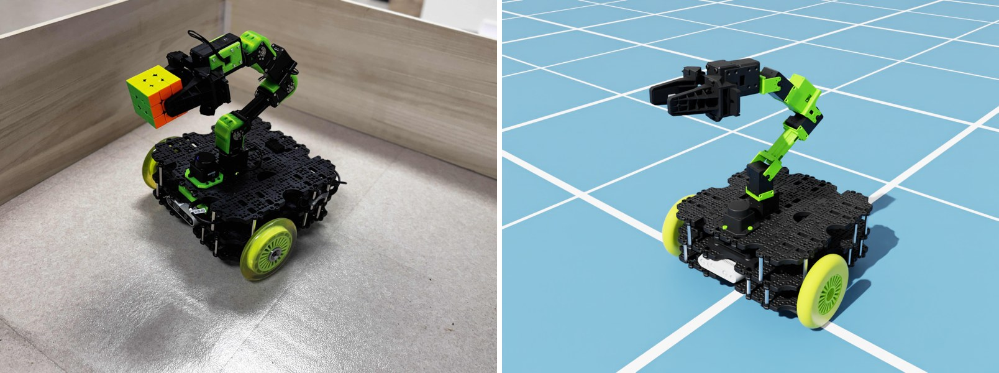

# TurtleBot3 Lime × Isaac Sim 6.2

Learn **NVIDIA Isaac Sim 6.2** step by step with one robot: the **TurtleBot3 Lime**, a mobile
manipulator with a differential-drive base, a 6-DoF arm with gripper, an Intel RealSense D435 camera
and a 2D LiDAR.

The tutorials follow the structure of NVIDIA's own Isaac Sim tutorials. Every step uses the Lime,
and every step is written for people who are **opening Isaac Sim for the first time**.

## The real robot and its twin

<figure class="result" markdown>
{ .full }
<figcaption>Left: the real TurtleBot3 Lime (photo: Momoi Open Source). Right: the simulated Lime in Isaac Sim, built in these tutorials from the real robot's ROS packages: the same URDF, joints, sensors and topic names, and the real robot's colours (tutorial 03).</figcaption>
</figure>

The **TurtleBot3 Lime** is ROBOTIS Japan's mobile manipulator: a TurtleBot3 base with large wheels, a 6-joint arm
with a gripper (Dynamixel XM430 servos, 3D-printed lime-green brackets), an Intel RealSense D435 camera at the
front and an LDS 2D LiDAR on top. Everything on the ROS side of these tutorials uses the real robot's topic and
frame names, so what you build in simulation is meant to carry over to the hardware.

<figure class="result" markdown>
<video controls autoplay loop muted playsinline>
  <source src="assets/video/tutorial16_tidy.mp4" type="video/mp4">
</video>
<figcaption>The final tutorial: the Lime tidies the room. Nav2 drives it from lookout to lookout, the depth camera finds what is on the floor, YOLO tells the bananas from the mug and the bottle, MoveIt picks up all three bananas and puts them into the bowl, and a behavior tree decides what to do next. Everything simulated in Isaac Sim 6.2 and controlled from ROS 2 Jazzy.</figcaption>
</figure>

## Who is this for?

- **People who are new to Isaac Sim.** You don't need to know Isaac Sim, Omniverse or USD. Each tutorial
  explains the ideas it uses.
- **You can use a Linux terminal and read Python.** You run commands, read scripts and change values in them.
  You don't need to write a program from scratch.
- **ROS 2: the basics help.** From tutorial 06 on, Isaac Sim talks to ROS 2. The tutorials explain the ROS 2
  words they use ([ROS 2 in 10 minutes](tutorials/06-ros2-drive.md#ros-2-in-10-minutes)), but they don't teach
  ROS 2 programming from the ground up. If ROS 2 is new to you, do the official
  [Jazzy beginner tutorials on the command-line tools](https://docs.ros.org/en/jazzy/Tutorials/Beginner-CLI-Tools.html)
  before or alongside tutorial 06, and the
  [client library tutorials](https://docs.ros.org/en/jazzy/Tutorials/Beginner-Client-Libraries.html) before you
  change the Python missions of tutorials 13–16. They run in this project's ROS 2 container too.
- **You need a Linux PC with an NVIDIA RTX GPU** (see [What you need](#what-you-need)). These tutorials don't
  cover Windows or macOS.

Each part builds on the one before:

| Part | Tutorials | Level | Time (the estimates on each page) |
|---|---|---|---|
| Getting started, robot setup, OmniGraph | 00–05 | beginner (03, physics tuning, is the hardest) | about 1¾ h, plus 30–60 min of setup (mostly downloads) |
| ROS 2, the sensors, YOLO | 06–10 | beginner | about 2 h |
| Nav2, MoveIt 2, pick and place, SLAM | 11–14 | intermediate | about 2½ h |
| Behavior trees, tidy the room | 15–16 | intermediate → advanced | about 1¾ h |

That is about 9 hours in total, without the time you spend trying things out.

## How each tutorial works

Every tutorial from 01 on starts with a video or a picture of the result. Most of them (02, 03, 05–09, 11–14)
give you two ways to do the same thing:

=== "GUI"

    Click through Isaac Sim's interface. This is best for learning *where things are* and *what they mean*.

=== "Python (standalone)"

    Run one script from `isaac/`. Every script also accepts:

    | Flag | What it does |
    |---|---|
    | `--headless` | no window (servers, CI) |
    | `--test` | runs a short automatic check and prints `PASS` / `FAIL` |
    | `--record NAME` | saves the video and picture shown on the tutorial page |

!!! tip "Choosing between the tabs"
    The two tabs are linked. Pick **GUI** or **Python** once and every page switches to it.

Tutorial 01 shows the GUI first and then the same in Python. Tutorial 04 is about the Python API, and 10, 15 and 16
are about ROS 2 code, so they have no GUI tab.

!!! tip "Save your stage in the GUI"
    Some GUI tabs continue from the stage you built in an earlier tutorial. Save it with **File ▸ Save As** in
    the repository's `my_stages/` folder (each page says which name), and open it again with **File ▸ Open**. Git
    ignores that folder. Don't save over the files in `assets/`: the scripts and the other GUI tabs use them.
    Isaac Sim's file dialogs can start in `omniverse://`: choose **My Computer** in the list on the left, then the
    repository folder.

## The tutorials

| # | Tutorial | You will learn |
|---|---|---|
| 00 | [Setup](tutorials/00-setup.md) | Install Isaac Sim 6.2 (pip), start the ROS 2 Jazzy container |
| 01 | [Isaac Sim basics & Hello World](tutorials/01-hello-world.md) | the window, USD prims and schemas, your first standalone script |
| 02 | [Import TurtleBot3 Lime](tutorials/02-import-urdf.md) | URDF → USD with the 6.2 URDF importer, the asset structure, physics variants |
| 03 | [Tune the robot](tutorials/03-tune-robot.md) | Joint drives, gains, friction and friction-combine modes, solver iterations |
| 04 | [Move it from Python](tutorials/04-hello-robot.md) | the Articulation API: wheels, arm, gripper |
| 05 | [Your first Action Graph](tutorials/05-action-graph.md) | OmniGraph basics: keyboard driving |
| 06 | [Drive with ROS 2](tutorials/06-ros2-drive.md) | ROS 2 bridge, Action Graph, `/clock`, `/cmd_vel`, differential controller |
| 07 | [Odometry, TF & RViz](tutorials/07-odom-tf.md) | `/odom`, TF tree, `/joint_states`, `robot_state_publisher`, RViz |
| 08 | [Camera (RealSense D435)](tutorials/08-camera.md) | RGB, depth, camera_info; optical frames; the lime_room scene |
| 09 | [LiDAR & IMU](tutorials/09-lidar-imu.md) | RTX LiDAR configured as the LDS-01, `/scan`, IMU, `/imu`, sensors in RViz |
| 10 | [Object detection with YOLO](tutorials/10-yolo.md) | a ROS 2 YOLO node on simulated images, `vision_msgs/Detection2DArray` |
| 11 | [Navigation with Nav2](tutorials/11-nav2.md) | occupancy map from the scene, Jazzy Nav2 parameters for the Lime, AMCL, goals, a traffic cone that is not in the map |
| 12 | [Arm control with MoveIt 2](tutorials/12-moveit2.md) | ros2_control over topics, MoveIt 2 on Jazzy, planning from RViz and Python |
| 13 | [Pick and place](tutorials/13-all-together.md) | the whole robot at once: YOLO + depth find the banana, MoveIt 2 picks it up and puts it into the bowl, Nav2 parks |
| 14 | [Make your own map with SLAM](tutorials/14-slam.md) | slam_toolbox maps the room from the LiDAR; Isaac Sim's −1 "no return"; grade the map against the truth |
| 15 | [Behavior trees](tutorials/15-behavior-trees.md) | the tree inside Nav2; your own tree with py_trees: a patrol that a low battery interrupts |
| 16 | [All together: tidy the room](tutorials/16-tidy-room.md) | a real job: find three bananas (depth camera + map), check things with YOLO, pick and place each one, all run by a behavior tree |

Every tutorial was run on Isaac Sim 6.2 and checked with its `--test` mode (`tools/run_all_checks.sh`).

## What you need

- Ubuntu 24.04 and an NVIDIA RTX GPU with 12 GB of VRAM or more (tested: RTX 5080 with 16 GB, driver 580).
  Ubuntu 22.04 is not tested.
- About 40 GB of free disk space
- Docker (for the ROS 2 Jazzy side)

!!! info "Why ROS 2 Jazzy and not Humble?"
    Isaac Sim 6.2 supports **Humble only on Ubuntu 22.04**. On Ubuntu 24.04 it supports **Jazzy**.
    The TurtleBot3 Lime packages are published for Humble, so this project ports them to Jazzy.
    The ROS side runs in a Docker container, so you do not need ROS installed on your PC.

## Source code

Everything is on GitHub:
[an-robotics/turtlebot3-lime-isaac-sim](https://github.com/an-robotics/turtlebot3-lime-isaac-sim).
The TurtleBot3 Lime packages come from
[ROBOTIS-JAPAN-GIT/turtlebot3_lime](https://github.com/ROBOTIS-JAPAN-GIT/turtlebot3_lime) (Apache-2.0).
See [Credits & license](reference/credits.md).
