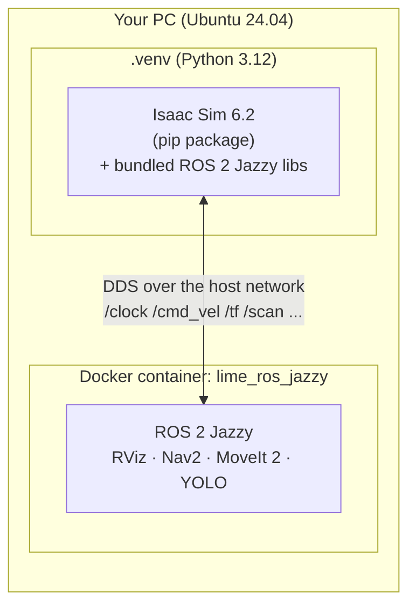
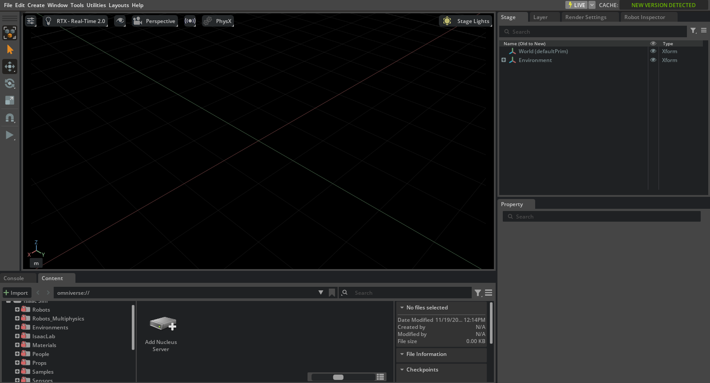

# 00 · セットアップ { #00-setup }

<p class="tutorial-meta">⏱ 30〜60 分（ほとんどはダウンロード） · レベル：初級</p>

**目標：** Isaac Sim 6.2 をインストールし、ROS 2 Jazzy のコンテナを起動して、両者が通信できることを確かめます。

## インストールするもの { #what-you-will-install }



- **Isaac Sim** は PC 上で直接動きます。このリポジトリの中に作る Python 仮想環境から起動します。Isaac Sim は **ROS 2 Jazzy のライブラリを自前で同梱している**ので、ROS をインストールしなくても ROS 2 ブリッジが動きます。
- **ROS 2 Jazzy** は **Docker コンテナ**の中で動きます。RViz、Nav2、MoveIt 2、ros2_control、YOLO ノード、TurtleBot3 Lime のパッケージがここに入っています。コンテナは PC のネットワークを共有するので、両側の ROS 2 ノードがお互いを見つけられます。

## 動作要件 { #requirements }

| | |
|---|---|
| OS | Ubuntu 24.04（22.04 は未検証） |
| GPU | VRAM 12 GB 以上の NVIDIA RTX（検証環境：16 GB の RTX 5080） |
| ドライバー | 最近の NVIDIA ドライバー（検証環境：580.178） |
| ディスク | 約 40 GB（Isaac Sim ≈ 24 GB、ROS のコンテナイメージ ≈ 9 GB） |
| ソフトウェア | `git`、`curl`、[Docker](https://docs.docker.com/engine/install/ubuntu/)（`sudo` なしで実行できること） |

**NVIDIA は 16 GB を求めているのに、なぜ 12 GB なのか？** NVIDIA の [Isaac Sim の動作要件](https://docs.isaacsim.omniverse.nvidia.com/latest/installation/requirements.html)は、はるかに大きなシーンも含めた Isaac Sim 全般の最小要件として 16 GB を挙げています。ここで扱うシーンは小さく、部屋が 1 つ、カメラが 1 台、LiDAR が 1 台です。テスト PC では、最も重いチュートリアル（13、14、16。`nvidia-smi` で測定）でも Isaac Sim の VRAM 使用量は最大で約 3.5 GB でした。そのため 12 GB あれば、デスクトップ、ブラウザー、RViz の分の余裕が残ります。ただし、12 GB のカードではまだ試していません。お持ちの方は、[Issue を作成](https://github.com/an-robotics/turtlebot3-lime-isaac-sim/issues)して結果を教えてください。

## 1. リポジトリを取得する { #1-get-the-repository }

```bash
git clone https://github.com/an-robotics/turtlebot3-lime-isaac-sim.git
cd turtlebot3-lime-isaac-sim
```

## 2. Isaac Sim 6.2 をインストールする { #2-install-isaac-sim-62 }

```bash
./scripts/setup_isaacsim.sh
```

このスクリプトは次のことを行います。

1. [uv](https://docs.astral.sh/uv/) を使って、`.venv/` に Python 3.12 の仮想環境を作ります。
2. `pip install "isaacsim[all,extscache]==6.2.0.0" --extra-index-url https://pypi.nvidia.com` を実行します（数 GB あります）。
3. チュートリアルで動画の保存に使う `imageio-ffmpeg` をインストールします。
4. GUI アプリ用の小さな修正を加えます（[トラブルシューティング](../reference/troubleshooting.md#core-extensions-fail-to-load-charset_normalizer)を参照）。

??? note "公式の zip 版 / ワークステーション版でインストールしたい場合は？（ここでは未検証）"
    動くはずですが、このチュートリアルは pip でのインストールでしか検証していません。チュートリアルに `python isaac/xx.py` とある箇所では、代わりに `~/isaacsim/python.sh isaac/xx.py` を使ってください。`isaac-sim.sh` は同梱の ROS 2 ライブラリを自分で設定するので、`scripts/isaac_env.sh` は省略できます。ただし、そのファイルにある `DDS` 関連の変数（`ROS_DOMAIN_ID`、`RMW_IMPLEMENTATION`、Fast DDS のプロファイル）は必要です。

## 3. Isaac Sim 用のターミナルを準備する { #3-prepare-a-terminal-for-isaac-sim }

Isaac Sim を起動する**新しいターミナルごとに**、次を実行します。

```bash
source scripts/isaac_env.sh
```

これは `.venv` を有効にし、次の 4 つを設定します。

| 変数 | 理由 |
|---|---|
| `ROS_DISTRO=jazzy`、`LD_LIBRARY_PATH=…/isaacsim.ros2.core/jazzy/lib` | Isaac Sim に**同梱の** ROS 2 Jazzy ライブラリを読み込ませるためです。pip でのインストールには、これを行ってくれる `isaac-sim.sh` ランチャーがありません。また、この設定は Isaac Sim の起動*前*に済ませておく必要があります。 |
| `RMW_IMPLEMENTATION=rmw_fastrtps_cpp`、`FASTDDS_DEFAULT_PROFILES_FILE` | コンテナと同じ DDS の設定（UDP のみ）にして、両者の間でトピックがやり取りされるようにします。 |
| `ROS_DOMAIN_ID`（デフォルトは `0`） | コンテナと一致している必要があります。 |

また、それより前に source した ROS の環境（例えば `/opt/ros/jazzy`）があれば、それを**取り除きます**。これで、Isaac Sim がシステムの ROS と自前のライブラリを混ぜて使うことはなくなります。

Isaac Sim の GUI は次のコマンドで起動します。

```bash
isaacsim
```

初回の起動では、シェーダーのコンパイルに数分かかります。2 回目以降は数秒で起動します。

<figure class="result" markdown>
{ .full }
<figcaption>Isaac Sim が起動しました。ステージは空で、Stage パネルには <code>World</code> と <code>Environment</code> があります。ウィンドウの説明はチュートリアル 01 で行います。今はいったん閉じてかまいません。</figcaption>
</figure>

## 4. ROS 2 Jazzy のコンテナを起動する { #4-start-the-ros-2-jazzy-container }

```bash
./docker/run_ros.sh
```

初回の実行では、`docker/ros_jazzy/Dockerfile` からイメージ `lime_ros_jazzy` をビルドし（10〜20 分）、ROS 2 を source 済みのシェルをコンテナの中で開きます。2 回目以降は、実行中の `lime_ros` という名前のコンテナを再利用します。

```bash
./docker/run_ros.sh                      # interactive shell
./docker/run_ros.sh ros2 topic list      # run one command
```

!!! tip "ビルド中の `apt` のダウンロードが遅い場合は？"
    [公式のミラー一覧](https://launchpad.net/ubuntu/+archivemirrors)から近くの Ubuntu ミラーを選び、その完全な URL を指定します。これで `archive.ubuntu.com` と `security.ubuntu.com` の両方が置き換わります。
    ```bash
    UBUNTU_MIRROR=http://<mirror>/ubuntu/ ./docker/run_ros.sh
    ```
    例えば日本なら `UBUNTU_MIRROR=http://ftp.udx.icscoe.jp/Linux/ubuntu/` です。これが効くのは、最初にイメージをビルドするときだけです。

??? note "Docker ではなく、ROS 2 を PC に直接インストールしたい場合は？（ここでは未検証）"
    このチュートリアルは、コンテナでしか検証していません。Ubuntu 24.04 なら、Dockerfile がインストールするのと同じパッケージを次のようにインストールできます：`sudo apt install ros-jazzy-desktop ros-jazzy-navigation2 ros-jazzy-nav2-bringup ros-jazzy-slam-toolbox ros-jazzy-moveit ros-jazzy-ros2-control ros-jazzy-ros2-controllers ros-jazzy-gripper-controllers ros-jazzy-joint-state-topic-hardware-interface ros-jazzy-xacro ros-jazzy-realsense2-description ros-jazzy-vision-msgs ros-jazzy-cv-bridge ros-jazzy-teleop-twist-keyboard ros-jazzy-py-trees ros-jazzy-py-trees-ros`。そのうえで、`scripts/isaac_env.sh` と同じ `ROS_DOMAIN_ID`、`RMW_IMPLEMENTATION`、Fast DDS のプロファイルを使ってください。Isaac Sim を実行するターミナルでは、決して `/opt/ros/jazzy` を source しないでください。

## 5. すべてが通信できることを確かめる { #5-check-that-everything-talks }

ターミナル 1 では、Isaac Sim を実行します（ヘッドレスなので、ウィンドウは不要です）。

```bash
source scripts/isaac_env.sh
python isaac/00_check_setup.py --headless
```

ターミナル 2 では、ROS 2 のコンテナで次を実行します。

```bash
./docker/run_ros.sh ros2 topic echo /clock --once
```

次のように表示されるはずです。

```text
clock:
  sec: 6
  nanosec: 716666666
---
```

このメッセージは、Isaac Sim の Action Graph が生成し、コンテナ内の ROS 2 が受信したものです。🎉

??? example "スクリプト：`isaac/00_check_setup.py`"
    ```python
    --8<-- "isaac/00_check_setup.py"
    ```

!!! success "自動チェック"
    `python isaac/00_check_setup.py --headless --test` は、Isaac Sim の中から `/clock` をサブスクライブし、`[00][test] ... PASS` を表示します。

## トラブルシューティング { #troubleshooting }

| 症状 | 対処 |
|---|---|
| `ROS2 Bridge startup failed … libament_index_cpp.so` | このターミナルで `source scripts/isaac_env.sh` を実行していないか、その後に `/opt/ros/...` を source しています。 |
| `ros2 topic list` には `/clock` が表示されるが、`echo` では何も表示されない | DDS の設定が合っていません。両側で `ROS_DOMAIN_ID` は同じですか？ファイアウォールが UDP をブロックしていませんか？ |
| Isaac Sim のウィンドウが長い間真っ黒のまま | 初回の起動ではシェーダーをコンパイルします（数分かかります）。待ってください。 |

詳しくは[トラブルシューティング](../reference/troubleshooting.md)を参照してください。

**次へ：** [01 · Isaac Sim の基本と Hello World](01-hello-world.md)
