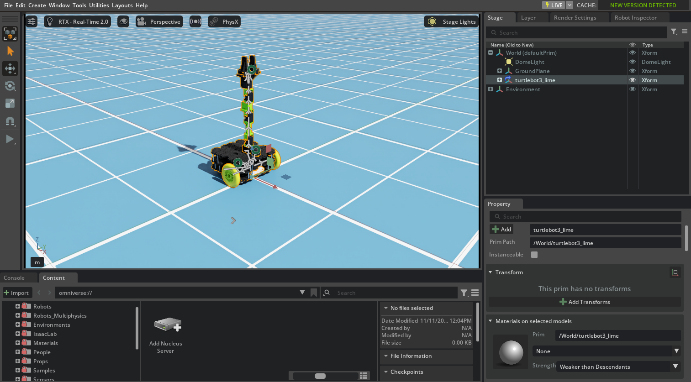

# 01 · Isaac Sim の基本と Hello World { #01-isaac-sim-basics-hello-world }

<p class="tutorial-meta">⏱ 20 分 · レベル：はじめて · スクリプト：<code>isaac/01_hello_world.py</code></p>

**目標：** Isaac Sim のウィンドウの各部を把握し、はじめてのスタンドアロン Python スクリプトを書きます。題材は、TurtleBot3 Lime の隣で落ちる立方体です。

<figure class="result" markdown>
<video controls autoplay loop muted playsinline>
  <source src="../../../assets/video/tutorial01_hello_world.mp4" type="video/mp4">
</video>
</figure>

## ウィンドウ { #the-window }

{ .full }

| 領域 | 役割 |
|---|---|
| **Viewport**（中央） | 3D ビューです。マウスの右ボタンを押しながら `WASD` で視点を動かし、`F` で選択中のものを画面に収め、スクロールでズームします。上のツールバーで、レンダラーとカメラを選びます。 |
| **Stage**（右上） | シーンを*プリム*（USD のオブジェクト）のツリーとして表示します：`/World/GroundPlane`、`/World/turtlebot3_lime`、… |
| **Property**（右下） | 選択したプリムのすべての情報です：トランスフォーム、物理、マテリアル、バリアント。 |
| **Content / Console**（下） | NVIDIA のアセットライブラリと自分のファイル、そしてログです。 |
| **Play ▶ / Stop ■**（左のツールバー） | シミュレーションを開始・停止します。物理、センサー、ROS 2 は再生中にしか動きません。 |

!!! info "1 段落でわかる USD"
    Isaac Sim のシーンは **USD** のステージです。ステージは、属性を持つプリムのツリーです。プリムは*スキーマ*を適用することで振る舞いを持ちます。`UsdPhysics.RigidBodyAPI` を適用すると重力で動くようになり、`CollisionAPI` を適用するとほかの物体と接触するようになり、`ArticulationRootAPI` はリンクとジョイントのツリーをロボットにします。ステージは、ほかの USD ファイルを*リファレンス*できます。Lime は 1 つのファイル (`assets/usd/turtlebot3_lime_tuned.usda`) で、各シーンにリファレンスとして読み込まれます。

## GUI で試してみる { #try-it-in-the-gui }

1. `source scripts/isaac_env.sh && isaacsim` を実行します。
2. **Create ▸ Physics ▸ Ground Plane** を選びます。
3. **Create ▸ Shape ▸ Cube** を選びます。**Property ▸ Transform** で *Translate* の z を 1 にします。
4. 立方体を選択した状態で、**Add ▸ Physics ▸ Rigid Body with Colliders Preset** を選びます。
5. **Content** ブラウザーから `assets/usd/turtlebot3_lime_tuned.usda` をビューポートにドラッグします。これでロボットがリファレンスとして追加されます。Content ブラウザーは、NVIDIA のアセットライブラリがある `omniverse://` から始まります。自分のファイルを探すには、左側のリストを **My Computer** までスクロールし、リポジトリをクローンしたフォルダーを開きます。
6. **Play** ▶ を押します。立方体が落ち、ロボットは車輪で立ちます。
7. **Stop** ■ を押してから、**File ▸ Save As** で `my_stages/01_hello_world.usd` としてステージを保存します。リポジトリの `my_stages/` フォルダーは自分のステージ用で、git はこのフォルダーを無視します。この後の GUI タブは、ここに保存したステージの続きから始まります。

## Python で同じことをする { #the-same-in-python }

*スタンドアロン*スクリプトは Isaac Sim を自分で起動するので、ウィンドウなしでも実行できます。例えば、サーバー上やテストで実行できます。

```bash
source scripts/isaac_env.sh
python isaac/01_hello_world.py
python isaac/01_hello_world.py --headless --test
```

このプロジェクトのスクリプトは、どれも同じ 4 つのステップでできています。

```python
from isaacsim import SimulationApp
simulation_app = SimulationApp({"headless": False})       # 1. start Isaac Sim - always first!

import isaacsim.core.experimental.utils.stage as stage_utils   # (imports only after SimulationApp)
stage = stage_utils.create_new_stage(template="sunlight") # 2. build a scene
GroundPlane("/World/GroundPlane")
cube = Cube("/World/LimeCube", sizes=0.2, positions=[0.6, 0.0, 1.0], colors=["limegreen"])
UsdPhysics.RigidBodyAPI.Apply(stage.GetPrimAtPath("/World/LimeCube"))
UsdPhysics.CollisionAPI.Apply(stage.GetPrimAtPath("/World/LimeCube"))

SimulationManager.setup_simulation(dt=1.0 / 60.0)       # 3. physics settings, then Play
app_utils.play()

while simulation_app.is_running():                      # 4. step: render + physics
    simulation_app.update()
```

```text
[01] t = 0.5 s   cube height = 0.791 m
[01] t = 1.0 s   cube height = 0.100 m
[01][check] ok   cube landed on the floor (centre at 0.100 m = half its size)
[01][check] ok   robot stands on its wheels (base_link at 0.060 m = wheel radius)
[01][check] ok   robot has 10 joints that can move
[01][test] PASS
```

!!! tip "どの Python API を使えばよいか？"
    Isaac Sim 6.x では、`isaacsim.core.experimental.*` モジュール（`prims`、`objects`、`utils`）を `SimulationManager` と組み合わせて使うことが推奨されています。インターネット上の古いチュートリアルでは、`isaacsim.core.api` の `World` が使われています。これは 6.2 でもまだ動きますが、**非推奨**なので、このチュートリアルでは新しい API を使います。

??? example "スクリプト全体：`isaac/01_hello_world.py`"
    ```python
    --8<-- "isaac/01_hello_world.py"
    ```

**次へ：** [02 · TurtleBot3 Lime のインポート](02-import-urdf.md)。ロボットのファイルがどこから来るのかを説明します。
