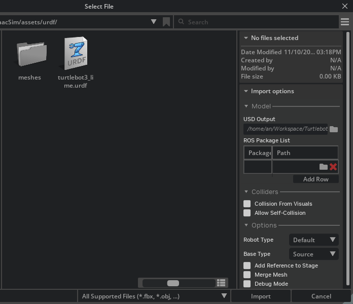
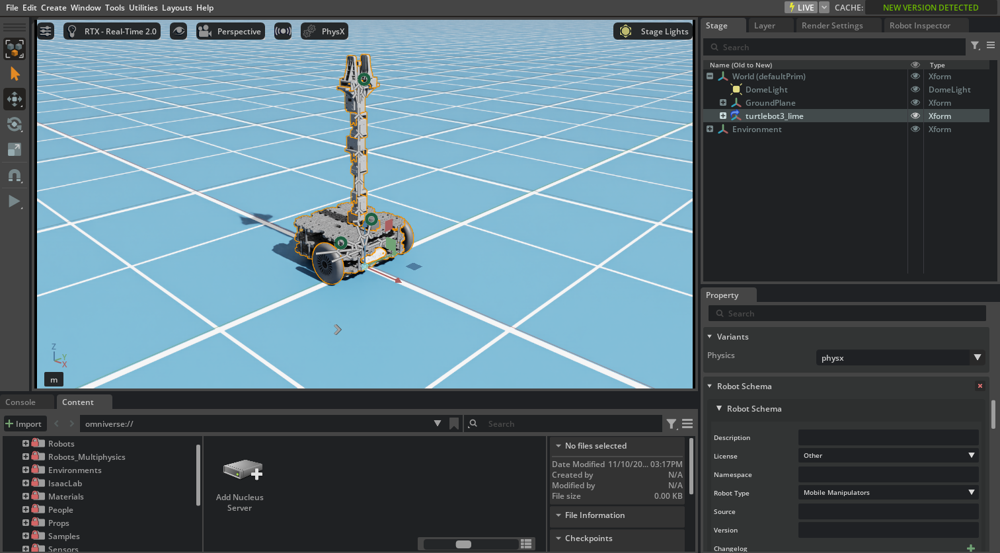
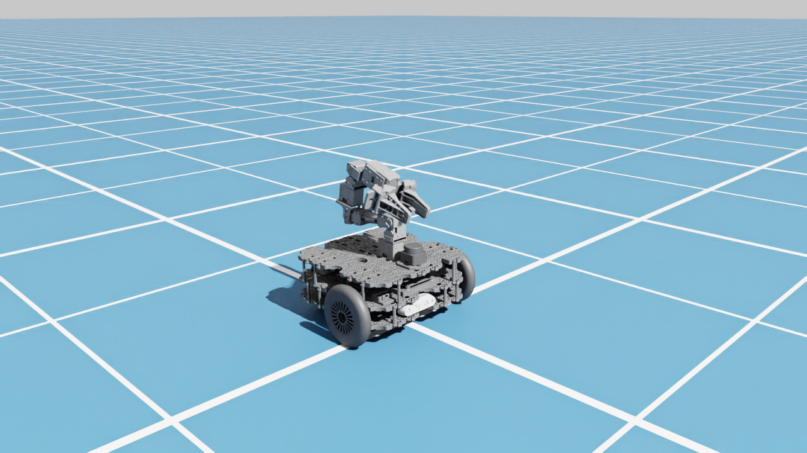

# 02 · TurtleBot3 Lime のインポート (URDF → USD) { #02-import-turtlebot3-lime-urdf-usd }

<p class="tutorial-meta">⏱ 15 分 · レベル：初級 · スクリプト：<code>isaac/02_import_urdf.py</code></p>

**目標：** ROS が使うロボットの記述（URDF）を、Isaac Sim がシミュレーションする形式（USD）に変換し、インポーターが何を作るのかを理解します。

<figure class="result" markdown>
<video controls autoplay loop muted playsinline>
  <source src="../../../assets/video/tutorial02_import.mp4" type="video/mp4">
</video>
<figcaption>インポート直後は、アームが崩れ落ちます。ジョイントドライブにまだ剛性がないためです。これはチュートリアル 03 で直します。</figcaption>
</figure>

## 考え方 { #concepts }

**URDF** は、XML で書かれた ROS のロボット記述です。*リンク*（メッシュ、質量、慣性、衝突形状を持つ剛体の部品）を*ジョイント*（fixed、revolute、continuous、prismatic）でつないで表します。Lime の URDF は `ros2_ws/src/turtlebot3_lime/turtlebot3_lime_description/urdf/*.xacro` にあります。

**USD** (Universal Scene Description) は、Omniverse と Isaac Sim のシーン形式です。USD のロボットは*プリム*のツリーです。物理は、`RigidBodyAPI`、`ArticulationRootAPI`、`DriveAPI` などの*スキーマ*で追加します。

**URDF インポーター** (`isaacsim.asset.importer.urdf`) は、URDF を USD に変換します。

!!! info "インポートするのは `.xacro` ではなく、生成済みの `.urdf` です"
    インポーターは xacro を読めません。`scripts/gen_urdf.sh` で xacro を一度展開し、ROS なしでも使えるようにメッシュのパスを書き換えてあります。その結果は `assets/urdf/turtlebot3_lime.urdf` としてコミットされています。このスクリプトを実行する必要があるのは、xacro ファイルを変更したときだけです。

### 6.2 のインポーターが作るもの { #what-the-62-importer-creates }

```text
assets/usd/turtlebot3_lime/
├── turtlebot3_lime.usda          ← the file you open or reference ("interface" layer)
└── payloads/
    ├── base.usda                 ← the prim tree: Geometry/ (links) and Physics/ (joints)
    ├── geometries.usd            ← the meshes
    ├── materials.usda, instances.usda
    ├── robot.usda                ← Isaac robot schema (robot type, ordered links and joints)
    └── Physics/
        ├── physics.usda          ← engine-neutral USD Physics (bodies, joints, drives, masses)
        ├── physx.usda            ← PhysX-specific additions
        └── mujoco.usda           ← MuJoCo/Newton-specific additions
```

インターフェースのファイルには、`none`、`physics`、`physx`、`mujoco` の選択肢を持つ **`Physics` という名前のバリアントセット**があります。**デフォルトでは、どのバリアントも選択されていません。**選択しないと、ロボットには*物理がありません*。宙に浮いたままになり、アーティキュレーションも見つかりません。Isaac Sim はデフォルトで PhysX を使ってシミュレーションするので、**`physx` を選択します**。

ロボットの中では、リンクは `Geometry/` の下に URDF のツリーと同じ形で入れ子になっていて、ジョイントは `Physics/` の下にあります。

```text
/turtlebot3_lime
├── Geometry/base_footprint/base_link            ← articulation root
│   ├── wheel_left_link, wheel_right_link
│   ├── caster_back_left_link, caster_back_right_link
│   ├── base_scan, imu_link, camera_bottom_screw_frame/camera_link/...
│   └── link1/link2/.../link7/{gripper_left_link, gripper_right_link, end_effector_link}
└── Physics/wheel_left_joint, joint1 … joint6, gripper_left_joint, ...
```

## インポート { #import }

=== "GUI"

    1. `source scripts/isaac_env.sh && isaacsim` で Isaac Sim を起動します。
    2. **File ▸ Import** を選び、`assets/urdf/turtlebot3_lime.urdf` を選択します。
    3. このファイルのオプションが、ダイアログの右側に表示されます。

        { width="420" }


        | セクション | オプション | 値 | 理由 |
        |---|---|---|---|
        | Model | USD Output | `assets/usd` | インポーターがこの中に `turtlebot3_lime/` フォルダーを作ります |
        | Colliders | Collision From Visuals | **off** | URDF にはすでに単純な衝突形状があります |
        | Colliders | Allow Self-Collision | off | |
        | Options | Robot Type | **Mobile Manipulators** | |
        | Options | Base Type | **Mobile** | 移動ロボットは、ワールドに固定（*Fixed*）してはいけません |
        | Options | Add Reference to Stage | **on**（デフォルト：off） | 開いているステージにロボットを追加します。off の場合は、代わりにインポートしたファイルが開かれます |
        | Options | Merge Mesh | off | |

    4. **Import** をクリックします。29 MB ある台車のメッシュの変換に、数分かかります。
    5. **Stage** パネルでロボットのプリムを選択します。**Property ▸ Variants** で **Physics = physx** に設定します。

        { .full }

    6. **Create ▸ Physics ▸ Ground Plane** で床を追加します。シーンが暗ければ、**Create ▸ Light ▸ Dome Light** でライトを追加します。
    7. **Play** ▶ を押します。ロボットが床に落ち、アームが折れ曲がって垂れ下がります。これは想定どおりです。
    8. **Stop** ■ を押してから、**File ▸ Save As** で `my_stages/02_import.usd` としてステージを保存します。チュートリアル 03 は、このステージから続けます。

=== "Python (standalone)"

    ```bash
    source scripts/isaac_env.sh
    python isaac/02_import_urdf.py            # with window
    python isaac/02_import_urdf.py --headless --test
    ```

    !!! note "`git status` で `geometries.usd` が変更扱いになったら？"
        リポジトリにはこのインポート結果がすでに入っているので、このチュートリアルを飛ばしても以降のチュートリアルは動きます。スクリプトは `assets/usd/turtlebot3_lime/` を削除してから、もう一度インポートします。結果は同じロボットですが、メッシュのファイル `payloads/geometries.usd` は数バイト異なることがあり、`git pull` は変更されたファイルの上書きを拒否します。pull する前に、コミット済みのファイルに戻してください。
        ```bash
        git checkout assets/usd/turtlebot3_lime
        ```

    主要な行は次のとおりです。

    ```python
    app_utils.enable_extension("isaacsim.asset.importer.urdf")   # (1)!
    from isaacsim.asset.importer.urdf import URDFImporter, URDFImporterConfig

    config = URDFImporterConfig(
        urdf_path=str(LIME_URDF),
        usd_path=str(USD_DIR),           # (2)!
        fix_base=False,                  # mobile robot
        merge_fixed_joints=False,        # (3)!
        collision_from_visuals=False,
        robot_type="Mobile Manipulators",
    )
    usd_path = URDFImporter(config).import_urdf()

    stage_utils.add_reference_to_stage(
        usd_path, "/World/turtlebot3_lime", variants=[("Physics", "physx")]   # (4)!
    )
    ```

    1. インポーターは拡張機能です。スタンドアロンアプリは、デフォルトではこれを読み込みません。
    2. これは出力先の**フォルダー**です。インポーターは上書きをしません。`turtlebot3_lime/` がすでにあると、`turtlebot3_lime_1/` に書き出します。そのため、スクリプトは先に古いフォルダーを削除します。
    3. センサーのフレーム（`base_scan`、`imu_link`、`camera_*_optical_frame`）が別々のプリムとして残るように、固定ジョイントを残します。以降のチュートリアルでは、これらにセンサーを取り付けます。
    4. PhysX の物理バリアントを選択します（上を参照）。

    ??? example "スクリプト全体：`isaac/02_import_urdf.py`"
        ```python
        --8<-- "isaac/02_import_urdf.py"
        ```

## 結果を確かめる { #check-the-result }

スクリプトは、見つけたアーティキュレーションを表示します。

```text
[02] articulation root: /World/turtlebot3_lime/Geometry/base_footprint/base_link
[02] 10 degrees of freedom: ['wheel_left_joint', 'wheel_right_joint', 'joint1', 'joint2', 'joint3',
     'joint4', 'joint5', 'joint6', 'gripper_left_joint', 'gripper_right_joint']
[02][test] missing joints: none; base height after 3 s: 0.060 m
[02][test] PASS
```

- **10 DoF（自由度）：** 車輪 2 個 + アームのジョイント 6 個 + グリッパーの指 2 本です。固定ジョイント（キャスター、センサーの取り付け部）は DoF を増やしません。
- **0.060 m：** `base_link` は、床からちょうど車輪の半径 1 つ分の高さにあります。ロボットを支えているのは車輪です。

{ .full }

## わざと残してある問題点 { #whats-wrong-with-it-on-purpose }

| 見えること | 原因 | 修正するチュートリアル |
|---|---|---|
| アームが崩れ落ちる | ジョイントドライブは `maxForce` 付きでインポートされましたが、**剛性 = 減衰 = 0** です | [03](03-tune-robot.md) |
| 車輪を駆動できない | 同じ原因です。速度ドライブには減衰 > 0 が必要です | [03](03-tune-robot.md) |
| 右のグリッパーの指 | **mimic ジョイント**（URDF の `<mimic>` タグから作られた `NewtonMimicAPI`）によって、左の指に追従します | すでに動作します |
| ロボットが灰色 | URDF はすべてのリンクに単色を 1 つ付けています。実機の Lime は黒とライムグリーンです | [03](03-tune-robot.md) |

**次へ：** [03 · ロボットの調整](03-tune-robot.md)
