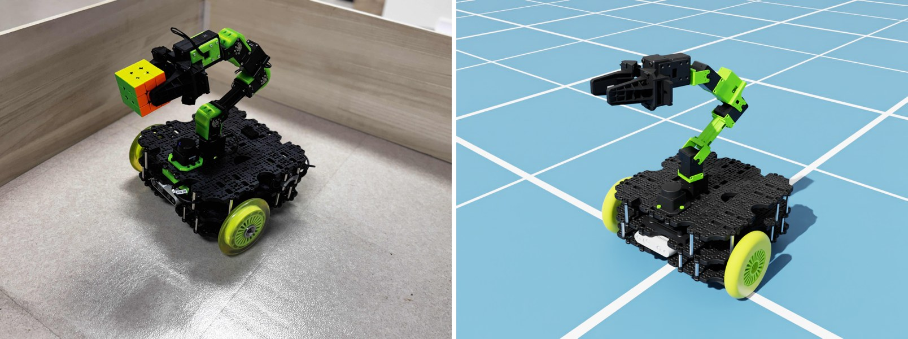
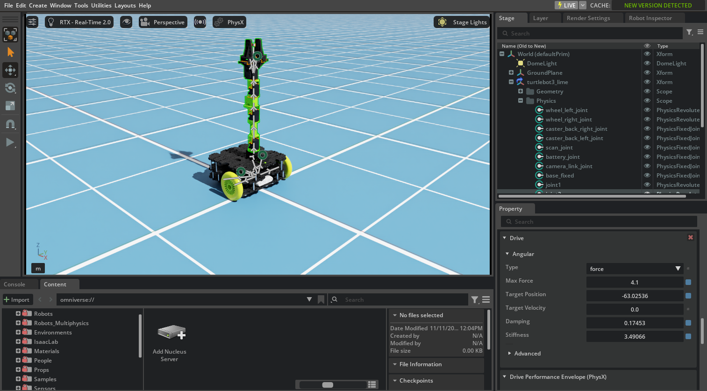
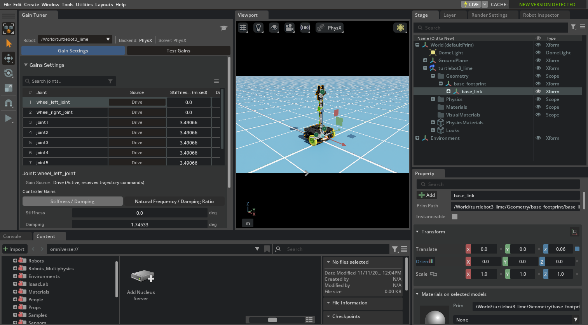

# 03 · ロボットの調整 { #03-tune-the-robot }

<p class="tutorial-meta">⏱ 25 分 · レベル：初級 → 中級 · スクリプト：<code>isaac/03_tune_robot.py</code>、<code>isaac/03_before_after.py</code></p>

**目標：** インポートした Lime がシミュレーションで正しく動くようにします。アームは姿勢を保ち、車輪は速度指令に従い、キャスターは滑り、グリッパーは開閉するようにします。そのうえで、**見た目を実機に近づけます**。調整内容は専用の USD ファイルに入れるので、再インポートしても失われません。

<figure class="result" markdown>
<video controls autoplay loop muted playsinline>
  <source src="../../../assets/video/tutorial03_before_after.mp4" type="video/mp4">
</video>
<figcaption>調整前と調整後。両方に同じテストを行います：2 秒待ち、両輪を 5 rad/s で 3 秒間回し、グリッパーを開きます。<b>左</b>：チュートリアル 02 でインポートしたままのロボット（車輪がそもそも回るように、車輪のドライブだけは与えています）。アームは倒れ、ロボットは約 0.25 m 進んで約 18° 向きが変わり、グリッパーは閉じたままです。<b>右</b>：調整後。アームは折りたたんだ「home」姿勢を保ち、ロボットは 0.87 m まっすぐ進み（理想は 0.90 m）、グリッパーが開きます。</figcaption>
</figure>

## 考え方 { #concepts }

### ジョイントドライブ { #joint-drives }

動かせるジョイントにはそれぞれ**ドライブ**があります。ドライブはばね・ダンパーで、PhysX がこれを*陰的に*（implicit）解くため、硬くしても安定しています。

$$
\tau = k_p\,(q_{target} - q) + k_d\,(\dot q_{target} - \dot q), \qquad |\tau| \le \tau_{max}
$$

| 用途 | 剛性 $k_p$ | 減衰 $k_d$ | 目標値 |
|---|---|---|---|
| **位置制御**（アーム、グリッパー） | > 0 | > 0 | 位置 |
| **速度制御**（車輪） | **0** | > 0 | 速度 |

$\tau_{max}$ は **Max Force**（最大力）です。インポーターはこれを URDF の `effort` の制限値（車輪 3 N·m、アーム 1 N·m）から取りましたが、剛性（stiffness）と減衰（damping）は 0 のままにしました。チュートリアル 02 ですべてがぐにゃぐにゃだったのはこのためです。

!!! warning "単位：USD は角度のゲインを*度あたり*で保存します"
    Property パネルと `.usda` ファイルでは、回転ジョイントの剛性は **N·m/deg**、減衰は **N·m·s/deg** です。Isaac Sim の Python API (`Articulation.set_dof_gains`) は**ラジアン**を使います。200 N·m/rad = 3.49 N·m/deg です。スクリプトは `gain * π / 180` で変換しています。

### 摩擦と*結合モード* { #friction-and-combine-modes }

2 つのコライダーが接触すると、PhysX はそれぞれの摩擦係数を**結合**します。デフォルトは **average**（平均）です。キャスターは滑らせたいので、摩擦を 0 にします。床（自前の物理マテリアルを持たないグラウンドプレーン）は PhysX のデフォルトのマテリアルを使い、その摩擦は > 0 です。この 2 つの平均は 0 に**なりません**。キャスターのパッドは後部の重いバッテリーを支えているので、その摩擦がロボットにブレーキをかけます。キャスターのマテリアルの結合モード（combine mode）を **min** にすると、0.0 のほうが採用されます。

最終的な調整済みアセットで測定した結果です（両輪を 5 rad/s で 3 秒間、理想の距離は 0.90 m）。

| キャスターのマテリアル | 床 | 走行距離 | 車輪の速度 |
|---|---|---|---|
| 摩擦 0、結合 *average* | デフォルトのマテリアル | 0.67 m | 1.2 / 2.4 rad/s（しかも曲がる） |
| 摩擦 0、結合 *average* | 摩擦を 0 に設定 | 0.87 m | 5.0 rad/s |
| 摩擦 0、結合 **min** | デフォルトのマテリアル | **0.87 m** | **5.0 rad/s** |

2 行目で原因が確かめられます。キャスターと床の接触から摩擦をなくすと、問題は解消します。3 行目は、床に手を加えずに解消しています。

ページ上部の動画で左にいるロボットは、さらに短い約 0.25 m しか進みません。そのキャスターのパッドには物理マテリアルがまったくないので、摩擦は 0 ではなく PhysX のデフォルトのままです。このロボットにキャスターのマテリアル（摩擦 0、結合 *min*）だけを与えると、アームは倒れたまま、タイヤは円柱のままでも、同じテストで 0.86 m 進みます。

### 車輪のコライダー：円柱か球か { #wheel-colliders-cylinder-vs-sphere }

URDF では、各タイヤは半径 0.06 m、幅 24 mm の円柱です。円柱は、接地面（トレッド）を横切る**線**で床に接します。ロボットが旋回するとき、この線の内側の端と外側の端では必要な速度が異なるため、タイヤが床を擦って旋回に抵抗します。同じ半径の**球**なら、床と 1 つの**点**で接します。これは差動二輪の式（チュートリアル 06）が前提とする理想的な車輪です。

測定方法：0.2 m/s と 0.5 rad/s を指令し、ロボットの実際のヨー角速度を読み取ります。

| タイヤのコライダー | 車輪の速度（指令 2.11 / 4.56 rad/s） | ヨー角速度（指令 0.5 rad/s） |
|---|---|---|
| 円柱 (URDF) | 2.40 / 4.16 rad/s | 0.44 rad/s |
| **球** | **2.06 / 4.56 rad/s** | **0.50 rad/s** |

そこで調整済みアセットでは、円柱の衝突判定をオフにし、各車輪リンクに見えない球のコライダー（`sphere_collider`、purpose は *guide*）を追加しています。目に見えるタイヤのメッシュは変わりません。

### 見た目：実機の色 { #looks-the-real-robots-colours }

URDF はロボット全体を灰色に塗っています。実機の Lime は黒とライムグリーンです。黒いワッフルプレートと Dynamixel サーボ、ライムグリーンの 3D プリント製ブラケット、ライムグリーンのハブが付いた半透明の黄緑色のタイヤ、金属のスペーサー、そしてライムグリーンのマウントに載った LiDAR です。以下の色は、実機の写真から測ったものです。

{ .full }

リンクごとにメッシュ 1 つでは粗すぎます。例えば `link2.stl` には、サーボ、ブラケット、ネジ 4 本が入っています。しかしメッシュの中では、これらは別々の**ソリッド**（solid）になっています。ソリッドとは、ほかの部分と頂点を共有しない三角形のまとまりです。スクリプトはすべてのメッシュをソリッドに分割し、それぞれの大きさで色を決めます。28 × 42 × 46 mm のブロックは Dynamixel サーボ（黒）、アームのその他の部品はブラケット（ライムグリーン）、車輪の 120 mm のリングはタイヤ、84 mm の円盤はハブです。変わるのは見た目だけです。コライダー、質量、ジョイントには手を加えません。

??? example "色とルール：`isaac/common/looks.py`"
    ```python
    --8<-- "isaac/common/looks.py:colours"
    ```

    ```python
    --8<-- "isaac/common/looks.py:classify"
    ```

!!! info "インスタンス化されたメッシュ"
    インポーターは、各リンクのビジュアルメッシュを*インスタンス*として保存します。インスタンスとは、共有された読み取り専用のコピーです。その一部に色を付けるため、スクリプトはまずビジュアルメッシュのインスタンス化をオフにします（`SetInstanceable(False)`、調整済みレイヤーでのオーバーライド）。コライダーはインスタンスのままです。

### ソルバーの反復回数 { #solver-iterations }

アーティキュレーション（ロボットのジョイントのツリー）は反復計算で解かれます。アーティキュレーションの**位置の反復回数を 32（デフォルト）から 64 に**上げると、走行テストが少し正確になりました。上の実行では 0.847 m → 0.874 m です。**速度の反復回数は 4 以下**にしてください。PhysX の TGS ソルバーはそれより多い値の扱いを変更しており、警告を出します。

## 設定値 { #the-values }

| 対象 | 設定 |
|---|---|
| 車輪 (×2) | 速度ドライブ：剛性 0、減衰 100 N·m·s/rad、最大力 3 N·m (XM430-W210) |
| アームのジョイント (×6) | 位置ドライブ：剛性 200 N·m/rad、減衰 10 N·m·s/rad、最大力 4.1 N·m（XM430-W350 のストールトルク） |
| アームの初期姿勢 | SRDF の `home` 姿勢 `[0, -1.10, 1.80, 0, 0.98, 0]` rad を、ドライブの目標値とジョイントの初期状態の両方に使います（upstream は `joint3` に 1.87 を使っていますが、これは upstream 自身の URDF の制限 1.8567 の外です。チュートリアル 12 では MoveIt がこれを拒否します。1.80 なら、重力でアームが垂れる分の余裕が残ります） |
| グリッパー（左） | 位置ドライブ：剛性 1000 N/m、減衰 20 N·s/m、最大力 10 N |
| グリッパー（右） | ドライブなし。mimic ジョイントで左の指に追従します |
| タイヤ / キャスター | 摩擦 1.0 (average) / 摩擦 0.0 (**min**) |
| タイヤの衝突形状 | URDF の円柱の代わりに**球**、r = 0.06 m |
| アーティキュレーション | ソルバーの反復回数：位置 64 / 速度 4 |
| 見た目 | 黒いプレートとサーボ、ライムグリーンのブラケット、半透明の黄緑色のタイヤ、ライムグリーンのハブ、金属のスペーサー (`common/looks.py`) |

## 調整してみる { #tune-it }

=== "GUI"

    チュートリアル 02 で作ったステージ `my_stages/02_import.usd`（ロボットをリファレンスで読み込み済み、`Physics = physx`、グラウンドプレーンあり）を開きます。

    **ドライブ：** Stage パネルで `turtlebot3_lime ▸ Physics` を開き、ジョイントを 1 つ選びます（例えば `joint2`）。**Property ▸ Drive ▸ Angular** で *Stiffness*、*Damping*、*Max Force* を設定します（単位は**度あたり**です。上の表を参照してください）。*Target Position* は**度**で設定します。複数のジョイントを同時に選ぶ（Ctrl+クリック）と、まとめて編集できます。

    { .full }

    **Gain Tuner：** **Tools ▸ Robotics ▸ Asset Editors ▸ Gain Tuner** は、選択したアーティキュレーションの全ジョイントを 1 つの表に表示します。テスト動作（正弦波やステップ）を再生して、各ジョイントがどう追従するかをプロットすることもできます。ゲインを確定する前に、その効果を確かめるのに使ってください。

    { .full }

    **摩擦：** **Create ▸ Physics ▸ Physics Material** を選びます（剛体用）。その **Rigid Body Material** セクションで *Static/Dynamic Friction* を設定します。キャスター用のマテリアルでは、**Material (PhysX)** セクションで *Friction Combine Mode* を `min` にします。次に、キャスターの各コライダー (`caster_back_*_link/box`) を選び、**Property ▸ Physics materials on selected models** でそのマテリアルを選びます。*Materials on selected models* セクションは使わないでください。そちらは見た目用です。

    **球のタイヤ**（この GUI の手順は、スクリプトが行う処理を説明したものです。動作が検証済みなのはスクリプトのほうです）。各 `wheel_*_link` について、その `cylinder` を選び、**Collider ▸ Collision Enabled** のチェックを外します。次にリンクを右クリックし、**Create ▸ Shape ▸ Sphere** を選びます。その *Radius* を `0.06`、*Purpose* を `guide`（レンダリングされません）にします。**Add ▸ Physics ▸ Collider** でコライダーを追加し、タイヤの物理マテリアルを割り当てます。

    **ソルバー：** `base_link`（アーティキュレーションのルート）を選びます。その **Articulation Root** / **PhysxArticulationAPI** のプロパティで、*Solver Position Iteration Count* = 64、*Solver Velocity Iteration Count* = 4 に設定します。

    **見た目**（この GUI の手順は、スクリプトが行う処理を説明したものです。動作が検証済みなのはスクリプトのほうです）。色ごとに **Create ▸ Material ▸ OmniPBR** でマテリアルを作り、その *Albedo* の色を設定します。リンクのビジュアルのプリム（例えば `link4/link4`）を選び、Property パネルで **Instanceable** のチェックを外してから（インスタンス化されたプリムは読み取り専用です）、**Materials on selected models** でマテリアルを選びます。GUI ではメッシュ全体に色を付けます。メッシュの*中*のソリッドを別々に色分けする（サーボは黒、ブラケットはライムグリーン）のは、スクリプトが追加で行う処理です。

    **オーバーライドレイヤーとして保存：** ステージはインポートしたロボットを*リファレンス*として持っているので、ここまでの編集はインポートしたファイルを変更していません。編集内容は、リファレンスの上に重なる *over* としてステージに保存されています。**Stop** ■ を押してから、**File ▸ Save As** で `my_stages/03_tune_robot.usd` として保存します。下のスクリプトも同じ種類のレイヤーを作り、`assets/usd/turtlebot3_lime_tuned.usda` に書き出します。このファイルに上書き保存しないでください。以降のすべてのチュートリアルがこのファイルを読み込み、ステージ全体ではなく、ルートにロボットがあることを前提にしています。

=== "Python (standalone)"

    ```bash
    source scripts/isaac_env.sh
    python isaac/03_tune_robot.py --headless --test
    ```

    スクリプトは `assets/usd/turtlebot3_lime_tuned.usda` を書き出します。これは、インポートしたアセットを*リファレンス*し、オーバーライドを追加する小さなレイヤーです。その後、このファイルを読み込んで結果をチェックします。

    ```python
    robot = stage.DefinePrim("/turtlebot3_lime", "Xform")
    robot.GetReferences().AddReference("./turtlebot3_lime/turtlebot3_lime.usda")
    robot.GetVariantSet("Physics").SetVariantSelection("physx")      # (1)!

    drive = UsdPhysics.DriveAPI.Apply(joint_prim, "angular")
    drive.CreateStiffnessAttr(200.0 * math.pi / 180.0)                # (2)!
    drive.CreateDampingAttr(10.0 * math.pi / 180.0)
    drive.CreateMaxForceAttr(4.1)
    drive.CreateTargetPositionAttr(math.degrees(home))                 # (3)!

    PhysxSchema.PhysxMaterialAPI.Apply(caster_material).CreateFrictionCombineModeAttr("min")

    looks.paint_like_the_real_lime(stage, "/turtlebot3_lime")       # (4)!
    ```

    1. 調整済みファイルを使う側は、Physics バリアントを選ぶ必要がなくなります。
    2. N·m/rad → N·m/deg。
    3. USD のジョイント角も度で表します。
    4. 実機の色を、ソリッドごとに付けます（上の*見た目*を参照）。

    ??? example "スクリプト全体：`isaac/03_tune_robot.py`"
        ```python
        --8<-- "isaac/03_tune_robot.py"
        ```

## 結果を確かめる { #check-the-result }

```text
[03] painted like the real Lime: black 645338 faces, servo 38830 faces, lime 45098 faces, tyre 5848 faces, hub 8444 faces, metal 3864 faces
[03] arm max error after 2 s : 0.002 rad
[03] distance in 3 s         : 0.873 m (ideal 0.90 m)
[03] gripper left / right    : 0.0190 / 0.0190 m (target 0.019)
[03][test] PASS
```

- アームは重力に逆らって、`home` を 0.002 rad (0.1°) 以内に保っています。
- 5 rad/s × 0.06 m = 0.30 m/s なので、3 秒で 0.90 m です。足りない 2.6 cm は加速区間の分です。
- 右の指は左の指を正確にコピーしています。mimic ジョイントが PhysX 上で機能しています。

<figure class="result" markdown>
<video controls autoplay loop muted playsinline>
  <source src="../../../assets/video/tutorial03_tuned.mp4" type="video/mp4">
</video>
<figcaption>調整済みのロボットで実行した <code>03_tune_robot.py</code>：アームは姿勢を保ち、ロボットは走り、グリッパーは開きます。</figcaption>
</figure>

!!! tip "実験してみる"
    `ARM_DRIVE = dict(stiffness=200.0, ...)` を `stiffness=20.0` に変えて再実行すると、アームが垂れ下がります。キャスターの結合モードを `"average"` に戻すと、ロボットは約 0.67 m しか進まずに曲がり、走行距離のテストが失敗します。

### 調整前と調整後を並べて比べる { #before-and-after-side-by-side }

`isaac/03_before_after.py` は、このページ上部の動画を作るスクリプトです。インポートしたままのロボットを調整済みのロボットの隣に置き、両方で同じテストを実行します。2 つのアセットを読み込むだけなので、先に `03_tune_robot.py` を実行しておいてください。

```bash
python isaac/03_before_after.py                     # with a window
python isaac/03_before_after.py --headless --test
```

左のロボットは、チュートリアル 02 でインポートしたとおりのアセットです。

```python
--8<-- "isaac/03_before_after.py:robots"
```

ただし、1 か所だけ変更しています。このアセットの車輪のドライブには減衰がないので、速度指令を出してもまったく何も起きません。そこでスクリプトは、実行中のシミュレーションの中でだけ、調整済みロボットの減衰を車輪のドライブに与えます。

```python
--8<-- "isaac/03_before_after.py:one_change"
```

```text
[03vs] as imported : arm moved 1.819 rad in 2 s, drove 0.251 m (sideways +0.044 m, turned +17.5 deg), wheels 3.06 / 1.26 rad/s, gripper 1.1 mm
[03vs] tuned       : arm moved 0.001 rad in 2 s, drove 0.874 m (sideways +0.001 m, turned +0.1 deg), wheels 5.00 / 5.01 rad/s, gripper 19.0 mm
[03vs][check] ok   tuned: arm holds its pose (moved 0.001 rad)
[03vs][check] ok   tuned: drove 0.87 m (ideal 0.90 m)
[03vs][check] ok   tuned: gripper open (19.0 mm)
[03vs][check] ok   as imported: arm falls (moved 1.82 rad)
[03vs][check] ok   as imported: gripper does not open (1.1 mm)
[03vs][test] PASS
```

- インポートしたままのアームには剛性がないので、最初の 2 秒で約 105° 倒れます。
- インポートしたままの車輪は、5 rad/s ではなく約 3 rad/s と 1 rad/s でしか回らず、ロボットは 4 分の 1 メートルほど進んで進路がそれます。原因はキャスターのパッドです（[摩擦と結合モード](#friction-and-combine-modes)を参照）。
- インポートしたままのグリッパーにはドライブがないので、開く指令を出しても何も起きません。
- 左のロボットの走行は、シーンのわずかな変化に敏感です。ロボットの位置を数 cm ずらすと、0.23〜0.25 m、17〜19° になりました。そのため、左のロボットについては、チェックでアームとグリッパーだけをテストします。調整済みのロボットは、上と同じテストに合格する必要があります。

??? example "スクリプト全体：`isaac/03_before_after.py`"
    ```python
    --8<-- "isaac/03_before_after.py"
    ```

これ以降のすべてのチュートリアルは **`assets/usd/turtlebot3_lime_tuned.usda`** を読み込みます。Python では `common.lime.add_lime()` がこれを行います。

**次へ：** [04 · Python でロボットを動かす](04-hello-robot.md)
