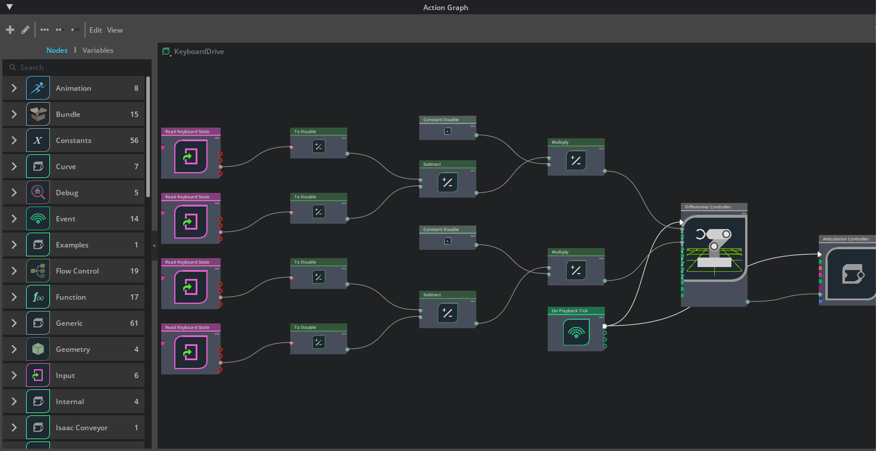

# 05 · はじめての Action Graph：キーボードで運転 { #05-your-first-action-graph-keyboard-driving }

<p class="tutorial-meta">⏱ 25 分 · レベル：初級 · スクリプト：<code>isaac/05_action_graph.py</code></p>

**目標：** 制御ループを書かずに、`W` `A` `S` `D` キーで Lime を運転する **Action Graph** (OmniGraph) を作ります。これは、以降のチュートリアルで Isaac Sim と ROS 2 をつなぐのと同じ仕組みです。

<figure class="result" markdown>
<video controls autoplay loop muted playsinline>
  <source src="../../../assets/video/tutorial05_action_graph.mp4" type="video/mp4">
</video>
<figcaption><code>W</code> を 3 秒間押し続け、次に <code>A</code> を 2 秒間押し続けます。</figcaption>
</figure>

## 考え方 { #concepts }

**OmniGraph** は、Isaac Sim のビジュアルプログラミングの仕組みです。ノードには**入力**と**出力**があり、ワイヤーがノードの間でデータを運びます。**Action Graph** は、*イベント*が発生したときに実行されます。**On Playback Tick** は再生中にシミュレーションの 1 フレームごとに 1 回発生し、白い *exec* ワイヤーがどのノードを実行するかを決めます。

キーボードのグラフは、キーの状態を車輪の速度に変換します。

$$
v = 0.2\,\tfrac{m}{s}\cdot(W - S), \qquad \omega = 0.8\,\tfrac{rad}{s}\cdot(A - D)
$$

押されているキーは 1、離されているキーは 0 になります。そのため、`W` だけを押すと $v = 0.2$ m/s、`S` だけを押すと $-0.2$ m/s になります。

{ .full }

## 作ってみる { #build-it }

=== "GUI"

    1. チュートリアル 01 のステージ (`my_stages/01_hello_world.usd`) を開くか、新しく作ります。新しく作る場合は、**File ▸ New**、**Create ▸ Physics ▸ Ground Plane** を選び、続いて **File ▸ Add Reference** で `assets/usd/turtlebot3_lime_tuned.usda` を追加します。
    2. **Window ▸ Visual Scripting ▸ Action Graph ▸ New Action Graph** を選びます。
    3. 左側のノード検索に名前を入力して、次のノードをドラッグして追加します：4 × **Read Keyboard State**（*key* をそれぞれ `W`、`S`、`A`、`D` に設定）、4 × **To Double**、2 × **Subtract**、2 × **Constant Double**（`0.2` と `0.8`）、2 × **Multiply**、**Differential Controller**、**Articulation Controller**、**On Playback Tick**。
    4. 図のとおりに接続します。W と S を一方の Subtract (`a` − `b`) に、A と D をもう一方の Subtract につなぎます。それぞれの差に対応する定数を掛け、その積を Differential Controller の *linearVelocity* と *angularVelocity* につなぎます。*velocityCommand* は Articulation Controller に、*tick* は両方のコントローラーの *execIn* につなぎます。
    5. Differential Controller では、*wheelRadius* を `0.06`、*wheelDistance* を `0.29425` にします。Articulation Controller では、*targetPrim* = `…/Geometry/base_footprint/base_link`、*jointNames* = `wheel_left_joint`、`wheel_right_joint` にします。
    6. **Play** を押し、ビューポートをクリックしてから運転します。

    !!! tip "近道"
        **Tools ▸ Robotics ▸ OmniGraph Controllers ▸ Differential Controller** を使うと、このグラフのうちコントローラーの部分が作られます。

=== "Python (standalone)"

    ```bash
    source scripts/isaac_env.sh
    python isaac/05_action_graph.py
    ```

    `og.Controller.edit()` は、手作業で行ったのと同じこと、つまりノードの作成、値の設定、ポートの接続を行います。

    ```python
    og.Controller.edit(
        {"graph_path": "/World/KeyboardDrive", "evaluator_name": "execution"},
        {
            keys.CREATE_NODES: [("KeyW", "omni.graph.nodes.ReadKeyboardState"), ...],
            keys.SET_VALUES:   [("KeyW.inputs:key", "W"), ...],
            keys.CONNECT:      [("KeyW.outputs:isPressed", "ToDoubleW.inputs:value"), ...],
        },
    )
    ```

    ??? example "スクリプト全体：`isaac/05_action_graph.py`"
        ```python
        --8<-- "isaac/05_action_graph.py"
        ```

## 自動チェック { #automatic-check }

`--test` は、Kit の入力システムを通してスクリプトからキーを押します。そのため、グラフ全体（キーボードのノード → … → 車輪）が、実際にキーを打ったときとまったく同じように動きます。

```text
[05][check] ok   W held for 3 s: drove 0.60 m (expected ~0.6)
[05][check] ok   A held for 2 s: turned left to 87 deg (expected ~90)
[05][test] PASS
```

| ノードタイプ ID (Python) | GUI での名前 |
|---|---|
| `omni.graph.action.OnPlaybackTick` | On Playback Tick |
| `omni.graph.nodes.ReadKeyboardState` | Read Keyboard State |
| `omni.graph.nodes.ToDouble` / `Subtract` / `Multiply` / `ConstantDouble` | To Double / Subtract / Multiply / Constant Double |
| `isaacsim.robot.wheeled_robots.DifferentialController` | Differential Controller |
| `isaacsim.core.nodes.IsaacArticulationController` | Articulation Controller |

**次へ：** [06 · ROS 2 で走らせる](06-ros2-drive.md)。グラフは同じですが、速度は `/cmd_vel` から来ます。
