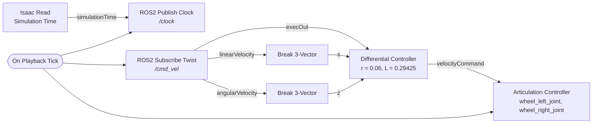
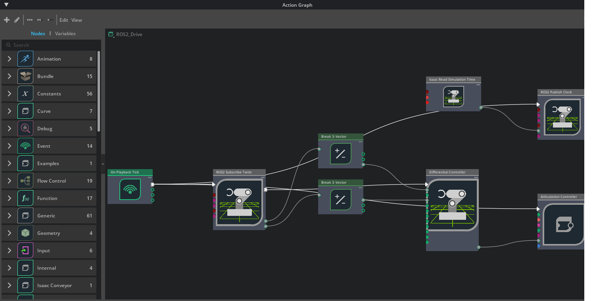
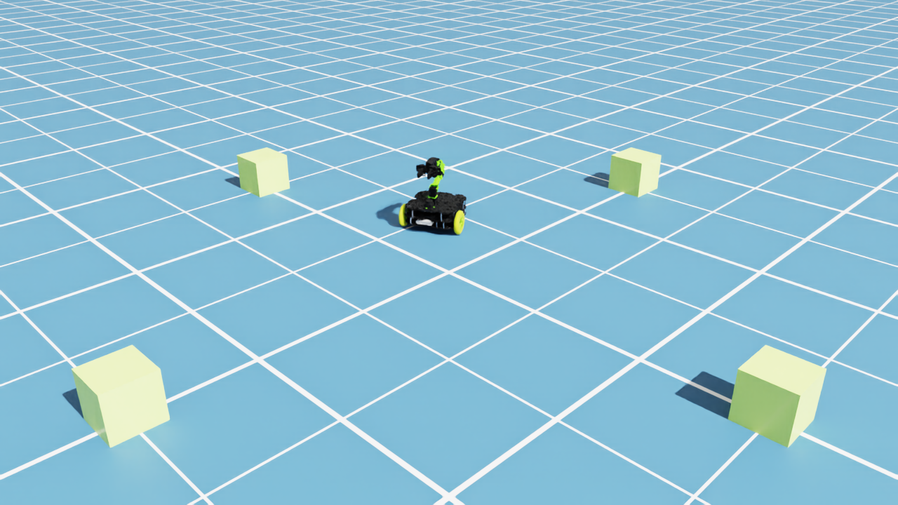

# 06 · ROS 2 で TurtleBot3 Lime を走らせる（`/cmd_vel`） { #06-drive-turtlebot3-lime-with-ros-2-cmd_vel }

<p class="tutorial-meta">⏱ 20 分 · レベル：初級 · スクリプト：<code>isaac/06_ros2_drive.py</code></p>

**目標：** シミュレーションのクロックをパブリッシュし、`/cmd_vel` の ROS 2 `geometry_msgs/Twist` メッセージを車輪の速度に変換する **Action Graph** を作ります。そのあと、ROS 2 コンテナからキーボードで Lime を運転します。

<figure class="result" markdown>
<video controls autoplay loop muted playsinline>
  <source src="../../../assets/video/tutorial06_ros2_drive.mp4" type="video/mp4">
</video>
<figcaption>ROS 2 コンテナから <code>ros2 topic pub /cmd_vel … {linear: {x: 0.25}, angular: {z: 0.5}}</code> を実行：Lime は円を描いて走ります。</figcaption>
</figure>

## 10 分でわかる ROS 2 { #ros-2-in-10-minutes }

このチュートリアル以降、Isaac Sim は ROS 2 システムの一部になります。以下は、各チュートリアルで使う ROS 2 の用語です。すでに知っている場合は、[考え方](#concepts)まで飛ばしてください。

| 用語 | 意味 | チュートリアルでの例 |
|---|---|---|
| **ノード**（node） | 1 つの仕事を受け持ち、ほかのノードとやりとりする、実行中のプログラム（またはその一部） | RViz、Nav2 のプランナー、YOLO の検出器 |
| **トピック**（topic） | 名前の付いた通信路です。*パブリッシャー*がメッセージを送り、*サブスクライバー*がそれを受け取ります。どちらも相手を知る必要はありません | `/cmd_vel`（速度指令）、`/odom`、`/scan`、`/clock` |
| **メッセージ型**（message type） | トピックのデータ形式 | `/cmd_vel` は `geometry_msgs/msg/Twist` を運びます。中身は並進速度と角速度で、それぞれ 3 つの数値です |
| **サービス**（service） | 要求とその応答 | Nav2 のノードがアクティブかどうかの問い合わせ (`/amcl/get_state`)、コストマップのクリア（チュートリアル 15） |
| **アクション**（action） | 実行中にフィードバックを返し、最後に結果を返す、時間のかかる仕事です。途中でキャンセルもできます | `NavigateToPose`（Nav2、チュートリアル 11）、`MoveGroup` と `GripperCommand`（MoveIt 2、チュートリアル 12） |
| **TF** | 座標フレームのツリーです。ロボットの各部分がどこにあるかを表します | チュートリアル 07 |
| **パッケージ**（package） | ROS 2 のコード、設定、launch ファイルをまとめたフォルダー | `ros2_ws/src/lime_isaac_bringup`、`lime_yolo`、… |
| **ワークスペース**（workspace）、**colcon** | パッケージを収めるフォルダー (`ros2_ws/`) と、それらをビルドするツール | `./scripts/build_ws.sh` がコンテナの中で `colcon build` を実行します |
| **launch ファイル** | 複数のノードを、それぞれの設定とともに一度に起動する Python ファイル | `ros2 launch lime_isaac_bringup navigation.launch.py` |
| **パラメーター**（parameter） | ノードの設定 | `use_sim_time`、`nav2_params.yaml` にある Nav2 の設定 |
| **`/clock`**、**`use_sim_time`** | Isaac Sim は、シミュレーション時間を `/clock` にパブリッシュします。`use_sim_time: true` で起動したノードは、PC の時計の代わりにこれを使います。そのため、シミュレーションが実時間より遅く動いていても、ノードの時刻はシミュレーションと一致します | このプロジェクトの launch ファイルが自動で設定します |

!!! note "2 種類の*ノード*"
    Isaac Sim の Action Graph も*ノード*、つまりグラフエディターの中の `ROS2 Subscribe Twist` のような箱でできています。これらは OmniGraph のノードです。このページで ROS 2 のノードを指すときは、そう明記します。

各チュートリアルの ROS 2 コマンドは、すべて ROS 2 コンテナの中で実行します。`./docker/run_ros.sh ros2 …` はコマンドを 1 つ実行し、`./docker/run_ros.sh` だけを実行するとコンテナの中でシェルが開きます。これらの考え方を、小さなサンプルプログラムを使って実際に手を動かしながら学ぶには、ROS 2 Jazzy の公式チュートリアルに取り組んでください。[Beginner: CLI tools](https://docs.ros.org/en/jazzy/Tutorials/Beginner-CLI-Tools.html)（ノード、トピック、サービス、パラメーター、アクション、launch）と [Beginner: Client libraries](https://docs.ros.org/en/jazzy/Tutorials/Beginner-Client-Libraries.html)（自作のパッケージとノード、colcon）です。コンテナには、これらの公式チュートリアルで使う `turtlesim` とサンプルノードが入っています。

## 考え方 { #concepts }

**OmniGraph / Action Graph：** Isaac Sim は、ノードの*グラフ*でシミュレーションと ROS 2 をつなぎます。**Action Graph** は、*イベント*が発生したときに実行されます。`On Playback Tick` は、シミュレーションの再生中にシミュレーションの 1 フレームごとに 1 回発生します。ROS 2 のトピックがパブリッシュ・受信されるのは、**再生（Play）中だけ**です。

**ROS 2 ブリッジ：** 拡張機能 `isaacsim.ros2.bridge` は、ROS 2 とやりとりするグラフのノード（`ROS2 Publish Clock`、`ROS2 Subscribe Twist`、…）を提供します。この拡張機能は、Isaac Sim に同梱された Jazzy のライブラリで動きます（[セットアップ](00-setup.md)を参照）。

**差動二輪駆動：** Twist は、ロボットの前進速度 $v$ と旋回の角速度 $\omega$ を与えます。`Differential Controller` ノードは、これらを車輪の速度に変換します。

$$
\omega_{left} = \frac{v - \omega\,\frac{L}{2}}{r}, \qquad \omega_{right} = \frac{v + \omega\,\frac{L}{2}}{r}
$$

Lime の車輪の半径は $r = 0.06$ m、車輪の間隔は $L = 0.29425$ m です（URDF の値）。

## グラフ { #the-graph }



## 作ってみる { #build-it }

=== "GUI"

    1. 調整済みのロボットを入れたステージを作ります。**File ▸ New**、**Create ▸ Physics ▸ Ground Plane** を選び、続いて **File ▸ Add Reference** で `assets/usd/turtlebot3_lime_tuned.usda` を追加します。（ロボットのファイル自体は開かないでください。それを保存してしまうと、以降のすべてのチュートリアルがその変更を読み込みます。）
    2. **Window ▸ Visual Scripting ▸ Action Graph** を開き、**New Action Graph** を選びます。
    3. ノードライブラリ（左側）で各ノードを名前で検索し、グラフにドラッグします。追加するのは `On Playback Tick`、`Isaac Read Simulation Time`、`ROS2 Publish Clock`、`ROS2 Subscribe Twist`、2× `Break 3-Vector`、`Differential Controller`、`Articulation Controller` です。
    4. 上の図のとおりに接続します。
    5. **Property** パネルで入力を設定します。

        | ノード | 入力 | 値 |
        |---|---|---|
        | ROS2 Subscribe Twist | topicName | `/cmd_vel` |
        | Differential Controller | wheelRadius / wheelDistance / maxWheelSpeed | `0.06` / `0.29425` / `8.063` |
        | Articulation Controller | targetPrim | `…/Geometry/base_footprint/base_link`（アーティキュレーションのルート） |
        | Articulation Controller | jointNames | `wheel_left_joint`、`wheel_right_joint` |

    6. **Play** ▶ を押します。
    7. 運転してみます（次の節）。終わったら **Stop** ■ を押し、**File ▸ Save As** でステージを `my_stages/06_ros2_drive.usd` として保存します。チュートリアル 07 はこのステージから続けます。

    !!! tip "近道"
        Isaac Sim には、よく使う構成のグラフを作ってくれるツールがあります。**Tools ▸ Robotics ▸ OmniGraph Controllers ▸ Differential Controller** は、このグラフのうちコントローラーの半分を作ります。**Tools ▸ Robotics ▸ ROS 2 OmniGraphs** は、クロック、TF、オドメトリ、カメラ、LiDAR 用の ROS 2 グラフを作ります。これらの近道が何を作るのかを理解するには、このグラフを一度手で作ってみるのがいちばんです。

    { .full }

=== "Python (standalone)"

    ```bash
    source scripts/isaac_env.sh
    python isaac/06_ros2_drive.py
    ```

    `og.Controller.edit()` は、1 回の呼び出しでノードを作り、値を設定し、ポートをつなぎます。これは、GUI で手作業で行う 3 つの手順と同じです。

    ```python
    og.Controller.edit(
        {"graph_path": "/World/ROS2_Drive", "evaluator_name": "execution"},
        {
            keys.CREATE_NODES: [
                ("OnPlaybackTick", "omni.graph.action.OnPlaybackTick"),
                ("SubscribeTwist", "isaacsim.ros2.bridge.ROS2SubscribeTwist"),
                ("DiffController", "isaacsim.robot.wheeled_robots.DifferentialController"),
                ("ArticulationController", "isaacsim.core.nodes.IsaacArticulationController"),
                # ...
            ],
            keys.SET_VALUES: [("DiffController.inputs:wheelRadius", 0.06), ...],
            keys.CONNECT: [("DiffController.outputs:velocityCommand",
                            "ArticulationController.inputs:velocityCommand"), ...],
        },
    )
    ```

    スクリプトには、ほかにも 2 つのポイントがあります。

    - `app_utils.enable_extension("isaacsim.ros2.bridge")`：スタンドアロンのアプリは、ブリッジなしで起動するためです。
    - メインループは 60 Hz に制限しています (`/app/runLoops/main/rateLimitEnabled`)。制限しないと、ヘッドレスのスクリプトは実時間より速く動きます。teleop、RViz、Nav2 などの ROS のツールは、ほぼ実時間で動くことを前提にしています。

    ??? example "スクリプト全体：`isaac/06_ros2_drive.py`"
        ```python
        --8<-- "isaac/06_ros2_drive.py"
        ```

## ROS 2 から走らせる { #drive-it-from-ros-2 }

シミュレーションを再生したまま、2 つ目のターミナルを開きます。まず、ROS 2 から何が見えるかを確かめます。

```bash
./docker/run_ros.sh ros2 topic list                               # the topics that exist now
./docker/run_ros.sh ros2 topic info /cmd_vel                      # its message type, who publishes, who listens
./docker/run_ros.sh ros2 interface show geometry_msgs/msg/Twist   # what a Twist message contains
```

```text
/clock
/cmd_vel
/parameter_events
/rosout

Type: geometry_msgs/msg/Twist
Publisher count: 0
Subscription count: 1

# This expresses velocity in free space broken into its linear and angular parts.

Vector3  linear
    float64 x
    float64 y
    float64 z
Vector3  angular
    float64 x
    float64 y
    float64 z
```

Lime が使うのは `linear.x`（前進速度）と `angular.z`（旋回の角速度）です。1 つだけあるサブスクライバーは、Isaac Sim の中の `ROS2 Subscribe Twist` グラフノードです。`/cmd_vel` にはまだ誰もパブリッシュしていません。それをこれから行います。

=== "キーボード"

    ```bash
    ./docker/run_ros.sh ros2 run teleop_twist_keyboard teleop_twist_keyboard
    ```

    `i` で前進、`,` で後退、`j` / `l` で旋回、`k` で停止します。`q` / `z` で速度を変えます。

=== "コマンド 1 つで"

    ```bash
    ./docker/run_ros.sh ros2 topic pub -r 10 /cmd_vel geometry_msgs/msg/Twist \
      "{linear: {x: 0.25}, angular: {z: 0.5}}"
    ```

クロックも確認します。

```bash
./docker/run_ros.sh ros2 topic hz /clock        # ≈ 60 Hz
```

!!! success "自動チェック"
    `python isaac/06_ros2_drive.py --headless --test` は `/cmd_vel` のメッセージを待ち、ロボットがスタート地点から 0.3 m を超えて動いたことをチェックします。上の `topic pub` コマンド（半径 0.5 m の円の上を 12 秒）では、`robot moved 0.47 m … PASS` と表示されます。

{ .full }

## トラブルシューティング { #troubleshooting }

| 症状 | 対処 |
|---|---|
| `/cmd_vel` はパブリッシュされているのに、ロボットが動かない | シミュレーションは**再生中**ですか？`targetPrim` は*アーティキュレーションのルート* (`…/base_link`) ですか？ |
| ロボットが逆向きに曲がる、または後ろに走る | `jointNames` の順序を確認してください。左が先、右が後です |
| ロボットが遅い、またはガタつく | 調整済みのアセットを使っていないためです（[03](03-tune-robot.md) を参照） |

**次へ：** [07 · オドメトリ、TF、RViz](07-odom-tf.md)
