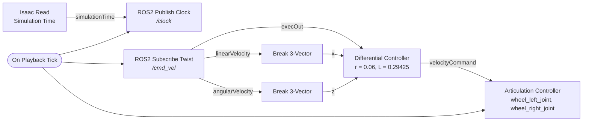
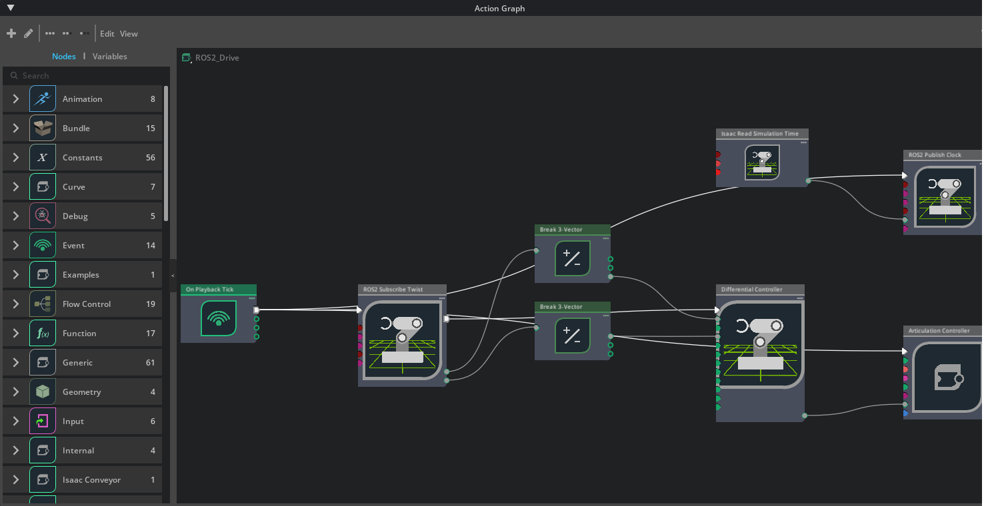
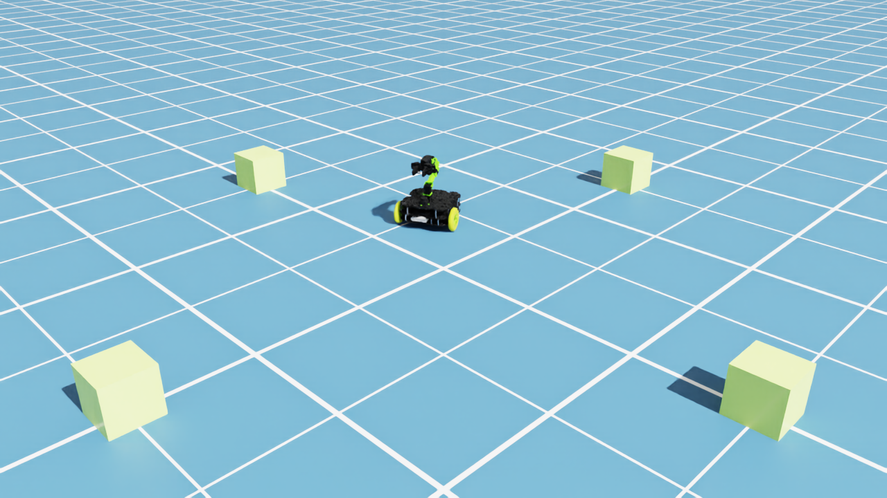

# 06 · Drive TurtleBot3 Lime with ROS 2 (`/cmd_vel`)

<p class="tutorial-meta">⏱ 20 min · Level: beginner · Script: <code>isaac/06_ros2_drive.py</code></p>

**Goal.** Build an **Action Graph** that publishes the simulation clock and turns ROS 2 `geometry_msgs/Twist`
messages on `/cmd_vel` into wheel speeds. Then drive the Lime with your keyboard from the ROS 2 container.

<figure class="result" markdown>
<video controls autoplay loop muted playsinline>
  <source src="../../assets/video/tutorial06_ros2_drive.mp4" type="video/mp4">
</video>
<figcaption><code>ros2 topic pub /cmd_vel … {linear: {x: 0.25}, angular: {z: 0.5}}</code> from the ROS 2 container: the Lime drives a circle.</figcaption>
</figure>

## ROS 2 in 10 minutes

From this tutorial on, Isaac Sim is one part of a ROS 2 system. These are the ROS 2 words the tutorials use.
Already know them? Skip to [Concepts](#concepts).

| Word | What it is | In these tutorials |
|---|---|---|
| **node** | a running program, or part of one, that does one job and talks to other nodes | RViz, Nav2's planner, the YOLO detector |
| **topic** | a named channel. *Publishers* send messages to it, *subscribers* receive them, and neither needs to know the other | `/cmd_vel` (speed commands), `/odom`, `/scan`, `/clock` |
| **message type** | the data format of a topic | `/cmd_vel` carries `geometry_msgs/msg/Twist`: a linear and an angular velocity, three numbers each |
| **service** | a request and its answer | asking a Nav2 node whether it is active (`/amcl/get_state`), clearing a costmap (tutorial 15) |
| **action** | a longer job with feedback while it runs and a result at the end. It can be cancelled | `NavigateToPose` (Nav2, tutorial 11), `MoveGroup` and `GripperCommand` (MoveIt 2, tutorial 12) |
| **TF** | the tree of coordinate frames: where each part of the robot is | tutorial 07 |
| **package** | a folder of ROS 2 code, settings and launch files | `ros2_ws/src/lime_isaac_bringup`, `lime_yolo`, … |
| **workspace**, **colcon** | the folder that holds the packages (`ros2_ws/`), and the tool that builds them | `./scripts/build_ws.sh` runs `colcon build` in the container |
| **launch file** | a Python file that starts several nodes with their settings at once | `ros2 launch lime_isaac_bringup navigation.launch.py` |
| **parameter** | a setting of a node | `use_sim_time`; Nav2's settings in `nav2_params.yaml` |
| **`/clock`**, **`use_sim_time`** | Isaac Sim publishes the simulated time on `/clock`. Nodes started with `use_sim_time: true` use it instead of the PC's clock, so they agree with the simulation even when it runs slower than real time | this project's launch files set it for you |

!!! note "Two kinds of *node*"
    Isaac Sim's Action Graphs are also made of *nodes*: the boxes in the graph editor, such as `ROS2 Subscribe Twist`.
    Those are OmniGraph nodes. When this page means a ROS 2 node, it says so.

Every ROS 2 command in these tutorials runs in the ROS 2 container: `./docker/run_ros.sh ros2 …` runs one command,
and `./docker/run_ros.sh` alone opens a shell there. To learn these ideas hands-on, with small example programs,
follow the official ROS 2 Jazzy tutorials:
[Beginner: CLI tools](https://docs.ros.org/en/jazzy/Tutorials/Beginner-CLI-Tools.html) (nodes, topics,
services, parameters, actions, launch) and
[Beginner: Client libraries](https://docs.ros.org/en/jazzy/Tutorials/Beginner-Client-Libraries.html) (your own
packages and nodes, colcon). The container has their `turtlesim` and example nodes.

## Concepts

**OmniGraph / Action Graph.** Isaac Sim connects simulation and ROS 2 with *graphs* of nodes.
An **Action Graph** runs when an *event* fires. `On Playback Tick` fires once per simulated frame while the
simulation is playing. ROS 2 topics are only published or received **while you are in Play**.

**ROS 2 bridge.** The extension `isaacsim.ros2.bridge` provides the graph nodes that talk to ROS 2 (`ROS2 Publish Clock`,
`ROS2 Subscribe Twist`, …). It runs on Isaac Sim's bundled Jazzy libraries (see [Setup](00-setup.md)).

**Differential drive.** A Twist gives the robot's forward speed $v$ and turn rate $\omega$.
The `Differential Controller` node converts them to wheel speeds:

$$
\omega_{left} = \frac{v - \omega\,\frac{L}{2}}{r}, \qquad \omega_{right} = \frac{v + \omega\,\frac{L}{2}}{r}
$$

For the Lime the wheel radius is $r = 0.06$ m and the wheel separation is $L = 0.29425$ m (from the URDF).

## The graph



## Build it

=== "GUI"

    1. Make a stage with the tuned robot: **File ▸ New**, **Create ▸ Physics ▸ Ground Plane**, then
       **File ▸ Add Reference** `assets/usd/turtlebot3_lime_tuned.usda`. (Don't open the robot file itself: if you
       saved it, every later tutorial would load your changes.)
    2. **Window ▸ Visual Scripting ▸ Action Graph**, then **New Action Graph**.
    3. Search for each node by name in the node library (left side) and drag it into the graph:
       `On Playback Tick`, `Isaac Read Simulation Time`, `ROS2 Publish Clock`, `ROS2 Subscribe Twist`,
       2× `Break 3-Vector`, `Differential Controller`, `Articulation Controller`.
    4. Connect them as in the diagram above.
    5. Set the inputs in the **Property** panel:

        | Node | Input | Value |
        |---|---|---|
        | ROS2 Subscribe Twist | topicName | `/cmd_vel` |
        | Differential Controller | wheelRadius / wheelDistance / maxWheelSpeed | `0.06` / `0.29425` / `8.063` |
        | Articulation Controller | targetPrim | `…/Geometry/base_footprint/base_link` (the articulation root) |
        | Articulation Controller | jointNames | `wheel_left_joint`, `wheel_right_joint` |

    6. Press **Play** ▶.
    7. Drive it (next section). Afterwards press **Stop** ■ and save your stage: **File ▸ Save As**
       `my_stages/06_ros2_drive.usd`. Tutorial 07 continues from it.

    !!! tip "Shortcuts"
        Isaac Sim has graph builders for common cases. **Tools ▸ Robotics ▸ OmniGraph Controllers ▸ Differential Controller**
        creates the controller half of this graph. **Tools ▸ Robotics ▸ ROS 2 OmniGraphs** creates ROS 2 graphs
        for clock, TF, odometry, cameras and LiDAR. Building this one by hand once is the best way to understand what those shortcuts produce.

    { .full }

=== "Python (standalone)"

    ```bash
    source scripts/isaac_env.sh
    python isaac/06_ros2_drive.py
    ```

    `og.Controller.edit()` creates nodes, sets values and connects ports in one call. These are the
    same three steps you do by hand in the GUI:

    ```python
    og.Controller.edit(
        {"graph_path": "/World/ROS2_Drive", "evaluator_name": "execution"},
        {
            keys.CREATE_NODES: [
                ("OnPlaybackTick", "omni.graph.action.OnPlaybackTick"),
                ("SubscribeTwist", "isaacsim.ros2.bridge.ROS2SubscribeTwist"),
                ("DiffController", "isaacsim.robot.wheeled_robots.DifferentialController"),
                ("ArticulationController", "isaacsim.core.nodes.IsaacArticulationController"),
                # ...
            ],
            keys.SET_VALUES: [("DiffController.inputs:wheelRadius", 0.06), ...],
            keys.CONNECT: [("DiffController.outputs:velocityCommand",
                            "ArticulationController.inputs:velocityCommand"), ...],
        },
    )
    ```

    Two more details in the script:

    - `app_utils.enable_extension("isaacsim.ros2.bridge")`: standalone apps start without the bridge.
    - The main loop is capped at 60 Hz (`/app/runLoops/main/rateLimitEnabled`). A headless script
      otherwise runs faster than real time, and ROS tools such as teleop, RViz and Nav2 expect
      roughly real time.

    ??? example "Full script: `isaac/06_ros2_drive.py`"
        ```python
        --8<-- "isaac/06_ros2_drive.py"
        ```

## Drive it from ROS 2

With the simulation playing, open a second terminal. First look at what ROS 2 sees:

```bash
./docker/run_ros.sh ros2 topic list                               # the topics that exist now
./docker/run_ros.sh ros2 topic info /cmd_vel                      # its message type, who publishes, who listens
./docker/run_ros.sh ros2 interface show geometry_msgs/msg/Twist   # what a Twist message contains
```

```text
/clock
/cmd_vel
/parameter_events
/rosout

Type: geometry_msgs/msg/Twist
Publisher count: 0
Subscription count: 1

# This expresses velocity in free space broken into its linear and angular parts.

Vector3  linear
    float64 x
    float64 y
    float64 z
Vector3  angular
    float64 x
    float64 y
    float64 z
```

The Lime uses `linear.x` (forward speed) and `angular.z` (turn rate). The one subscriber is your `ROS2 Subscribe Twist` graph node in Isaac Sim. Nobody publishes on `/cmd_vel` yet:
that is your job now.

=== "Keyboard"

    ```bash
    ./docker/run_ros.sh ros2 run teleop_twist_keyboard teleop_twist_keyboard
    ```

    `i` forward, `,` backward, `j` / `l` turn, `k` stop. `q` / `z` change the speed.

=== "One command"

    ```bash
    ./docker/run_ros.sh ros2 topic pub -r 10 /cmd_vel geometry_msgs/msg/Twist \
      "{linear: {x: 0.25}, angular: {z: 0.5}}"
    ```

Look at the clock as well:

```bash
./docker/run_ros.sh ros2 topic hz /clock        # ≈ 60 Hz
```

!!! success "Automatic check"
    `python isaac/06_ros2_drive.py --headless --test` waits for `/cmd_vel` messages, then checks that the
    robot moved more than 0.3 m from its start. With the `topic pub` command above (12 s on a circle of 0.5 m
    radius) it reports `robot moved 0.47 m … PASS`.

{ .full }

## Troubleshooting

| Symptom | Fix |
|---|---|
| `/cmd_vel` is published but the robot does not move | Is the simulation **playing**? Is `targetPrim` the *articulation root* (`…/base_link`)? |
| The robot turns the wrong way or drives backwards | Check the `jointNames` order: left first, then right. |
| The robot is slow or jittery | You are not using the tuned asset (see [03](03-tune-robot.md)). |

**Next:** [07 · Odometry, TF & RViz](07-odom-tf.md)
