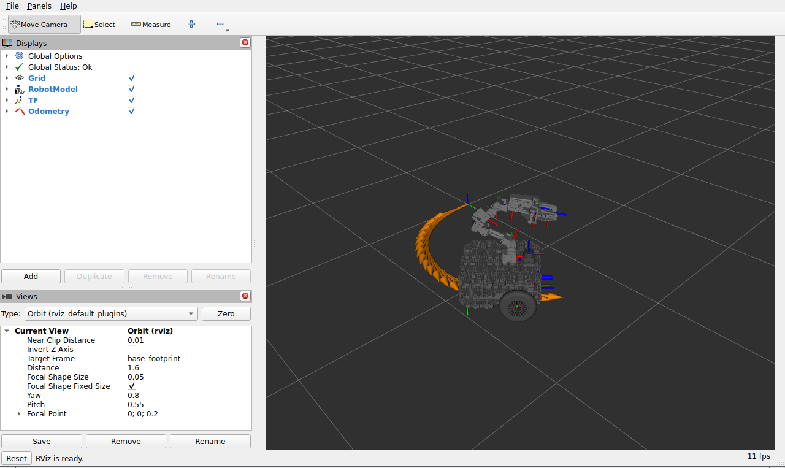
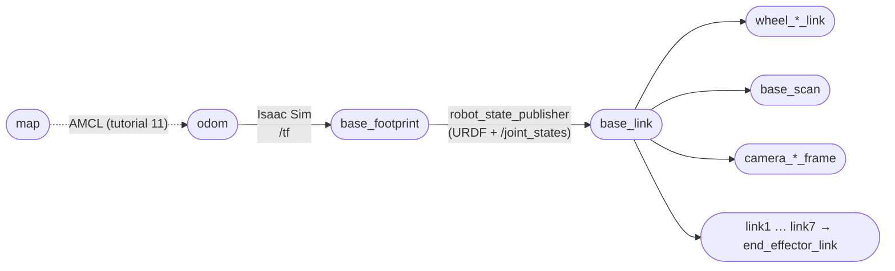
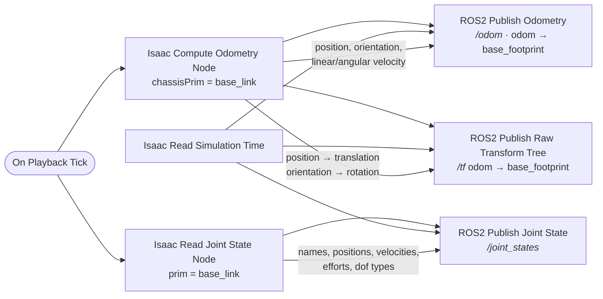
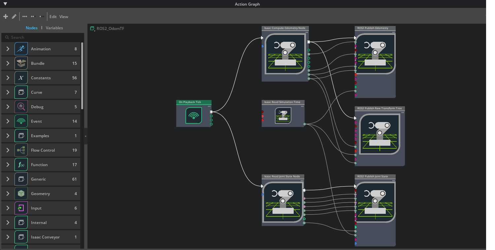

# 07 · オドメトリ、TF、RViz { #07-odometry-tf-and-rviz }

<p class="tutorial-meta">⏱ 25 分 · レベル：初級 · スクリプト：<code>isaac/07_odom_tf.py</code> · ROS：<code>lime_isaac_bringup/view_robot.launch.py</code></p>

**目標：** *ロボットがどこにいるか*と*ジョイントがどう動いているか*を ROS が知るために必要なものを、すべてパブリッシュします。`/odom`、TF の変換 `odom → base_footprint`、そして `/joint_states` です。そのうえで、**RViz** で Lime が動く様子を見ます。

<figure class="result" markdown>
{ .full }
<figcaption>ROS 2 コンテナ内の RViz：ロボットのモデル（Isaac Sim の <code>/joint_states</code> で姿勢を決めています）、TF の座標軸、左旋回したときのオドメトリの矢印。</figcaption>
</figure>

## 考え方 { #concepts }

**TF** は、ROS の座標フレームのツリーです。移動ロボットでは次のようになります。



- **`odom → base_footprint`** は、ロボットが起動してからどれだけ走ったかを表します。これは Isaac Sim がパブリッシュします。Isaac Sim がロボットそのものだからです。
- **`base_footprint` より下のすべて**は URDF から来ます。`robot_state_publisher`（ROS コンテナ内）が URDF と `/joint_states` を読み、それらの変換をパブリッシュします。実機も同じ構成で、フレーム名とトピック名も同じです。

!!! info "誰が何をパブリッシュするか"
    | トピック / 変換 | パブリッシャー |
    |---|---|
    | `/clock` | Isaac Sim |
    | `/odom` (`nav_msgs/Odometry`) | Isaac Sim |
    | `/tf` `odom → base_footprint` | Isaac Sim |
    | `/joint_states` | Isaac Sim、10 個のジョイントすべて（チュートリアル 12 で ros2_control に引き継ぐまで） |
    | `/tf` `base_footprint → …`、`/robot_description` | `robot_state_publisher` (ROS) |

## グラフ { #the-graph }



[チュートリアル 06](06-ros2-drive.md) のクロックのグラフと `/cmd_vel` のグラフは、そのまま使います。

## 作ってみる { #build-it }

=== "GUI"

    1. チュートリアル 06 のステージ `my_stages/06_ros2_drive.usd`（ロボット + クロック + 走行用のグラフ）を開きます。
    2. 新しい Action Graph を作り (**Window ▸ Visual Scripting ▸ Action Graph ▸ New Action Graph**)、上の図のノードを追加します。次のように設定します。

        | ノード | 入力 | 値 |
        |---|---|---|
        | Isaac Compute Odometry Node | chassisPrim | `…/Geometry/base_footprint/base_link` |
        | ROS2 Publish Odometry | topicName / odomFrameId / chassisFrameId | `/odom` / `odom` / `base_footprint` |
        | ROS2 Publish Raw Transform Tree | parentFrameId / childFrameId | `odom` / `base_footprint` |
        | Isaac Read Joint State Node | prim | `…/Geometry/base_footprint/base_link` |
        | ROS2 Publish Joint State | topicName | `/joint_states` |

    3. `Isaac Read Joint State Node` → `ROS2 Publish Joint State` を、ポートごとに接続します。`jointNames`、`jointPositions`、`jointVelocities`、`jointEfforts`、`jointDofTypes`、`stageMetersPerUnit`、そして `execOut → execIn` です。
    4. **Play** を押します。終わったら **Stop** ■ を押し、**File ▸ Save As** で `my_stages/07_odom_tf.usd` として保存します。チュートリアル 12 はこのステージから続けます。

    { .full }

    !!! tip "近道"
        **Tools ▸ Robotics ▸ ROS 2 OmniGraphs ▸ Odometry Publisher** と **▸ Joint States** を使うと、フォームに入力するだけで同様のグラフを作れます。

    !!! note "なぜパブリッシャーの `targetPrim` ではなく `Isaac Read Joint State` を使うのか"
        Isaac Sim 6.x では、`ROS2 Publish Joint State` 自身の `targetPrim` 入力は非推奨です。サポートされている方法は、`Isaac Read Joint State Node` でジョイントを読み取り、その配列をパブリッシャーに渡すことです。

=== "Python (standalone)"

    ```bash
    source scripts/isaac_env.sh
    python isaac/07_odom_tf.py
    ```

    スクリプトはチュートリアル 06 のグラフを再利用し、新しいグラフを追加します。グラフを作る 3 つの関数は、すべて `isaac/common/graphs.py` にあります。

    ```python
    graphs.enable_ros2_realtime(simulation_app)
    graphs.create_clock_graph()                                   # /clock          (06)
    graphs.create_drive_graph(articulation_root)                  # /cmd_vel        (06)
    graphs.create_odom_tf_joint_states_graph(articulation_root)   # /odom /tf /joint_states (new)
    ```

    ??? example "`isaac/common/graphs.py` の `create_odom_tf_joint_states_graph()`"
        ```python
        --8<-- "isaac/common/graphs.py:create_odom_tf_joint_states_graph"
        ```

    ??? example "スクリプト全体：`isaac/07_odom_tf.py`"
        ```python
        --8<-- "isaac/07_odom_tf.py"
        ```

## RViz で見る { #see-it-in-rviz }

まず、ROS 2 のワークスペースを一度ビルドします。ワークスペースには、Lime のロボット記述（description）と、このプロジェクトの launch ファイルが入っています。

```bash
./scripts/build_ws.sh
```

シミュレーションを再生した状態で、次を実行します。

```bash
./docker/run_ros.sh ros2 launch lime_isaac_bringup view_robot.launch.py
```

これで `robot_state_publisher`（`use_sim_time: true` を指定）と RViz が起動します。RViz の設定は `lime_isaac_bringup/rviz/view_robot.rviz` で、固定フレームは `odom`、表示は RobotModel、TF、Odometry です。ここで `teleop_twist_keyboard`（チュートリアル 06）を使って走らせ、オドメトリの軌跡を見てください。

TF のチェーン全体を、コマンドラインで確認します。

```bash
./docker/run_ros.sh ros2 run tf2_ros tf2_echo odom end_effector_link
```

```text
At time 19.916666666
- Translation: [0.338, 0.604, 0.312]
- Rotation: in Quaternion (xyzw) [0.631, -0.429, -0.534, -0.364]
```

<figure class="result" markdown>
<video controls autoplay loop muted playsinline>
  <source src="../../../assets/video/tutorial07_odom_tf.mp4" type="video/mp4">
</video>
<figcaption>自動チェックでは、0.2 m/s と 0.5 rad/s で 4 秒間走らせます。</figcaption>
</figure>

## 自動チェック { #automatic-check }

`python isaac/07_odom_tf.py --headless --test` は、自分で `/cmd_vel` をパブリッシュし、`/odom` に返ってくる値を、指令値およびシミュレーション内の実際の姿勢と比較します。

```text
[07][check] ok   odom twist v=0.199 m/s (cmd 0.2)
[07][check] ok   odom twist w=0.505 rad/s (cmd 0.5)
[07][check] ok   left turn -> yaw increased: odom yaw 106.6 deg
[07][check] ok   odom pose vs truth: |dxy|=0.003 m, dyaw=-0.48 deg
[07][check] ok   /joint_states has all 10 joints
[07][check] ok   TF odom -> base_footprint received
[07][test] PASS
```

!!! example "旋回速度が一致する理由"
    このチェックの最初のバージョンは失敗しました。ロボットは 0.5 rad/s ではなく 0.44 rad/s で旋回していたのです。タイヤのコライダーが URDF の幅の広い円柱で、旋回時に床を擦っていたためです。現在は、[チュートリアル 03](03-tune-robot.md#wheel-colliders-cylinder-vs-sphere) で車輪に球のコライダーを与えています。これが、「動いたか？」だけを見るのではなく、シミュレーションのデータを指令値と比較する理由の 1 つです。

## トラブルシューティング { #troubleshooting }

| 症状 | 対処 |
|---|---|
| RViz: *No transform from [base_link] to [odom]* | シミュレーションは再生中ですか？`robot_state_publisher` は `use_sim_time:=true` で動いていますか？ |
| RobotModel が灰色になる / アームの姿勢がおかしい | `/joint_states` が届いていません。`ros2 topic hz /joint_states` で確認してください。 |
| TF の時刻が飛ぶ / 「TF_OLD_DATA」の警告が出る | シミュレーションを再起動したためです。RViz を再起動してください（シミュレーション時間が 0 に戻っています）。 |

**次へ：** [08 · カメラ（RealSense D435）](08-camera.md)
