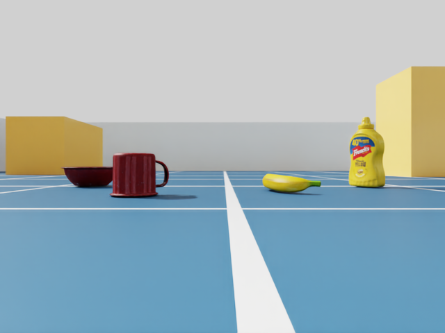
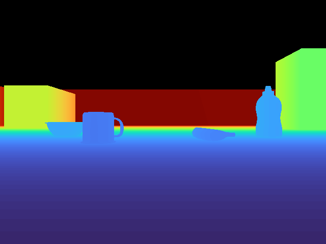
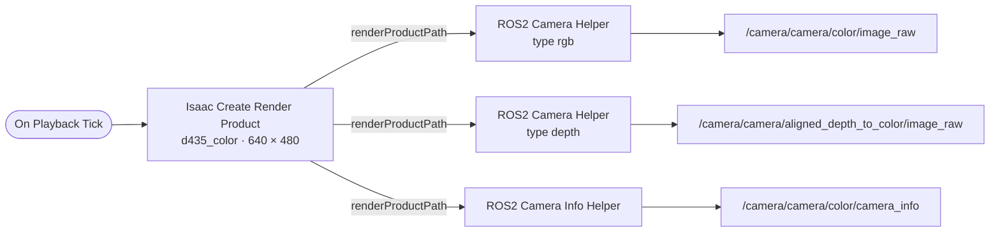
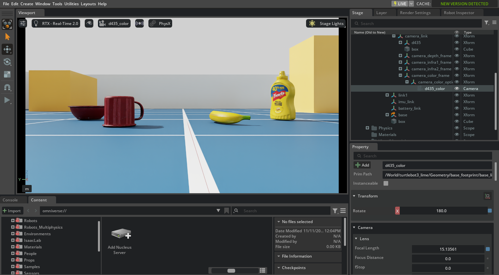
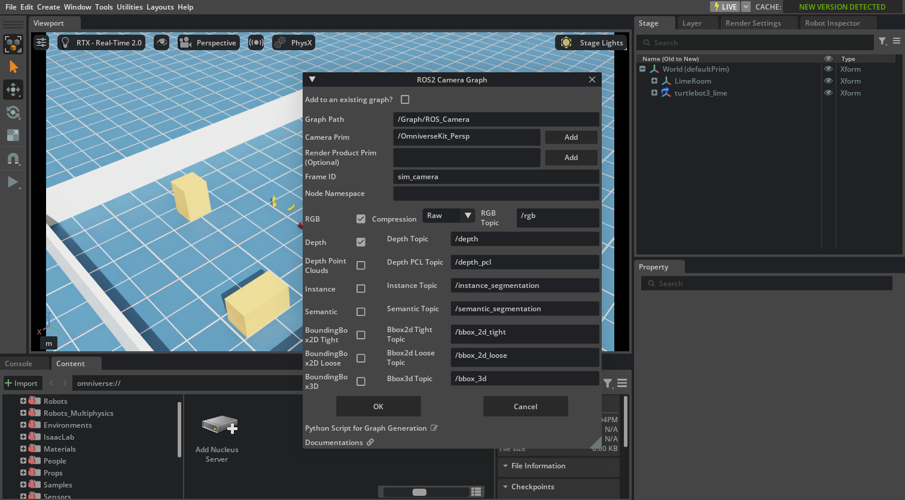

# 08 · カメラ（RealSense D435） { #08-camera-realsense-d435 }

<p class="tutorial-meta">⏱ 25 分 · レベル：初級 · スクリプト：<code>isaac/08_camera.py</code></p>

**目標：** Lime に RealSense D435 カメラを、URDF にあるとおりのフレームに取り付けます。そして、実機の `realsense2_camera` ドライバーと同じトピック名で、RGB 画像、深度画像、カメラの内部パラメーターを ROS 2 にパブリッシュします。

<div class="grid" markdown>

{ .full }

{ .full }

</div>

*左：`/camera/camera/color/image_raw`。右：`/camera/camera/aligned_depth_to_color/image_raw`（32 ビットの float、単位はメートル）を表示用に色付けしたもの。ロボットは「lime_room」の中で、マグカップ、ボウル、バナナ、ボトルの前に立っています。*

## 考え方 { #concepts }

**lime_room：** このチュートリアル以降、ロボットは小さな部屋 (`isaac/common/scene.py`) の中で過ごします。広さは 6 × 5 m で、高さ 0.6 m の壁、オレンジ色の障害物が 3 つあり、床には NVIDIA のアセットライブラリーから取った日用品が 4 つ置かれています。同じファイルを使って、この部屋を GUI 用に `assets/scenes/lime_room.usda` として保存することもできます (`python isaac/common/scene.py`)。

**カメラの位置：** URDF には、すでに D435 のフレームが含まれています。このチュートリアルでは、`camera_color_optical_frame` に USD カメラを置きます。このフレームは台車の前部にあり、**床から 5.8 cm** の高さで、前方を向いています。

!!! info "光学フレームと USD カメラ"
    ROS の*光学*フレームは **+Z** 方向を向き、**+Y が下**です（画像の行番号は下に向かって増えます）。USD カメラは **−Z** 方向を向き、**+Y が上**です。**X 軸まわりに 180° 回転**させると一方がもう一方になるので、カメラのプリムは `camera_color_optical_frame` の下に `rotateX = 180` で置きます。

**実機のカメラに合わせる：** URDF によると、解像度は 640 × 480、水平画角は 1.211 rad (69.4°) です。USD カメラはピンホールモデルを使います。焦点距離 $f$ と開口幅 $w$（単位は mm）から、画角 $\text{FOV} = 2\arctan\frac{w}{2f}$ が決まります。デフォルトの $w = 20.955$ mm では、$f = 15.1$ mm になります。このとき、パブリッシュされる `camera_info` は $f_x = 640 / (2\tan(1.211/2)) = 462.3$ px になります。

**レンダープロダクト：** カメラが画像を出力するのは、*レンダープロダクト*（カメラ + 解像度）を通したときだけです。`Isaac Create Render Product` がこれを作ります。ROS のヘルパーノードは、そこから RGB、深度、内部パラメーターを読み取ります。

## グラフ { #the-graph }



3 つとも `frameId = camera_color_optical_frame` を使うので、RViz やほかの ROS ツールは画像を正しい位置に配置できます。

## 作ってみる { #build-it }

=== "GUI"

    1. 部屋を開き、ロボットを追加します。**File ▸ Open** で `assets/scenes/lime_room.usda` を開き（最初に一度、`python isaac/common/scene.py` で作成してください）、**File ▸ Add Reference** で `assets/usd/turtlebot3_lime_tuned.usda` を `/World/turtlebot3_lime` に追加します。
    2. `…/camera_color_frame/camera_color_optical_frame` を選び、右クリックして **Create ▸ Camera** を選びます。名前は `d435_color` にします。**Property** で次のように設定します：*Transform ▸ Rotate* = (180, 0, 0)、*Focal Length* = 15.1、*Horizontal Aperture* = 20.955、*Vertical Aperture* = 15.716、*Clipping Range* = (0.05, 20)。
    3. このカメラから見てみます。ビューポートのカメラメニュー (**Perspective ▾**) ▸ `d435_color` を選びます。

        { .full }

    4. **Tools ▸ Robotics ▸ ROS 2 OmniGraphs ▸ Camera** を使うと、フォームに入力して上のグラフを作れます。そのデフォルト値（*Camera Prim* `/OmniverseKit_Persp`、*Frame ID* `sim_camera`、トピック `/rgb` と `/depth`）は仮の値です。カメラのプリムを `d435_color`、フレーム ID を `camera_color_optical_frame` にし、RGB と深度のトピックを図のとおりに設定してから、**OK** を押します。このフォームには camera_info のトピックを入力する欄がありません（`camera_info` が使われます）。作成されたグラフを開き、`ROS2 Camera Info Helper` ノードの *topicName* を `/camera/camera/color/camera_info` に設定します。

        { .full }

    5. **Play** を押します。終わったら **Stop** ■ を押し、**File ▸ Save As** で `my_stages/08_camera.usd` として保存します（`lime_room.usda` に上書きしないでください）。チュートリアル 09 はこのステージから続けます。

=== "Python (standalone)"

    ```bash
    source scripts/isaac_env.sh
    python isaac/08_camera.py
    ```

    ```python
    camera_path = sensors.add_d435_camera(robot_path)        # USD camera at camera_color_optical_frame
    graphs.create_camera_graph(camera_path, 640, 480)        # RGB + depth + camera_info
    ```

    ??? example "`isaac/common/sensors.py` の `add_d435_camera()`"
        ```python
        --8<-- "isaac/common/sensors.py:add_d435_camera"
        ```

    ??? example "`isaac/common/graphs.py` の `create_camera_graph()`"
        ```python
        --8<-- "isaac/common/graphs.py:create_camera_graph"
        ```

    ??? example "スクリプト全体：`isaac/08_camera.py`"
        ```python
        --8<-- "isaac/08_camera.py"
        ```

## ROS 2 から見る { #look-at-it-from-ros-2 }

```bash
./docker/run_ros.sh ros2 run rqt_image_view rqt_image_view /camera/camera/color/image_raw
./docker/run_ros.sh ros2 topic hz /camera/camera/color/image_raw
./docker/run_ros.sh ros2 topic echo /camera/camera/color/camera_info --once
```

カメラのパネルがある RViz を使うこともできます：`ros2 launch lime_isaac_bringup view_sensors.launch.py`（[チュートリアル 09](09-lidar-imu.md) を参照）。

<figure class="result" markdown>
<video controls autoplay loop muted playsinline>
  <source src="../../../assets/video/tutorial08_camera.mp4" type="video/mp4">
</video>
</figure>

## 自動チェック { #automatic-check }

`python isaac/08_camera.py --headless --test` は、自分がパブリッシュしたトピックをサブスクライブして確認します。

```text
[08][check] ok   rgb 640x480 rgb8
[08][check] ok   rgb rate 60.0 Hz (sim time)
[08][check] ok   depth 32FC1, centre distance 3.94 m
[08][check] ok   camera_info fx=462.3 (expected 462.3 from the 69.4 deg FOV)
[08][check] ok   frame_id camera_color_optical_frame
[08][test] PASS
```

中心の距離 3.94 m は、奥の壁までの距離です。壁の位置 x = 4.0 m から、カメラ自身の x 位置 0.059 m を引いた値です。

!!! note "パブリッシュレート"
    カメラのヘルパーは、レンダリングされたフレームをすべてパブリッシュします（ここでは 60 Hz）。Isaac Sim 6.x では、センサーごとのレートは `omni:sensor:tickRate` 属性で設定します。ヘルパーノードの `frameSkipCount` は非推奨です。

**次へ：** [09 · LiDAR と IMU](09-lidar-imu.md)
