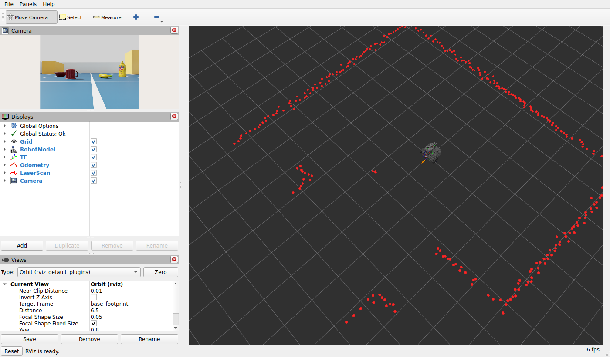
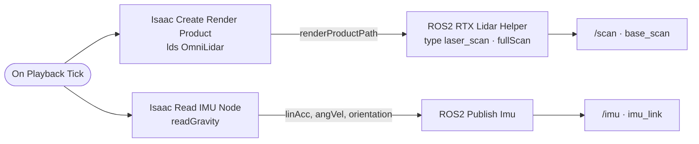
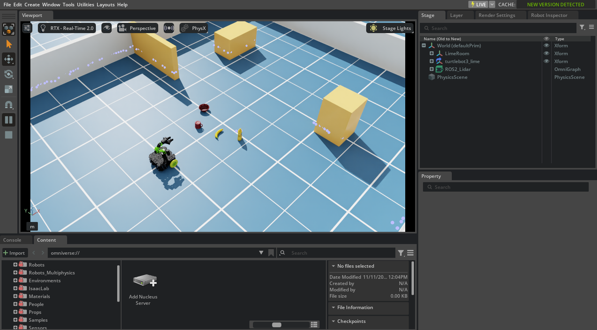

# 09 · LiDAR と IMU { #09-lidar-imu }

<p class="tutorial-meta">⏱ 25 分 · レベル：初級 · スクリプト：<code>isaac/09_lidar_imu.py</code> · ROS：<code>lime_isaac_bringup/view_sensors.launch.py</code></p>

**目標：** Lime の **LDS-01 2D LiDAR** を、実際のセンサーの数値で設定した RTX LiDAR として追加し、**IMU** も追加します。`/scan` と `/imu` をパブリッシュし、すべてを RViz で見ます。

<figure class="result" markdown>
{ .full }
<figcaption>RViz (<code>view_sensors.launch.py</code>)：カメラ画像（左上）と <code>/scan</code>（赤）。スキャンが壁、3 つの障害物、ボトルの輪郭を描いています。LiDAR のスキャン面の高さ 16 cm より背が高い物体は、ボトルだけです。</figcaption>
</figure>

## 考え方 { #concepts }

**RTX LiDAR：** Isaac Sim は、GPU でシーンをレイトレーシングして LiDAR をシミュレーションします。スキャンパターン、タイミング、ノイズも実物どおりに再現します。センサーモデルは Isaac Sim のセンサーライブラリー (`Lidar.create(config=...)`) にあり、すべてのパラメーターは `OmniLidar` プリムの USD 属性です。

**LDS-01 にする：** Lime の URDF によると、LDS-01 は **5 Hz で 1 回転あたり 360 点、0.12〜3.5 m** を測定します。このチュートリアルでは、単一ビームの `RPLIDAR_S2E` モデルから始めて、その数値を上書きします。

| 属性 | 値 | 理由 |
|---|---|---|
| `omni:sensor:Core:scanRateBaseHz`、`omni:sensor:tickRate` | 5 | 毎秒 5 回転 |
| `omni:sensor:Core:patternFiringRateHz`、`reportRateBaseHz` | 1800 | 1800 発/s ÷ 5 回転/s = 1 回転あたり 360 点 |
| `omni:sensor:Core:nearRangeM` / `farRangeM` | 0.12 / 3.5 | 測定距離の上下限。0.12 m にすることで、ロボット自身の折りたたんだアームに当たった点も無視します |

RPLIDAR の筐体のメッシュは非表示にしています。Lime 自身の LDS のメッシュがすでにあるためです。

**IMU：** 取り付けた剛体の加速度と角速度を読み取る物理センサーです。剛体の上に置く必要があります。`imu_link` は質量のない単なるフレームなので、IMU は `base_link` の 33 mm 上（`imu_link` がある位置）に置きます。パブリッシュは `frame_id = imu_link` で行います。

## グラフ { #the-graphs }



## 作ってみる { #build-it }

=== "GUI"

    1. チュートリアル 08 のステージ `my_stages/08_camera.usd`（lime_room + ロボット + カメラ）を開きます。
    2. **LiDAR：** `…/base_link/base_scan` を選び、**Create ▸ Sensors ▸ RTX Lidar ▸ Slamtec ▸ RPLIDAR S2E** を選びます。作成された `OmniLidar` プリムを選び、**Property ▸ Raw USD Properties** で上の表の属性を設定します。
    3. **Tools ▸ Robotics ▸ ROS 2 OmniGraphs ▸ RTX Lidar** を開きます。LiDAR のプリムを選び、タイプを *laser_scan*、トピックを `/scan`、フレームを `base_scan` にします。
    4. **IMU：** `…/base_link` を選び、**Create ▸ Sensors ▸ Imu Sensor** を選びます。その位置（translation）を (0, 0, 0.033) に設定します。
    5. IMU のグラフは手作業で作ります（Action Graph エディター）。`On Playback Tick` → `Isaac Read IMU Node`（*imuPrim* = 作成した IMU、*readGravity* ✓）→ `ROS2 Publish Imu`（*topicName* `/imu`、*frameId* `imu_link`）とつなぎます。`linAcc → linearAcceleration`、`angVel → angularVelocity`、`orientation → orientation` を接続し、シミュレーション時間を *timeStamp* に接続します。
    6. ビューポートで LiDAR を*見る*には、`ROS2 RTX Lidar Helper` ノードの **showDebugView** にチェックを入れます。**Play** を押します。

        { .full }

        点は壁、障害物、ボトルの上にあります。マグカップ、ボウル、バナナはスキャン面 (16 cm) より低いので、LiDAR には見えません。

    7. **Stop** ■ を押し、**File ▸ Save As** で `my_stages/09_lidar_imu.usd` として保存します。チュートリアル 14 はこのステージから続けます。

=== "Python (standalone)"

    ```bash
    source scripts/isaac_env.sh
    python isaac/09_lidar_imu.py
    ```

    ```python
    lidar_path = sensors.add_lds_lidar(robot_path)   # RTX LiDAR at base_scan, LDS-01 numbers
    graphs.create_lidar_graph(lidar_path, show_debug_view=not args.headless)   # -> /scan (+ dots in the viewport)
    imu_path = sensors.add_imu(robot_path)           # physics IMU on base_link
    graphs.create_imu_graph(imu_path)                # -> /imu
    ```

    ??? example "`isaac/common/sensors.py` の `add_lds_lidar()` と `add_imu()`"
        ```python
        --8<-- "isaac/common/sensors.py:add_lds_lidar"
        ```
        ```python
        --8<-- "isaac/common/sensors.py:add_imu"
        ```

    ??? example "`isaac/common/graphs.py` の `create_lidar_graph()` と `create_imu_graph()`"
        ```python
        --8<-- "isaac/common/graphs.py:create_lidar_graph"
        ```
        ```python
        --8<-- "isaac/common/graphs.py:create_imu_graph"
        ```

    ??? example "スクリプト全体：`isaac/09_lidar_imu.py`"
        ```python
        --8<-- "isaac/09_lidar_imu.py"
        ```

## ROS 2 から見る { #look-at-it-from-ros-2 }

```bash
./docker/run_ros.sh ros2 launch lime_isaac_bringup view_sensors.launch.py   # RViz: robot, TF, /scan, camera
./docker/run_ros.sh ros2 topic hz /scan                                     # ~5 Hz
./docker/run_ros.sh ros2 topic echo /imu --once
```

<figure class="result" markdown>
<video controls autoplay loop muted playsinline>
  <source src="../../../assets/video/tutorial09_lidar_imu.mp4" type="video/mp4">
</video>
<figcaption>自動チェックでは、IMU のジャイロスコープをテストするために、ロボットをその場で 0.5 rad/s で旋回させます。</figcaption>
</figure>

## 自動チェック { #automatic-check }

ロボットは部屋の原点に立っているので、期待される距離はわかっています。左右の壁は y = ±2.5 m、後ろの壁は x = −2.0 m（x = 0.027 m にある LiDAR からは 2.03 m）、前の壁は 3.97 m で、測定範囲の 3.5 m より遠くにあります。

```text
[09][check] ok   scan: 360 beams, 1.00 deg apart
[09][check] ok   scan range limits 0.12 .. 3.50 m
[09][check] ok   scan rate 5.0 Hz (sim time)
[09][check] ok   left wall  (+90 deg) 2.49 m (expected 2.50)
[09][check] ok   right wall (-90 deg) 2.53 m (expected 2.50)
[09][check] ok   back wall  (180 deg) 2.06 m (expected 2.03)
[09][check] ok   front (0 deg): east wall at 3.97 m is beyond 3.5 m -> -1.0
[09][check] ok   imu at rest: acc z = 9.81 m/s^2 (gravity 9.81)
[09][check] ok   imu turning: gyro z = 0.49 rad/s (commanded 0.50)
[09][check] ok   frames base_scan / imu_link
[09][test] PASS
```

!!! note "−1 は「反射なし」の意味"
    Isaac Sim は、測定範囲内で何にも当たらなかったビームに −1.0 を書き込みます。ROS の慣例では `inf` です。AMCL と Nav2 のコストマップ（チュートリアル 11）は −1 のままでも動きますが、slam_toolbox は動きません。そのため、チュートリアル 14 で変換します。

!!! note "LiDAR には実物と同じようにノイズがあります"
    1 本 1 本のビームは数 cm ばらつきます（センサーモデルの距離精度は 3 cm）。ある実行では、180° 付近で 1.97〜2.10 m の値が出ました。そのため、チェックでは **±3° 以内のビームの中央値**を使います。実際のセンサーをテストするときと同じやり方です。

!!! info "静止時、IMU は上向きに +9.81 m/s² を示します"
    加速度センサーが測るのは*比力*（specific force）です。静止しているとき、床は重力に逆らってロボットを上に押しています。`readGravity` をオンにしているのはこのためです。実際の IMU も同じように振る舞います。

**次へ：** [10 · YOLO で物体検出](10-yolo.md)
