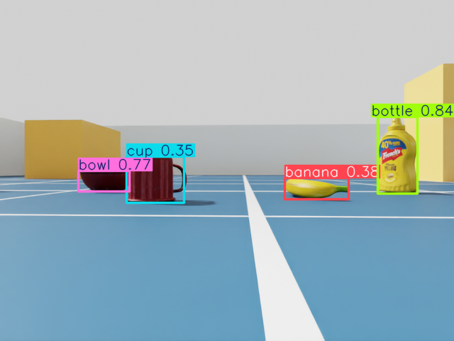
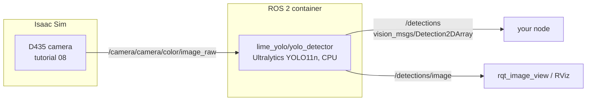

# 10 · YOLO で物体検出 { #10-object-detection-with-yolo }

<p class="tutorial-meta">⏱ 20 分 · レベル：初級 · スクリプト：<code>isaac/10_yolo.py</code> · ROS：<code>lime_yolo</code></p>

**目標：** Lime のカメラ画像に写った日用品を、**YOLO** で検出します。検出器は普通の ROS 2 ノードです。画像がシミュレーターから来ていることを知りませんし、気にもしません。

<figure class="result" markdown>
{ .full }
<figcaption><code>/detections/image</code>：YOLO11n が、チュートリアル 08 のカメラに写っているボウル、マグカップ、バナナ、ボトルを見つけています。</figcaption>
</figure>

## 考え方 { #concepts }



- **YOLO**（「You Only Look Once」の略）は、リアルタイム物体検出器のファミリーです。学習済みモデルは、COCO データセットにある日用品の 80 クラスを知っています：*cup, bowl, banana, bottle, chair, person, …*。lime_room の物体は、これらのクラスから選びました。
- **`vision_msgs/Detection2DArray`** は、2D の検出結果を表す ROS の標準メッセージです。物体ごとに 1 つのエントリーがあり、バウンディングボックス（中心とサイズ、単位はピクセル）と、スコア付きのクラス名を持ちます。
- ノードは**最新の**画像だけを、多くても毎秒 5 回処理します。CPU でもデモには十分で、シミュレーションがノードを待つこともありません。

!!! warning "ライセンス"
    チュートリアルのコードは Apache-2.0 です。**Ultralytics YOLO は AGPL-3.0 です**。Ultralytics YOLO は Docker イメージにインストールされ、モデルの重みは初回使用時に（コンテナ内の `~/.cache/lime_yolo` に）ダウンロードされます。どちらもこのリポジトリには含まれていません。製品に使う前に、ライセンスを確認してください。NVIDIA の [Isaac ROS `isaac_ros_yolov8`](https://nvidia-isaac-ros.github.io/repositories_and_packages/isaac_ros_object_detection/isaac_ros_yolov8/index.html) は、GPU (TensorRT) で高速化された上級者向けの代替手段です。

## 実行してみる { #run-it }

ターミナル 1 では、Isaac Sim を起動します（チュートリアル 08 と同じシーンです）。

```bash
source scripts/isaac_env.sh
python isaac/10_yolo.py
```

ターミナル 2 では、検出器を起動します（初回の起動時には、約 6 MB の `yolo11n.pt` をダウンロードします）。

```bash
./scripts/build_ws.sh lime_yolo        # once
./docker/run_ros.sh ros2 launch lime_yolo yolo.launch.py
```

```text
[yolo_detector]: loaded yolo11n.pt: 80 classes
[yolo_detector]: 3 objects: bottle 0.81, cup 0.68, bowl 0.67
```

ターミナル 3 では、結果を見ます。

```bash
./docker/run_ros.sh ros2 run rqt_image_view rqt_image_view /detections/image
./docker/run_ros.sh ros2 topic echo /detections --field detections
```

`teleop_twist_keyboard`（チュートリアル 06）でロボットを走らせ、検出結果が変わる様子を見てください。

<figure class="result" markdown>
<video controls autoplay loop muted playsinline>
  <source src="../../../assets/video/tutorial10_yolo.mp4" type="video/mp4">
</video>
<figcaption>ロボットがスタート時の向きから左に約 40°、右に 40° 回り、元の向きに戻る間の <code>/detections/image</code>。検出器は毎秒 5 回動くので、動画はコマ送りのように動きます。YOLO11n は、ほとんどの時間、ボトル、ボウル、マグカップを見つけています。平らに置かれたバナナはほとんど見逃され、一度は <i>frisbee</i> として囲まれています（下の <i>Sim-to-real</i> を参照）。</figcaption>
</figure>

!!! tip "より大きなモデル、ほかの設定"
    `ros2 launch lime_yolo yolo.launch.py model:=yolo11s.pt confidence:=0.5 max_rate:=10.0`。大きなモデルほど精度が高くなり、遅くなります。

??? example "検出器ノード：`lime_yolo/yolo_detector.py`"
    ```python
    --8<-- "ros2_ws/src/lime_yolo/lime_yolo/yolo_detector.py"
    ```

??? example "Isaac Sim 側：`isaac/10_yolo.py`"
    ```python
    --8<-- "isaac/10_yolo.py"
    ```

## 自動チェック { #automatic-check }

`python isaac/10_yolo.py --headless --test` は `/detections` をサブスクライブし（Isaac Sim 自身の rclpy には `vision_msgs` が入っています）、配置した 4 つの物体のうち 3 つ以上が検出されれば合格です。これを実行している間に、コンテナで検出器を起動してください（`tools/run_all_checks.sh 10` は両方を行います）。

```text
[10][check] ok   detected 'banana' (best score 0.39)
[10][check] ok   detected 'bottle' (best score 0.86)
[10][check] ok   detected 'bowl' (best score 0.78)
[10][check] ok   detected 'cup' (best score 0.77)
[10][check] other classes reported: ['frisbee']
[10][test] 4/4 objects detected: PASS
```

!!! example "Sim-to-real：スコアからわかること"
    ボトルとボウルは、高い信頼度で検出されます。バナナとマグカップはスコアが低く、平たい赤いボウルは *frisbee* と判定されることがあります。カメラは床から 5.8 cm の高さしかないので、物体を見慣れない角度から見ることになります。COCO の写真に、そのような角度から写したものはめったにありません。実機にも同じ問題があります。シミュレーションなら、ロボットが存在する前にこの問題を確かめ、その対策のための学習用画像を生成することもできます。

**次へ：** [11 · Nav2 でナビゲーション](11-nav2.md)
