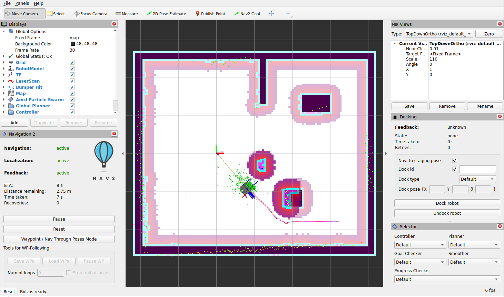
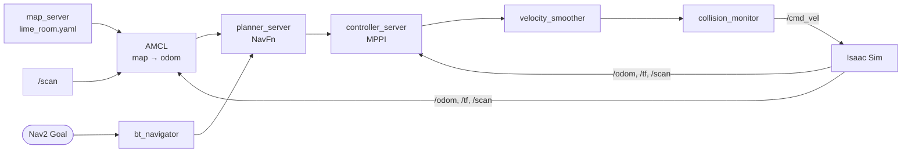
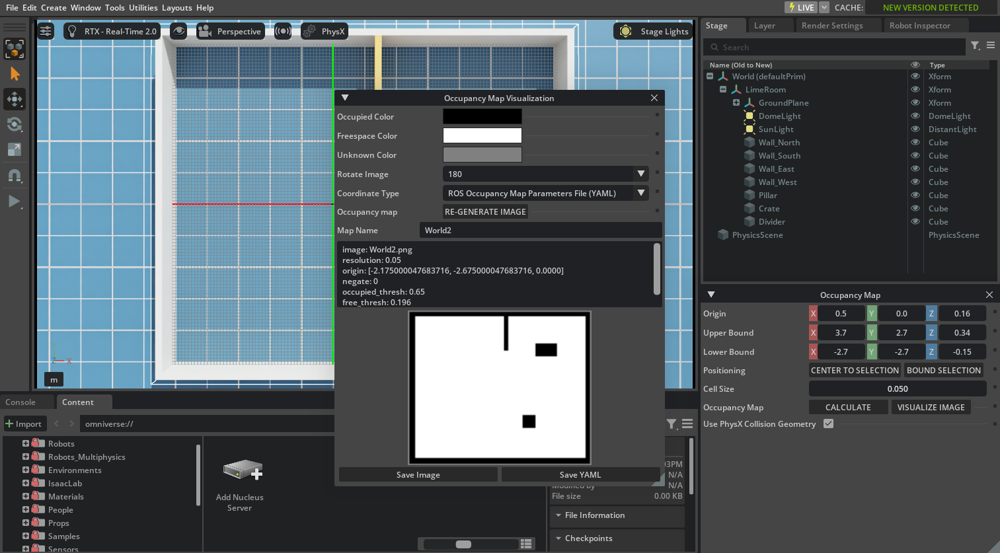
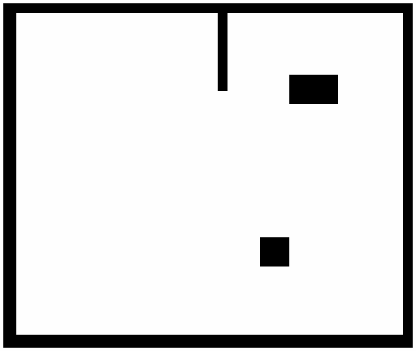

# 11 · Nav2 でナビゲーション { #11-navigation-with-nav2 }

<p class="tutorial-meta">⏱ 40 分 · レベル：中級 · スクリプト：<code>isaac/11_make_map.py</code>、<code>isaac/11_nav2.py</code> · ROS：<code>lime_isaac_bringup/navigation.launch.py</code></p>

**目標：** Isaac Sim で lime_room の地図を作り、ROS 2 のナビゲーションスタックである **Nav2** に Lime をゴールまで走らせてもらいます。AMCL で自己位置推定し、障害物を避ける経路を計画し、その経路に沿って進みます。

<figure class="result" markdown>
<video controls autoplay loop muted playsinline>
  <source src="../../../assets/video/tutorial11_nav2.mp4" type="video/mp4">
</video>
<figcaption>Nav2 が Lime を (0, 0) から (3.2, −1.8) まで走らせます。カラーコーンは地図にはありませんが、LiDAR には見えています。ロボットはカラーコーンと柱を回り込み、何にも触れずに 25 秒で 3.96 m 進みます。</figcaption>
</figure>

<div class="callouts" markdown>
{ .full }
<span class="callout" style="left: 49.0%; top: 9.3%" aria-hidden="true">1</span>
<span class="callout" style="left: 69.1%; top: 34.8%" aria-hidden="true">2</span>
<span class="callout" style="left: 38.3%; top: 81.7%" aria-hidden="true">3</span>
<span class="callout" style="left: 55.4%; top: 51.0%" aria-hidden="true">4</span>
<span class="callout" style="left: 42.1%; top: 60.3%" aria-hidden="true">5</span>
<span class="callout" style="left: 43.8%; top: 25.7%" aria-hidden="true">6</span>
<span class="callout" style="left: 63.7%; top: 77.6%" aria-hidden="true">7</span>
</div>

*RViz (`navigation.rviz`)：*

1. ツールバーの **Nav2 Goal**：これをクリックしてから地図上で矢印をドラッグすると、ゴールを送れます。
2. **地図**：壁、仕切り、箱（ここ）、柱です。
3. **コストマップ**：ピンクはインフレーションで膨らませた障害物です。
4. **カラーコーン**：コストマップにだけあります。カラーコーンのことを知っているのは LiDAR だけだからです。地図にはありません。
5. **AMCL のパーティクル**（緑）：ロボットがどこにいるかについての AMCL の推測です。
6. **LiDAR スキャン**：壁に沿って並ぶ点です。
7. **計画された経路**（ピンクの線）：カラーコーンと柱を回り込んでいます。

## 考え方 { #concepts }

Nav2 はロボットから 5 つのものを必要とします。どれも Isaac Sim が提供しており、チュートリアル 06〜09 で作ったものです。

| Nav2 に必要なもの | トピック | チュートリアル |
|---|---|---|
| クロック | `/clock` | 06 |
| 走らせる手段 | `/cmd_vel`（Nav2 がパブリッシュし、Isaac Sim のグラフがサブスクライブします） | 06 |
| オドメトリと TF `odom → base_footprint` | `/odom`、`/tf` | 07 |
| ロボットのフレーム | `/joint_states` → `robot_state_publisher` | 07 |
| レーザースキャン | `/scan` | 09 |

…それに加えて**地図**が必要です。地図はこのチュートリアルで新しく作ります。

!!! note "地図に載せるのは動かないもの。新しいものはコストマップが捉えます"
    地図には、壁、柱、箱、仕切りといった、動かないものが入っています。チュートリアル 08〜10 の物体は片付けてあります。その代わりに `11_nav2.py` は、地図を作った*あと*で、NVIDIA の倉庫用プロップの**カラーコーン**を、ロボットの通り道にちょうど重なるように置きます。そのため、地図はカラーコーンのことを知りません。LiDAR がカラーコーンを捉え、コストマップの障害物レイヤーがそれをマークし、プランナーがそれを回り込みます。誰かが床に置きっぱなしにした箱を回り込むのと同じです。

    カラーコーンの高さは 46 cm です。LiDAR に見えるのは、床から 16 cm の高さにあるスキャン平面を横切るものだけです。バナナ (4 cm) は LiDAR には見えません（チュートリアル 09）。実際のロボットでは、低い障害物を捉えるために、コストマップに深度カメラを加えます。

    ??? example "`isaac/common/scene.py` の `add_traffic_cone()`"
        ```python
        --8<-- "isaac/common/scene.py:add_traffic_cone"
        ```



## パート 1：地図を作る { #part-1-make-the-map }

Nav2 は*占有格子地図*（occupancy grid）を使って自己位置推定します。占有格子地図は、黒が占有、白が空き、灰色が未知を表す画像と、その解像度と原点を記した YAML ファイルでできています。実機では、SLAM を使いながら走り回って地図を作ります（[チュートリアル 14](14-slam.md)）。シミュレーションではシーン*そのもの*が正解（ground truth）なので、Isaac Sim はコライダーから直接地図を計算できます。

ジェネレーターは、シーンのある**高さの帯**を調べ、それを 1 枚の 2D 地図に押しつぶします。このチュートリアルでは、床から 1〜50 cm の帯を使います。床そのものを含まない程度に高く、上はどの障害物の上端よりも高い範囲です。先に床を片付けておきます。地図は動かないもののためのものだからです。

=== "GUI"

    1. `assets/scenes/lime_room.usda` を開きます（ロボットなし）。
    2. 床を片付けます。**Stage** パネルで `/World/LimeRoom/Objects` を選び、**Delete** を押します。そのあとでシーンを保存しないでください。チュートリアル 08〜10 と 13 では、これらの物体が必要です。
    3. **Tools ▸ Robotics ▸ Occupancy Map** を選びます。
    4. *Origin* には空いている点 (0.5, 0, 0.16) を設定します。*Lower Bound* (−2.7, −2.7, **−0.15**) と *Upper Bound* (3.7, 2.7, **0.34**) は原点からの相対値で、床から 1 cm〜50 cm の帯になります。*Cell Size* は 0.05 にします。
    5. **CALCULATE**、**VISUALIZE IMAGE** の順にクリックし、**Save Image** と **Save YAML** で `ros2_ws/src/lime_isaac_bringup/maps/` に保存します。

    { .full }

    これらの値なら、GUI はスクリプトと同じ地図を計算します。**Rotate Image = 180**（デフォルト）のままにしてください。これで北が上になります。保存する前に **Map Name** を `lime_room` にします。GUI の地図の YAML の原点 `[-2.175, -2.675]` は、スクリプトの `[-2.2, -2.7]` とセル半分 (2.5 cm) ずれていますが、どちらでも動きます。

=== "Python (standalone)"

    ```bash
    source scripts/isaac_env.sh
    python isaac/11_make_map.py --headless --test
    ```

    ```python
    generator = _omap.Generator(omni.physx.get_physx_interface(), omni.usd.get_context().get_stage_id())
    generator.update_settings(0.05, 4.0, 5.0, 6.0)      # cell size, occupied / free / unknown values
    generator.set_transform((0.5, 0.0, 0.16), lo, hi)    # origin (a free point); bounds: x, y and the 1-50 cm band
    generator.generate2d()                               # needs the simulation playing (PhysX queries)
    occupied = generator.get_occupied_positions()        # world coordinates
    ```

    スクリプトは、占有セルと空きセルを `lime_room.pgm` と `lime_room.yaml` に変換します。原点は `origin: [-2.2, -2.7, 0.0]` で、これは左下のピクセルのワールド座標です。スクリプトは既知のセルをチェックします。壁と柱は占有、スタート地点、部屋の中央、カラーコーンを置く場所は空きでなければなりません。

    ```text
    [11] generator: 1863 occupied, 11961 free cells
    [11] map 128 x 108 cells (6.40 x 5.40 m) -> ros2_ws/src/lime_isaac_bringup/maps
    [11][check] ok   north wall (1.0, 2.55) occupied
    [11][check] ok   pillar (2.0, -1.2) occupied
    [11][check] ok   robot start (0, 0) free
    [11][check] ok   room centre (1.0, -0.5) free
    [11][check] ok   where the cone will stand (1.2, -0.3) free (not in the map)
    [11][test] map PASS
    ```

    ??? example "スクリプト全体：`isaac/11_make_map.py`"
        ```python
        --8<-- "isaac/11_make_map.py"
        ```

{ width="420" }

*地図：壁、仕切り、箱、柱だけで、ほかには何もありません。カラーコーンはあとで登場します（パート 2）。*

地図はシミュレーションと同じ座標から作られているので、map フレーム = ワールドフレームです。ロボットは (0, 0) で +x 方向を向いてスタートし、AMCL にもまさにそのとおりに伝えます (`set_initial_pose: true`)。

## パート 2：ナビゲーションする { #part-2-navigate }

ターミナル 1 では Isaac Sim を起動します。

```bash
source scripts/isaac_env.sh
python isaac/11_nav2.py             # the lime_room with a traffic cone on the floor
```

ターミナル 2 では Nav2 + RViz を起動します。

```bash
./scripts/build_ws.sh lime_isaac_bringup     # once
./docker/run_ros.sh ros2 launch lime_isaac_bringup navigation.launch.py
```

`Managed nodes are active` と表示されるまで待ってから、RViz で **Nav2 Goal** をクリックし、地図上で矢印をドラッグします。または、コマンドラインからゴールを送ります。

```bash
./docker/run_ros.sh ros2 action send_goal /navigate_to_pose nav2_msgs/action/NavigateToPose \
  "{pose: {header: {frame_id: map}, pose: {position: {x: 3.2, y: -1.8}, orientation: {w: 1.0}}}}"
```

**カラーコーンで何が変わるか：** `python isaac/11_nav2.py --no-cone` で Isaac Sim を再起動し（Nav2 も再起動します）、同じゴールを送ります。カラーコーンがなければ、Nav2 はほぼまっすぐ進み、柱の北側を通ります。カラーコーンがその線上にあると、カラーコーンの南側を通り、続いて柱の南側を通ります。地図はどちらの場合も同じです。違うのは、LiDAR から情報を受け取るコストマップだけです。

### Lime の Nav2 パラメーター { #the-limes-nav2-parameters }

`lime_isaac_bringup/config/nav2_params.yaml` は、**Jazzy 自身の** `nav2_bringup/params/nav2_params.yaml` **から生成**しており、変更したのは次の点だけです。

| パラメーター | 値 | 理由 |
|---|---|---|
| `robot_base_frame`（bt_navigator、コストマップ、ビヘイビア） | `base_footprint` | Isaac Sim が `odom → base_footprint` をパブリッシュするため |
| コストマップの `footprint` | `[[0.075, 0.165], [0.075, -0.165], [-0.205, -0.165], [-0.205, 0.165]]` | 台車の箱と車輪。台車の中心は車輪軸の上にはありません |
| `inflation_radius` | 0.30 m | 狭い部屋、小さなロボット |
| AMCL の `laser_min_range` / `laser_max_range`、コストマップの距離範囲 | 0.12 / 3.5 m | LDS-01 |
| AMCL の `set_initial_pose`、`initial_pose` | true, (0, 0, 0) | 地図上でのロボットのスタート位置 |
| `vx_max`、`wz_max`、velocity smoother の制限値 | 0.3 m/s、1.2 rad/s | 屋内向けの穏やかな速度（Lime は約 0.48 m/s まで出せます） |

!!! warning "Humble 用の Nav2 パラメーターファイルを Jazzy で使い回さないでください"
    Jazzy ではプラグイン名が変わり（`/` ではなく `::`）、デフォルトの BT プラグインを自分で読み込み、パラメーターが必要な追加のサーバー（collision monitor、docking、route server）を起動します。ディストリビューション自身のファイルから始めれば、こうした問題はすべて避けられます。

??? example "Isaac Sim 側：`isaac/11_nav2.py`"
    ```python
    --8<-- "isaac/11_nav2.py"
    ```

## 自動チェック { #automatic-check }

`python isaac/11_nav2.py --headless --test` は、Isaac Sim でのロボットの**正解（ground truth）の位置**が、ゴール (3.2, −1.8) から 0.25 m 以内に入るまで待ちます。`tools/run_all_checks.sh 11` は Nav2 を起動し、ゴールを送ります。

```text
[11] goal reached after 25.0 s (sim time), 0.25 m from the goal
[11][check] ok   robot reached (3.2, -1.8) within 0.25 m (ground truth); driven 3.96 m
[11][check] ok   cone not touched (moved 0.0 cm); closest approach of the robot's footprint to its centre: 58 cm
[11][test] PASS
```

カラーコーンは剛体 (1 kg) なので、ロボットがカラーコーンに触れたかどうかもテストでわかります。触れていれば、カラーコーンが動いているはずです。

## トラブルシューティング { #troubleshooting }

| 症状 | 対処 |
|---|---|
| RViz：地図が表示されない / *"Frame [map] does not exist"* | AMCL にまだ初期姿勢がありません。`Managed nodes are active` と表示されるまで待つか、**2D Pose Estimate** で初期姿勢を設定してください。 |
| ロボットがその場で回る、または動かない | シミュレーションは再生中で、`/clock` はパブリッシュされていますか？実行しているシミュレーションは **1 つだけ**ですか？ |
| Isaac Sim を再起動したら、ロボットの自己位置推定がずれた | Nav2 も再起動してください。シミュレーション時間が 0 に戻ったためです。 |
| Nav2 がカラーコーンを突っ切る経路を計画する | カラーコーンはコストマップにしかなく、コストマップはそれを `/scan` から得ています。LiDAR はパブリッシュしていますか？スキャン平面 (16 cm) より低いものは、LiDAR には見えません。 |

**次へ：** [12 · MoveIt 2 でアームを制御](12-moveit2.md)
