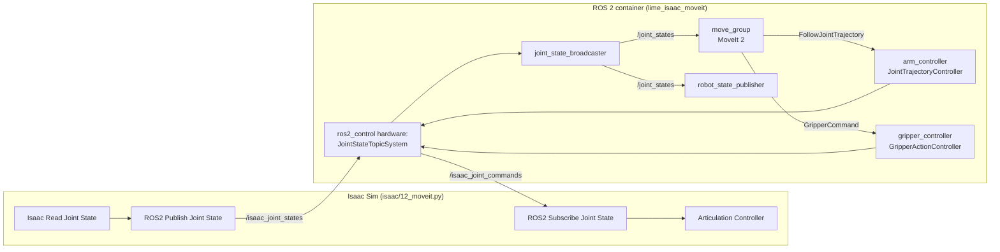
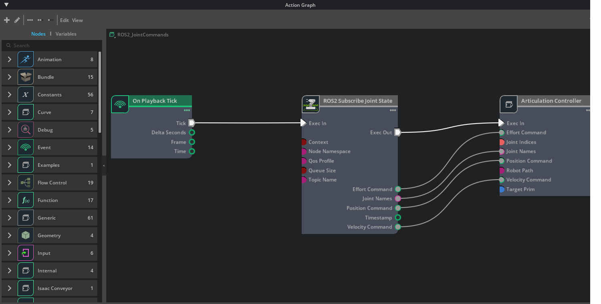
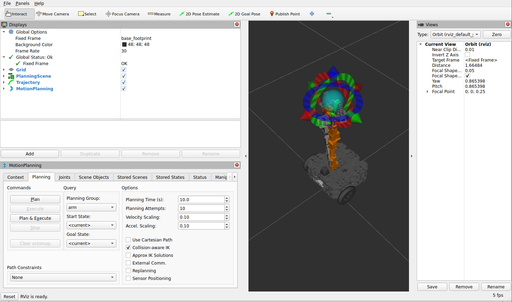

# 12 · MoveIt 2 でアームを制御 { #12-arm-control-with-moveit-2 }

<p class="tutorial-meta">⏱ 40 分 · レベル：中級 · スクリプト：<code>isaac/12_moveit.py</code> · ROS：<code>lime_isaac_moveit</code></p>

**目標：** **MoveIt 2** で Lime のアームの動作を計画・実行し、グリッパーを開閉します。ros2_control は 2 つのトピックを通して Isaac Sim とやり取りします。これは、実機のハードウェアドライバーとやり取りするときとまったく同じ方法です。

<figure class="result" markdown>
<video controls autoplay loop muted playsinline>
  <source src="../../../assets/video/tutorial12_moveit.mp4" type="video/mp4">
</video>
<figcaption>MoveIt が、折りたたんだ <code>home</code> 姿勢から手を伸ばした姿勢までの動作を計画し、グリッパーを開きます。実行するのは ros2_control、シミュレーションするのは Isaac Sim です。</figcaption>
</figure>

## 考え方 { #concepts }



- **ros2_control** は、コントローラーとハードウェアの間にある ROS 2 の標準的なレイヤーです。実機の Lime では、*ハードウェアコンポーネント*が Dynamixel サーボとやり取りします。ここでは、それが `joint_state_topic_hardware_interface/JointStateTopicSystem` です。これはジョイントの状態をあるトピックから読み取り、ジョイントへの指令を別のトピックに書き込みます。それらのトピックの向こう側にいるのが Isaac Sim です。
- **MoveIt 2** (`move_group`) は、OMPL で衝突のない軌道を計画し、`arm_controller` に送ります。グリッパーのゴールは `gripper_controller` に送られます。
- **トピックごとに持ち主は 1 つ：** このチュートリアル以降、`/isaac_joint_states` は Isaac Sim がパブリッシュし、`/joint_states` をパブリッシュするのは `joint_state_broadcaster` だけです。チュートリアル 07 では、まだ ros2_control がなかったので、Isaac Sim が `/joint_states` を直接パブリッシュしていました。

## Isaac Sim 側 { #isaac-sim-side }

=== "GUI"

    チュートリアル 07 のステージ `my_stages/07_odom_tf.usd` を開きます。続いて、次のようにします。

    1. チュートリアル 07 のグラフで、**ROS2 Publish Joint State ▸ topicName** を `/isaac_joint_states` に変更します。
    2. 新しい Action Graph を作り、`On Playback Tick` → `ROS2 Subscribe Joint State` (*topicName* `/isaac_joint_commands`) → `Articulation Controller` (*targetPrim* = `…/base_link`) とつなぎます。`execOut → execIn`、`jointNames → jointNames` を接続し、出力の `positionCommand`、`velocityCommand`、`effortCommand` をそれぞれ同じ名前の入力に接続します。
    3. **Play** を押します。

    { .full }

=== "Python (standalone)"

    ```bash
    source scripts/isaac_env.sh
    python isaac/12_moveit.py
    ```

    ```python
    graphs.create_odom_tf_joint_states_graph(articulation_root, joint_states_topic="/isaac_joint_states")
    graphs.create_joint_command_graph(articulation_root)   # /isaac_joint_commands -> Articulation Controller
    ```

    ??? example "`isaac/common/graphs.py` の `create_joint_command_graph()`"
        ```python
        --8<-- "isaac/common/graphs.py:create_joint_command_graph"
        ```

    ??? example "スクリプト全体：`isaac/12_moveit.py`"
        ```python
        --8<-- "isaac/12_moveit.py"
        ```

## ROS 側：RViz で計画する { #ros-side-plan-in-rviz }

```bash
./scripts/build_ws.sh                      # once, if you have not built the workspace yet
./docker/run_ros.sh ros2 launch lime_isaac_moveit moveit.launch.py
```

RViz の **MotionPlanning** パネルで、*Planning Group* を `arm` にし、インタラクティブマーカーをドラッグして（または `home` などの *Goal State* を選んで）から、**Plan & Execute** をクリックします。Isaac Sim でアームが動く様子を見てください。

{ .full }

## ROS 側：Python から計画する { #ros-side-plan-from-python }

`lime_isaac_moveit/scripts/arm_demo.py` は、MoveIt の `/move_action`（`moveit_msgs/action/MoveGroup`、*計画と実行*）にジョイントのゴールを送り、続いて `control_msgs/action/GripperCommand` を送ります。

```bash
./docker/run_ros.sh ros2 run lime_isaac_moveit arm_demo                         # reach forward, open
./docker/run_ros.sh ros2 run lime_isaac_moveit arm_demo --pose home --gripper close
```

```text
[lime_arm_demo]: arm -> [0.0, -0.6, 0.3, 0.0, 1.2, 0.0]: SUCCESS
[lime_arm_demo]: gripper -> 0.019 m: reached=True stalled=False at 0.0174
```

??? example "`arm_demo.py`"
    ```python
    --8<-- "ros2_ws/src/lime_isaac_moveit/scripts/arm_demo.py"
    ```

## Lime の MoveIt 設定を Humble から Jazzy へ移植する { #porting-the-limes-moveit-config-from-humble-to-jazzy }

upstream の `turtlebot3_lime_moveit_config` は、Humble と実機向けに書かれたものです。このチュートリアルで必要になった変更を以下に示します。最初の 2 つは Jazzy の移行ノートに書かれているもので、それ以外の行はすべて実際に動かしてみて見つけたものです。

??? info "9 つの問題とその対処"

    | 症状 | 原因 | 対処（`lime_isaac_moveit` 内） |
    |---|---|---|
    | `planning_plugin` / `default_planner_request_adapters/*` が見つからない | Jazzy で名前が変わった | Jazzy 形式の `ompl_planning.yaml`：`planning_plugins`、`default_planning_request_adapters/*`、`default_planning_response_adapters/*` |
    | `topic_based_ros2_control` が Jazzy では使えない | パッケージ名が変わった | `joint_state_topic_hardware_interface/JointStateTopicSystem`（パラメーターは同じ） |
    | `The requested state interface not found: 'wheel_left_joint/effort'`。ハードウェアが非アクティブになる | Isaac Sim の JointState には effort も入っていて、トピックシステムはすべてのフィールドをコピーする | `position`、`velocity` **に加えて** `effort` の状態インターフェースを宣言する |
    | アームがまったく動かない。Isaac Sim が「*ensure size of position … arrays match the number of actuators*」と警告する | 車輪（状態のみ）とアームが 1 つのコンポーネントに入っていた。そのため指令メッセージには名前が 9 個あるのに、位置は 7 個しかなかった | ハードウェアコンポーネントを 2 つに分ける：`IsaacArm`（指令あり）と `IsaacWheels`（状態のみ） |
    | MoveIt：`Start state out of bounds … joint3` | SRDF の `home` は `joint3 = 1.87` だが、URDF の制限は 1.8567 | `home` には 1.80 を使う。1.85 では、アームが数ミリラジアン垂れ下がっただけで、やはり制限に達してしまうことがある |
    | `No acceleration limit was defined for joint joint1` | Jazzy の時間パラメーター化には加速度の制限が必要 | `max_acceleration` を含む独自の `joint_limits.yaml` |
    | アームが動いていないのに「SUCCESS」になる | ゴールの許容誤差がないと、軌道コントローラーは時間が過ぎた時点で成功を報告する | `arm_controller.constraints.<joint>.goal: 0.05` |
    | グリッパーがすぐに「stalled at 0.0」になる | 指が動き出す前にストール検出が働いた | `stall_timeout: 2.0`、`stall_velocity_threshold: 0.0005` |
    | 一度だけ発生：`Switch controller timed out after 5 seconds!` と出て spawner が終了し、MoveIt にアームとグリッパーのコントローラーがない状態になる | コントローラーの有効化に、spawner のデフォルトの 5 s より長くかかった（Isaac Sim、YOLO、RViz を同時に動かしていて PC が忙しかった） | `moveit.launch.py` で spawner に `--switch-timeout 30` を指定 |

!!! warning "シミュレーションは一度に 1 つだけ"
    Isaac Sim のインスタンスが 2 つ動いていると、両方が `/clock` をパブリッシュします。すると、すべての ROS ノードで時間が前後に飛ぶようになり（「*Detected jump back in time. Clearing TF buffer.*」）、計画がおかしな形で失敗します。古い実行は `tools/stop_isaac.sh` で、古い ROS のプロセスは `docker/ros_clean.sh` で止めてください。

## 自動チェック { #automatic-check }

`python isaac/12_moveit.py --headless --test` は、シミュレーション上のアームが `arm_demo` の姿勢に（0.05 rad 以内で）到達し、グリッパーが開くまで待ちます。確かめているのはコントローラーの報告ではなく、Isaac Sim の中の実際のジョイントの状態です。

```text
[12] arm reached the demo pose (max error 0.012 rad), gripper open 0.0154 m
[12][test] MoveIt plan executed in Isaac Sim: PASS
```

`tools/run_all_checks.sh 12` を使うと、MoveIt と `arm_demo` がコンテナの中で自動的に起動します。

**次へ：** [13 · ピック＆プレース](13-all-together.md)
