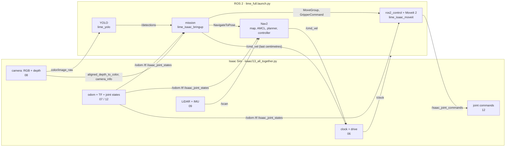
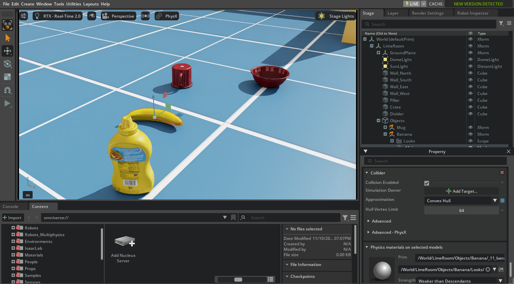
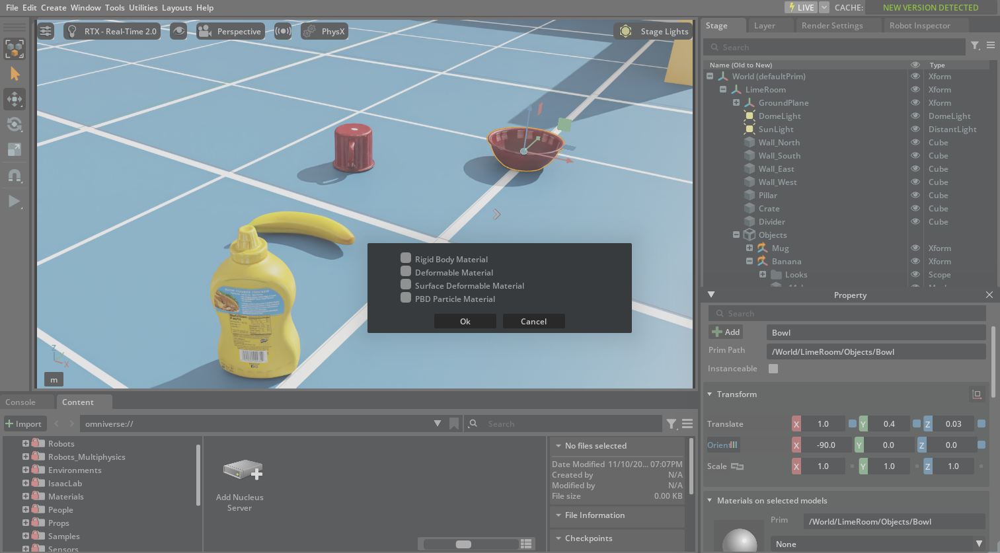
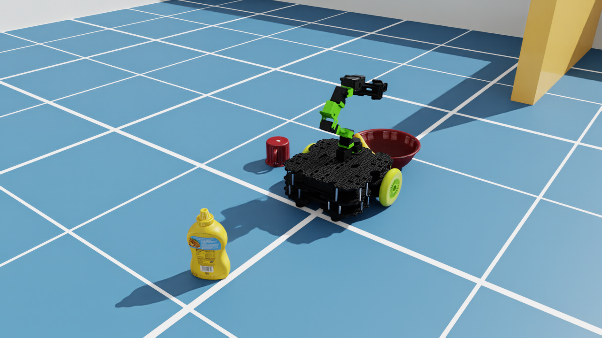
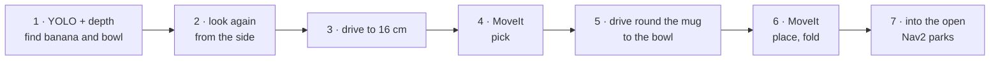
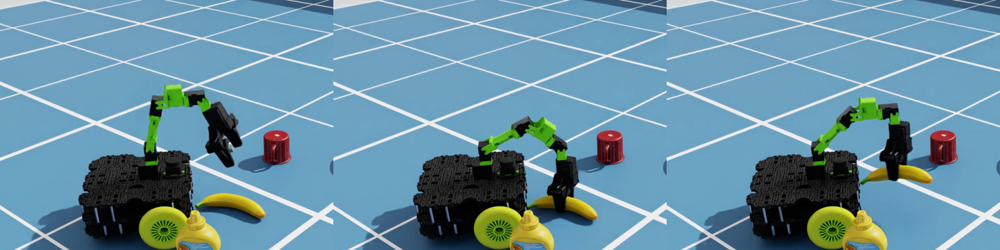

# 13 · ピック＆プレース { #13-pick-and-place }

<p class="tutorial-meta">⏱ 45 分 · レベル：中級 · スクリプト：<code>isaac/13_all_together.py</code> · ROS：<code>lime_full.launch.py</code>、<code>mission</code></p>

**目標：** シミュレーション上の TurtleBot3 Lime を、すべてそろった状態で動かします。チュートリアル 06〜12 のすべてのセンサーとグラフに加えて、MoveIt 2、Nav2、YOLO を同時に動かします。そのうえで、**バナナを見つけて拾い上げ、ボウルに入れてから駐車する**という仕事を与えます。2D の検出が 3D の位置になり、ロボットがそこまで正確に走り、アームがそれを把持する、という各部分のつながりがわかります。

<figure class="result" markdown>
<video controls autoplay loop muted playsinline>
  <source src="../../../assets/video/tutorial13_all_together.mp4" type="video/mp4">
</video>
<figcaption>ミッション：YOLO と深度カメラがバナナを見つけ、Lime がそこまで走り、MoveIt がバナナを拾い上げます。ロボットはバナナをボウルまで運んで中に落とし、最後に Nav2 がロボットを奥の隅に駐車します。</figcaption>
</figure>

## システム全体 { #the-whole-system }



!!! info "robot_state_publisher は 1 つだけ"
    `lime_full.launch.py` は `lime_isaac_moveit/moveit.launch.py` をインクルードし、これが唯一の `robot_state_publisher` を起動します。その URDF には ros2_control のブロックも含まれています。Nav2 の bringup は `navigation.launch.py` を介さずに直接インクルードしているので、2 つ目の `robot_state_publisher` が起動することはありません。`/joint_states` は `joint_state_broadcaster` からしか来ません（[チュートリアル 12](12-moveit2.md) を参照）。

## 拾い上げられる物体 { #objects-you-can-pick-up }

チュートリアル 08〜10 では、床の上の物体はカメラに映る絵にすぎず、コライダーも質量もありませんでした。ここでは物体が実体を持ちます (`add_object_physics`)。コライダーと質量があるので、ロボットは物体をすり抜けられず、ロボットがぶつかれば物体は倒れます。物体を拾い上げるには、さらに 2 つのものが必要です。バナナが入るボウルと、滑りにくい指です。

| 物体 | 物理設定 | 理由 |
|---|---|---|
| バナナ | 剛体、66 g、*convex decomposition*（凸分解）のコライダー | 落ちたり、押されたり、持ち上げられたりする必要がある。凸包 1 つだと、曲がったバナナが幅 7 cm の塊になり、グリッパーで挟むには幅が広すぎる |
| マグカップ、マスタードのボトル | 剛体、118 g と 603 g。マグカップは *convex decomposition*、ボトルは *convex hull*（凸包） | ロボットがぶつかれば倒れる。デフォルトの凸包では、マグカップが 5 s で床の上を勝手に 16 cm 動いた。凸分解にすると静止したままになる |
| ボウル | 静的なコライダー、*none*（三角形メッシュそのもの）。このチュートリアルでは **1.5 倍の大きさ** | くぼみの中にバナナを収める必要がある。19 cm のバナナは、元の 16 cm のボウルには入らない |
| 指 + バナナ | 物理マテリアル、摩擦 1.0（このチュートリアルで設定） | ゴムのようなパッドにして、10 N で挟めばバナナを保持できるようにする |

=== "GUI"

    `assets/scenes/lime_room.usda` を開き、Property パネルの **+ Add** ボタンを使います。

    1. `/World/LimeRoom/Objects/Banana` を選びます。**+ Add ▸ Physics ▸ Rigid Body with Colliders Preset** を選び、続いて **+ Add ▸ Physics ▸ Mass** を選んで、*Mass* を 0.066 にします。`Mug` (0.118) と `Bottle` (0.603) にも同じことをします。ボトルは *Convex Hull* のままでかまいません。マグカップのメッシュにも **Convex Decomposition** を設定します（手順 2）。
    2. Stage パネルでバナナを展開し、そのメッシュを選びます。プリセットによって **Convex Hull** のコライダーが付いています。*Approximation* を **Convex Decomposition** に変更します。

        { .full }

    3. ボウルを選びます。*Scale* を 1.5、*Translate Z* を 0.044 にして、床の上に立ったままになるようにします。次に **+ Add ▸ Physics ▸ Colliders Preset** を選びます。これで近似が *None*（三角形メッシュそのもの）の静的なコライダーになります。決して動かない物体なら、これを使ってかまいません。
    4. **Create ▸ Physics ▸ Physics Material** を選び、**Rigid Body Material** にチェックを入れて **Ok** をクリックします。その静止摩擦と動摩擦を 1.0 にします。バナナのメッシュをもう一度選び、その **Physics materials on selected models** セクションで新しいマテリアルを選びます（このセクションはコライダーのプリムにしか表示されません）。

       指にも同じマテリアルが必要ですが、ロボットの指のコライダー `gripper_left_palm` と `gripper_right_palm` は*インスタンス化*されています。つまり、共有された読み取り専用のコピーなので、GUI からは変更できません。Python 版では、1 つ上の階層の `gripper_left_link` と `gripper_right_link` にマテリアルをバインドしています。このバインドは、その下にあるすべてのコライダーに適用されます。

        { .full }

    **Play** を押し、**Shift + マウスの左ボタン**でバナナをドラッグします。バナナが落ちて転がるようになりました。

    作業内容を残すには、**Stop** ■ を押し、**File ▸ Save As** で `my_stages/13_pick_and_place.usd` として保存します。`lime_room.usda` には上書きしないでください。チュートリアル 08 と 11 の GUI タブがこのファイルを開きます。

=== "Python (standalone)"

    `13_all_together.py` は、`object_physics=True` を指定して lime_room を作ります。

    ??? example "`add_object_physics()`：すべての物体にコライダーと質量を与える"
        ```python
        --8<-- "isaac/common/scene.py:add_object_physics"
        ```

    そのあと、ボウルと指のための関数を 1 つ追加で呼び出します。

    ```python
    --8<-- "isaac/common/scene.py:setup_pick_and_place"
    ```

## 実行してみる { #run-it }

ターミナル 1 で Isaac Sim を起動します。

```bash
source scripts/isaac_env.sh
python isaac/13_all_together.py
```

ターミナル 2 で ROS 2 のスタックと RViz を起動します（「*Managed nodes are active*」と「*You can start planning now!*」が表示されるまで待ちます。RViz なしで起動するには `rviz:=false` を付けます）。

```bash
./scripts/build_ws.sh
./docker/run_ros.sh ros2 launch lime_isaac_bringup lime_full.launch.py
```

ターミナル 3 でミッションを実行します（初回の起動時には、ターミナル 2 で約 40 MB の `yolo11m.pt` がダウンロードされます）。

```bash
./docker/run_ros.sh ros2 run lime_isaac_bringup mission
```

```text
YOLO: banana (0.88) at (0.75, -0.11), bowl (0.70) at (0.96, 0.41)
YOLO: banana (0.92) at (0.792, -0.123), pointing 19 deg
MoveIt: above the banana: done
MoveIt: down to the banana: done
MoveIt: lift: done
MoveIt: carry: done
YOLO: bowl (0.67) at (0.998, 0.377), radius 9 cm
MoveIt: above the bowl: done
MoveIt: arm folded: done
Nav2: parking at (2.8, -1.8)
mission complete: the banana is in the bowl
```

シミュレーションでのバナナの実際の位置は (0.800, −0.121)、向きは 20° で、ボウルは (1.0, 0.4) にあります。スタート地点からの 1 回目の観測は、5 cm 手前にずれています。横からの 2 回目の観測は誤差 1 cm 以内で、把持するには十分な精度です。

{ .full }

## ミッションのしくみ { #how-the-mission-works }



??? example "ミッションの主要部分：`lime_isaac_bringup/scripts/mission.py`"
    ```python
    --8<-- "ros2_ws/src/lime_isaac_bringup/scripts/mission.py:mission"
    ```

### 1. 2D のボックスから 3D の点へ { #1-from-a-2d-box-to-3d-points }

!!! note "より大きな YOLO"
    `lime_full.launch.py` は、チュートリアル 10 の `yolo11n.pt` (nano) ではなく **`yolo11m.pt`** (medium) を実行します。低い位置にあるカメラから見ると、バナナは平たい黄色の三日月形です。nano モデルはこれを *frisbee* (0.44) と判定し、small モデルは 0.46 でバナナ、medium モデルは 0.88 でバナナと判定します（チュートリアル 10 では、nano モデルでも 0.40 でバナナを見つけられます。ここではバナナに物理が設定されていて数ミリメートル違う姿勢で静止するので、nano モデルの答えが *frisbee* に変わってしまいます）。medium モデルは CPU で 1 枚あたり約 75 ミリ秒かかりますが、毎秒 5 枚なら問題ありません。モデルは `yolo_model:=...` で選べます。

YOLO の答えは「*バナナ、0.9、このボックスの中*」で、単位はメートルではなくピクセルです。位置合わせ済みの深度画像（チュートリアル 08）には、各ピクセル $(u, v)$ について、カメラの光軸方向の距離 $z$ が入っています。`camera_info` のカメラモデルを使うと、これをカメラの光学フレームでの 3D の点に変換できます。

$$
x = \frac{(u - c_x)\,z}{f_x}, \qquad y = \frac{(v - c_y)\,z}{f_y}, \qquad z = z
$$

次に TF で、点を `camera_color_optical_frame` から `odom` フレームに移します。このとき、**画像が撮影された瞬間の変換を使います**（検出のタイムスタンプ）。ロボットはそのあと動いているかもしれません。床の上の点 ($z \approx 0$) は捨てます。残るのは、その物体の小さな点群です。

??? example "`Lime.locate()`"
    ```python
    --8<-- "ros2_ws/src/lime_isaac_bringup/scripts/mission.py:locate"
    ```

### 2. 正確にはどこにあるか { #2-where-exactly-is-it }

カメラには物体の手前側しか見えないので、形ごとに小さなルールを用意します。

- **バナナ（細長い物体）：** バナナの向きは点群の主軸（主成分分析）で求め、グリッパーはバナナを*横切る*向きに閉じます。把持点は**長さの中央**、つまり両端のちょうど中間です。単純な点の平均ではありません。カメラに近い側の端のほうが深度ピクセルが多く、平均をそちらに引き寄せてしまうからです。
- **ボウル（丸い物体）：** 中心は、見えている点の真ん中にはありません。見えている点はすべて手前側にあるからです。中心は視線の方向に半径 1 つ分だけ奥にあり、半径は見えている幅の半分です。

??? example "`long_object()` と `round_object()`"
    ```python
    --8<-- "ros2_ws/src/lime_isaac_bringup/scripts/mission.py:shapes"
    ```

### 3. 最後の数センチ：オドメトリで走る { #3-the-last-centimetres-drive-with-odometry }

真下を向いた状態でアームが床に届くのは、`base_footprint` の前方約 12〜20 cm の範囲だけです。Nav2 はゴールの許容誤差 25 cm 以内で停止します。駐車にはこれで十分ですが、把持には粗すぎます。そこで短い移動では、ミッションが自分でロボットを走らせます。目標のほうを向き、まっすぐ走り、1 cm 以内の誤差で止まります。`/cmd_vel` をパブリッシュし、姿勢は TF（`odom → base_footprint`、Isaac Sim のオドメトリ）から読み取ります。ロボットがバナナを運んでいることもあるので、速度はゆっくり変えます。

2 つのルールで、これを単純に保っています。

- **横から見て、あとは見ずに走る：** スタート地点からは、カメラにはバナナがほぼ端の方向から見えるので、奥の半分が手前の半分に隠れてしまいます（推定値は 5 cm 手前にずれました）。そこでロボットは、45 cm 離れ、55° 回り込んだ位置からもう一度見ます。そのあと、最後の 30 cm は見ずに走ります。近づくと、低い位置のカメラではバナナがきちんと見えなくなります（16 cm では画像の下端でバナナが切れます）。また、チュートリアル 07 では、0.8 m 走ったあとの Isaac Sim のオドメトリの誤差は 3 mm 以内でした。
- **物体は自分で回り込む：** これらの短い走行では Nav2 を使わないので、マグカップを回り込む経路を計画してくれるものはありません。そこでミッションは、ボウルのふさがっていない側から近づきます。
- **開けた場所で Nav2 に引き継ぐ：** バナナを落としたあと、ロボットはマスタードのボトルのすぐ隣にいます。Nav2 にはボトルが見えていますが、このミッションの最初のバージョンでは、これほど近くから出発したために、ボトルを突き抜けてまっすぐ走ってしまいました。そこでミッションは、ボウルから後退し、部屋の中央の開けた場所へ 60 cm 走ってから Nav2 に引き継ぎます。

??? example "`turn_to()`、`drive_to()`、`to_base()`"
    ```python
    --8<-- "ros2_ws/src/lime_isaac_bringup/scripts/mission.py:base"
    ```

### 4. 真上からの把持：紙の上で解く逆運動学 { #4-a-top-down-grasp-inverse-kinematics-on-paper }

真上から把持する場合、Lime の 6 ジョイントのアームは単純になります。

- `joint1` は物体のほうを向きます。
- `joint2`（肩）と `joint3`（肘）は、長さ $L_1 = 12.4$ cm と $L_2 = 10.45$ cm の**平面 2 リンクアーム**になります。手首は `end_effector_link` の $L_3 = 16.25$ cm 上に来ます（指先はさらに 2 cm 下まで届きます）。
- `joint5` は 3 つの傾きの合計を 180° にして、グリッパーが真下を向くようにします。
- `joint6` は、指がバナナを横切る向きになるように回します。

$r$ を水平距離、$d_z$ を肩から見た手首の高さとすると、余弦定理から肘の角度が求まります。

$$
\cos\theta_3 = \frac{r^2 + d_z^2 - L_1^2 - L_2^2}{2 L_1 L_2}, \qquad
\theta_2 = \operatorname{atan2}(r, d_z) - \operatorname{atan2}(L_2 \sin\theta_3,\; L_1 + L_2 \cos\theta_3), \qquad
\theta_5 = \pi - \theta_2 - \theta_3
$$

ミッションはこれらのジョイント角を計算し、**ジョイントのゴールとして MoveIt に**渡します。計画は引き続き MoveIt が行い、ジョイントの制限を守った、衝突のないなめらかな軌道を作ります（ミッションは最初に、MoveIt のプランニングシーンに床を追加します）。把持では、`end_effector_link` を床から 10 cm の高さに置き、次に 3 cm まで下げ（このとき指先は床から約 1 cm 上にあります）、グリッパーを閉じて、15 cm まで持ち上げます。

{ .full }

*バナナの上へ、下げて閉じる、持ち上げる。曲がったバナナを 2 本の指でつまむと、そこが蝶番のように働くので、アームが動くとバナナが揺れることがあります（動画を見てください）。それでも、バナナはしっかり保持されています。*

??? example "`top_down_ik()`"
    ```python
    --8<-- "ros2_ws/src/lime_isaac_bringup/scripts/mission.py:ik"
    ```

!!! note "なぜ姿勢のゴールを使わないのか"
    MoveIt は逆運動学を自分で解くこともできます (`kinematics.yaml`, KDL)。しかし Lime の MoveIt の設定は `position_only_ik: True` を使っていて、これはグリッパーの向きを無視するため、「真下を向く」という姿勢のゴールは守られません。真上からの把持なら、上の解析解は正確で、すぐに求まり、確かめるのも簡単です。

### 5. つかみ続ける { #5-holding-on }

グリッパーには完全に閉じた位置 (−1 cm) を指令し、指がバナナに触れたところでグリッパーは止まります。`GripperActionController` は閉じた位置を指令し続けるので、位置ドライブ（チュートリアル 03：剛性 1000 N/m、最大 10 N）は、アームが持ち上げている間もロボットが走っている間も、バナナを挟み続けます。

コントローラーは、*ストール*（指の速度がほぼ 0 の状態が 2 秒続くこと）を検出すると、ゴールを完了させるはずです（チュートリアル 12 の `ros2_controllers.yaml` にある `allow_stalling: true`）。しかしシミュレーションでは、物体を押している指は、位置が変わらないのに速度（ここでは約 0.3 m/s）を報告するので、ストールが検出されることはありません。そこでミッションは、グリッパーを最大 3 秒だけ待ってから先に進みます。ゴールはアクティブのまま残り、次のグリッパーへの指令（ボウルの上で開く）がそれを置き換えます。

## 自動チェック { #automatic-check }

`python isaac/13_all_together.py --headless --test` は、シミュレーションの正解（ground truth）を使ってミッションの進み具合を追跡します。

```text
[13] ground truth: banana at [ 0.8   -0.121], bowl at [1.  0.4]
[13] banana lifted (10 cm above the floor) at t = 47 s
[13] banana in the bowl, 4.9 cm from its centre at t = 71 s
[13] arm folded at t = 73 s
[13] robot parked in the far corner at t = 98 s
[13][check] ok   banana picked up (more than 10 cm above the floor)
[13][check] ok   banana put into the bowl (within 7 cm of its centre)
[13][check] ok   arm folded afterwards
[13][check] ok   robot parked in the far corner (within 0.3 m)
[13][check] ok   banana still in the bowl at the end (4.9 cm from its centre)
[13][check] ok   mug not bumped into (moved 0.0 cm)
[13][check] ok   bottle not bumped into (moved 0.0 cm)
[13][test] PASS
```

バナナはボウルの中心から約 5 cm 手前に落ちます。伸ばしたアームは、その高さではロボットの前方 18 cm までしか届かないからです（joint5 の制限）。ボウルの半径は 12 cm です。

## 作成中にうまくいかなかったこと（とその対処） { #things-that-went-wrong-while-building-this-and-the-fixes }

??? info "11 の問題とその対処"

    | 症状 | 原因 | 対処 |
    |---|---|---|
    | 把持が 2 cm ずれ、ロボットの向きが 6° 変わっていた | アームの目標値が 1 ステップで跳び、その衝撃でロボットが回転した | アームは常になめらかに動かす（MoveIt の軌道ならそうなる） |
    | 持ち上げたときにバナナが滑り落ちた | デフォルトの摩擦が 0.5 で、しかもバナナを中心から外れた位置で把持していた | ゴムのような摩擦 1.0 にし、点群の中央で把持する |
    | 指がバナナを囲むように閉じられなかった | `convexHull` によって、曲がったバナナが 7 cm の塊になっていた | `convexDecomposition` |
    | バナナがボウルの縁に乗ってしまった | 19 cm のバナナに 16 cm のボウル | 1.5 倍のボウルにし、バナナをロボットに対して横向きにして放す |
    | YOLO：バナナではなく *frisbee* | 床から 5.8 cm の高さから見た、平たい三日月形 | medium モデルの `yolo11m.pt` |
    | バナナの推定位置が 5 cm 手前にずれた | 端の方向から見ると、奥の半分が手前の半分に隠れる | 横からもう一度見る。長さの中央を使う |
    | グリッパーを閉じたあと、ミッションが止まった | 挟んでいる指が速度を報告するので、コントローラーがストールを検出しない | グリッパーは最大 3 s だけ待つ |
    | マグカップが勝手に床の上を動いた | 凸包（convex hull）のコライダー（マグカップのメッシュは底が平らなので、原因はモデルではなく凸包） | マグカップに `convexDecomposition` |
    | 駐車に向かう途中で、ロボットがマスタードのボトルを突き抜けた | ボトルにコライダーがなく、しかも Nav2 がボトルのすぐ隣から出発した | マグカップとボトルにコライダーを付け、Nav2 に引き継ぐ前に開けた場所まで走る |
    | 走行後に MoveIt：`Start state out of bounds … joint3` | 折りたたみ姿勢 (`joint3` = 1.85) が垂れ下がり、ジョイントの制限 (1.8567) に達した | `joint3` = 1.80 で折りたたむ（チュートリアル 03 の初期姿勢と SRDF の値） |
    | ときどき、開始直後に「*amcl/get_state service not available, waiting...*」と出たあと、ミッションが止まった | サービスが現れた直後は、DDS がまだ両側をマッチングしていないことがあり、最初のリクエストが失われる。すると `BasicNavigator.waitUntilNav2Active()` は応答をいつまでも待ち続ける | `mission.py` の `wait_until_nav2_active()`：同じ処理を、リクエストごとの 2 s のタイムアウトとリトライ付きで行う |

## この先へ { #where-to-go-from-here }

- **ほかの物体：** `locate()` は、YOLO の 80 クラスのどれにでも使えます。バナナと同じように物体に物理を設定し、その形に合った把持のルールを選んでください。
- **横から把持する：** ボトルのような背の高い物体には、水平向きのグリッパーが必要です。条件 $\theta_2 + \theta_3 + \theta_5 = \pi$ を $\pi/2$ に変え、手首 $L_3$ を把持点の上ではなく手前に置きます。
- **自分の検出器を学習させる：** Isaac Sim の Replicator を使えば、lime_room のラベル付き画像を何千枚もレンダリングできます。
- **実機：** ROS 側は実機の Lime と同じトピック名とフレーム名を使っているので、実機への移行は、おもにシミュレーションを実機のドライバーに置き換えるだけで済みます（`JointStateTopicSystem` の代わりに Lime 自身の ros2_control ハードウェアを使い、さらに RealSense と LDS のドライバーを使います）。これは実機の Lime ではテストしていません。

??? example "launch ファイル：`lime_isaac_bringup/launch/lime_full.launch.py`"
    ```python
    --8<-- "ros2_ws/src/lime_isaac_bringup/launch/lime_full.launch.py"
    ```

??? example "Isaac Sim 側：`isaac/13_all_together.py`"
    ```python
    --8<-- "isaac/13_all_together.py"
    ```

??? example "ミッション全体：`lime_isaac_bringup/scripts/mission.py`"
    ```python
    --8<-- "ros2_ws/src/lime_isaac_bringup/scripts/mission.py"
    ```

**次へ：** [14 · SLAM で自分の地図を作る](14-slam.md)。チュートリアル 16 はこのチュートリアルの続きです。ロボットはまず 3 本のバナナを探し出さなければならず、全体がビヘイビアツリーで動きます。
