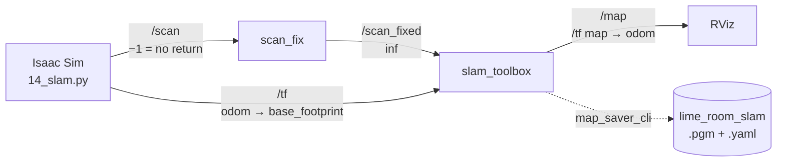
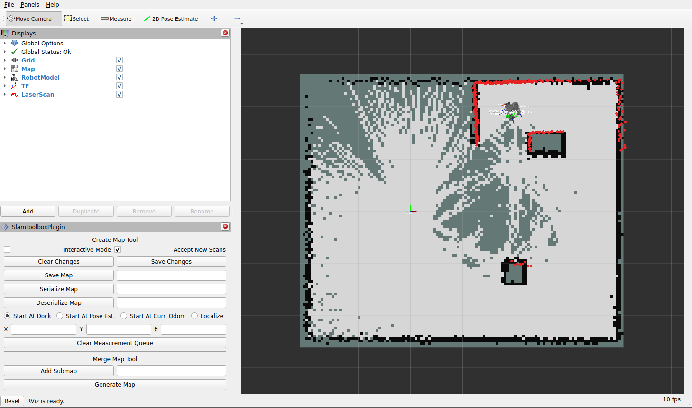
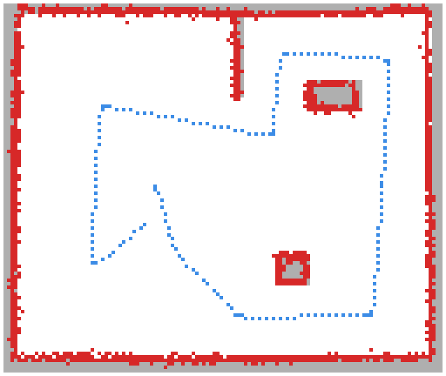

# 14 · SLAM で自分の地図を作る { #14-make-your-own-map-with-slam }

<p class="tutorial-meta">⏱ 30 分 · レベル：中級 · スクリプト：<code>isaac/14_slam.py</code> · ROS：<code>lime_isaac_bringup/slam.launch.py</code>、<code>scan_fix</code></p>

**目標：** チュートリアル 11 では、Isaac Sim がシーンから直接地図を計算しました。実機ではそうはいきません。実機は走り回り、自分がどこにいるかを推定しながら、自分の LiDAR で地図を作る必要があります。これが **SLAM**（*simultaneous localisation and mapping*、自己位置推定と地図作成の同時実行）です。このチュートリアルでは、Nav2 が使う SLAM パッケージである **slam_toolbox** で lime_room の地図を作り、その地図を保存して Isaac Sim の地図と比べ、その地図でナビゲーションします。

<figure class="result" markdown>
<video controls autoplay loop muted playsinline>
  <source src="../../../assets/video/tutorial14_slam.mp4" type="video/mp4">
</video>
<figcaption>左：Lime が lime_room を巡回します。右：走るにつれて広がっていく slam_toolbox の地図 (<code>/map</code>) と、ロボットの真の位置（緑）。</figcaption>
</figure>

## 考え方 { #concepts }

車輪のオドメトリは、ロボットがどれだけ走ったかを教えてくれます。しかし実機ではドリフトします。車輪は滑り、小さな誤差が積み重なっていくからです。slam_toolbox は LiDAR を使ってこれを補正します。

- **スキャンマッチング：** 新しいスキャンを、それ以前のスキャンと重ね合わせます。最もよく一致する位置が、ロボットが実際にいる位置です。
- **ループクロージャ：** ロボットが以前に見た場所に戻ってくると、slam_toolbox はその場所を認識し、その間の経路全体を補正します。

slam_toolbox は地図 `/map` と、TF `map → odom` をパブリッシュします。`map → odom` は、オドメトリが考えるロボットの位置と、ロボットが実際にいる位置との間の補正です。これはチュートリアル 11 で AMCL が行うのと同じ仕事ですが、最初に地図がない状態から行います。

| | チュートリアル 11 (Nav2) | チュートリアル 14 (SLAM) |
|---|---|---|
| 地図 | Isaac Sim がコライダーから計算します | 走行中に slam_toolbox が `/scan` から作ります |
| `map → odom` | AMCL（既知の地図の中で自己位置推定します） | slam_toolbox |
| Isaac Sim 側 | `/clock`、`/cmd_vel`、`/odom`、`/tf`、`/joint_states`、`/scan` | 同じです。新しいものはありません |



運転は `teleop_twist_keyboard` (`/cmd_vel`) で行うか、スクリプトに任せます。

!!! warning "Isaac Sim の LiDAR は「何もない」を −1 と書き、slam_toolbox はそれを扱えません"
    ビームが 3.5 m 以内で何にも当たらないと、Isaac Sim の RTX LiDAR は距離 **−1.0** を報告します（チュートリアル 09）。ROS の規約（[REP 117](https://ros.org/reps/rep-0117.html)）では **+inf** です。チュートリアル 11 の AMCL とコストマップは −1 でも問題なく動きますが、slam_toolbox のスキャンマッチャーが無視するのは `inf` と `NaN` だけです。スキャンマッチャーは −1 をすべて、**そのビーム自身の反対側、1 m 先にある点**に変えてしまいます。巡回中、これは 360 本のビームのうち 30〜150 本、典型的には 85 本に上ります。どのスキャンにも幻の点が含まれるということです。この点はロボットと一緒に動き、スキャンマッチャーを後ろに引き戻します。

    対策は小さなノード `scan_fix` です。このノードは、`/scan` の −1 をすべて `inf` に置き換えて `/scan_fixed` として再パブリッシュします。`slam.launch.py` がこのノードを起動し、slam_toolbox は `/scan_fixed` を読みます。

    −1 がどれだけ悪影響を与えるかは、slam_toolbox がどのくらいの頻度でスキャンを地図に追加するか（`minimum_travel_distance`、`minimum_travel_heading`）によって変わります。記録した同じ巡回を slam_toolbox に再生して入力すると、巡回中の最大の姿勢誤差（と最後の誤差）は次のようになります。

    | slam_toolbox がスキャンを追加する間隔 | −1 を含む `/scan` | inf に置き換えた `/scan_fixed` |
    |---|---|---|
    | 0.2 m または 0.3 rad | **137 cm** (136 cm, 25°)：地図がねじれます | 13 cm (8.5 cm, 1.2°) |
    | 0.5 m または 0.5 rad（デフォルト、ここで使用） | 11 cm (11 cm, 2.0°) | **7 cm (2.4 cm, 1.0°)** |

    ```python
    --8<-- "ros2_ws/src/lime_isaac_bringup/scripts/scan_fix.py:scan_fix"
    ```

## パート 1：シミュレーションを起動する { #part-1-start-the-simulation }

!!! note "地図を作る前に床を片付ける"
    地図は、動かないもののためのものです。壁、柱、箱、仕切りなどです。SLAM には、それらとマスタードのボトルの区別がつきません。SLAM は LiDAR に見えるものをすべて地図に入れます。LiDAR は床から 16 cm の高さをスキャンし、ボトルの高さは 19 cm なので、ボトルは小さな柱のように地図に入ってしまいます。あとでボトルを動かしても、Nav2 はボトルがあった場所を避けて経路を計画し続けます。一方で AMCL は、もう合わなくなった地図とスキャンを比べることになります。

    そこで、実際の部屋の地図を作る前と同じように、まず片付けます。このチュートリアルでは、4 つの物体は床に置いていません。現れたり消えたりするものは、コストマップの担当です。Nav2 はリアルタイムの LiDAR でそれらを捉えます（パート 5）。

=== "GUI"

    Isaac Sim 側で新しく必要なものはありませんが、すべての部品を 1 つのステージにまとめる必要があります。

    1. チュートリアル 09 のステージ `my_stages/09_lidar_imu.usd` を開きます。lime_room、ロボット、LiDAR のグラフ (`/scan`) が入っています。
    2. 床を片付けます。**Stage** パネルで `/World/LimeRoom/Objects` を選び、**Delete** を押します（保存する場合は、チュートリアル 09 のステージに物体が残るように、`my_stages/14_slam.usd` のような新しい名前を使ってください）。
    3. チュートリアル 06 で作ったグラフ (`/clock`、`/cmd_vel`) と、チュートリアル 07 で作ったグラフ (`/odom`、`/tf`、`/joint_states`) を、そのときと同じ方法で追加します。
    4. **Play** を押します。

    クリックする箇所がたくさんあります。Python スクリプトなら、4 回の関数呼び出しで同じステージを作れます（もう一方のタブ）。

=== "Python (standalone)"

    ```bash
    source scripts/isaac_env.sh
    python isaac/14_slam.py                # you drive
    python isaac/14_slam.py --auto-drive   # the script drives a tour of the room for you
    ```

    スクリプトは、チュートリアル 11 と同じロボットとグラフを、物体のない lime_room の中に作ります (`build_lime_room(stage, with_objects=False)`)。

    ```python
    graphs.create_clock_graph()                                     # 06  /clock
    graphs.create_drive_graph(articulation_root)                    # 06  /cmd_vel
    graphs.create_odom_tf_joint_states_graph(articulation_root)     # 07  /odom /tf /joint_states
    graphs.create_lidar_graph(sensors.add_lds_lidar(robot_path))    # 09  /scan
    ```

    `--auto-drive` を付けると、すべての障害物の両側を通る、決まった巡回ルートをたどります。自動運転にはシミュレーションから得た真の位置を使いますが、slam_toolbox がその位置を目にすることはありません。

    ```python
    --8<-- "isaac/14_slam.py:route"
    ```

    ??? example "スクリプト全体：`isaac/14_slam.py`"
        ```python
        --8<-- "isaac/14_slam.py"
        ```

## パート 2：部屋の地図を作る { #part-2-map-the-room }

ターミナル 2 では slam_toolbox + RViz を起動します。

```bash
./scripts/build_ws.sh lime_isaac_bringup     # (again) - installs the new scan_fix node
./docker/run_ros.sh ros2 launch lime_isaac_bringup slam.launch.py
```

ターミナル 3 では運転します（`--auto-drive` の場合は不要です）。

```bash
./docker/run_ros.sh ros2 run teleop_twist_keyboard teleop_twist_keyboard
```

RViz では、ロボットの周りに地図が現れ、走るにつれて広がっていきます。

<div class="callouts" markdown>
{ .full }
<span class="callout" style="left: 77.8%; top: 23.8%" aria-hidden="true">1</span>
<span class="callout" style="left: 52.1%; top: 71.9%" aria-hidden="true">2</span>
<span class="callout" style="left: 47.3%; top: 60.3%" aria-hidden="true">3</span>
<span class="callout" style="left: 48.0%; top: 23.2%" aria-hidden="true">4</span>
<span class="callout" style="left: 85.7%; top: 17.4%" aria-hidden="true">5</span>
<span class="callout" style="left: 26.0%; top: 55.1%" aria-hidden="true">6</span>
</div>

*巡回の途中の RViz (`slam.rviz`)：*

1. **ロボット**：上のほう、仕切りと箱の間にいます。
2. **ここまでの地図の空き領域**（明るい灰色）。
3. **壁**（黒）。
4. **まだ見ていない領域**（暗い灰色）。
5. **LiDAR スキャン**（赤い点）。
6. **slam_toolbox 自身のパネル**。

!!! tip "よい地図を作るための運転のコツ"
    - **ゆっくり、特に旋回はゆっくり：** LiDAR の 1 回転には 0.2 秒かかり、その間にロボットはあまり動かないほうがよいのです。巡回ルートでは 0.2 m/s と 0.2 rad/s を使っています。
    - **どの壁も近くから見る：** LDS-01 は 3.5 m までしか届きません。
    - **スタート地点に戻ってくる：** これでループが閉じ、slam_toolbox が地図全体をまっすぐに補正します。

## パート 3：地図を保存する { #part-3-save-the-map }

slam_toolbox がまだ動いている間に実行します。

```bash
./docker/run_ros.sh bash -c 'mkdir -p /lime/my_maps && ros2 run nav2_map_server map_saver_cli -f /lime/my_maps/lime_room_slam --ros-args -p use_sim_time:=true'
```

これで、リポジトリ内に `my_maps/lime_room_slam.pgm` と `.yaml` が書き出されます。チュートリアル 11 の地図と同じ形式なので、Nav2 で使えます。

## パート 4：Isaac Sim の地図と比べる { #part-4-compare-with-isaac-sims-map }

シミュレーションでは正解がわかっているので、SLAM の地図を採点できます。灰色はチュートリアル 11 の Isaac Sim の地図、赤は slam_toolbox が見つけたもの、青はロボットの経路です。

{ width="520" }

*SLAM の壁セルの 99.5 % は実際の壁の上（10 cm 以内）にあり、SLAM は、LiDAR が部屋の内側から見ることのできる壁面をすべて見つけました。壁、柱、箱、仕切りがすべて揃っています。*

!!! info "SLAM の地図に入るのは、まさに LiDAR に見えるもの"
    LiDAR がスキャンするのは、床から 16 cm の高さにある 1 つの平面です。SLAM はこの平面を横切るものをすべて地図に入れ、それより低いものは何も入れません。物体を床に置いたままにすると、ボトル (19 cm) は小さな柱のように地図に入り、バナナ (4 cm)、マグカップ (8 cm)、ボウル (6 cm) はまったく入りません。同じ LiDAR から障害物を得ている Nav2 のコストマップにも入りません。実際のロボットでは、低い障害物を捉えるために、コストマップに深度カメラを加えます。

## パート 5：自分の地図でナビゲーションする { #part-5-navigate-on-your-map }

チュートリアル 11 を、Isaac Sim の地図の代わりに自分の地図で実行します。

```bash
python isaac/11_nav2.py                                                                      # terminal 1
./docker/run_ros.sh ros2 launch lime_isaac_bringup navigation.launch.py map:=/lime/my_maps/lime_room_slam.yaml   # terminal 2
```

自分の地図でも、Nav2 は同じようにうまく AMCL で自己位置推定できます。`11_nav2.py` は、チュートリアル 11 のカラーコーンを床に置きます。カラーコーンは自分の地図にも入っていませんが、LiDAR がカラーコーンを捉え、コストマップがリアルタイムのスキャンからそれをマークし、プランナーがそれを回り込みます。Isaac Sim の地図のときと同じです。

チェック `14nav` は、SLAM のチェックが保存したばかりの地図の上で、チュートリアル 11 のゴール (3.2, −1.8) を送ります。ロボットは 26 秒 (3.95 m) でゴールに着き、カラーコーンには触れません。

### Lime の slam_toolbox パラメーター { #the-limes-slam_toolbox-parameters }

`lime_isaac_bringup/config/slam_params.yaml` は、**slam_toolbox 自身の** `mapper_params_online_async.yaml` に、次の変更だけを加えたものです。

| パラメーター | 値 | 理由 |
|---|---|---|
| `scan_topic` | `/scan_fixed` | −1 の代わりに `inf` を入れたスキャン（上を参照） |
| `min_laser_range` / `max_laser_range` | 0.12 / 3.5 m | LDS-01 |
| `map_update_interval` | 1 s（デフォルトは 5 s） | 地図が広がっていく様子を見るため |

!!! note "slam_toolbox のキーフレーム間隔はデフォルトのままにする"
    slam_toolbox は、0.5 m または 0.5 rad ごとにスキャンを地図に追加します。小さな部屋ならスキャンは多いほうがよさそうに思えますが、マッチングするスキャンが 1 つ増えるたびに、少しだけ間違える機会も 1 つ増えます。0.2 m / 0.3 rad では、`/scan_fixed` を使っても記録した巡回は最後に 8.5 cm ずれました。デフォルトでは 2.4 cm です（上の表）。

## 自動チェック { #automatic-check }

`python isaac/14_slam.py --headless --test` は巡回ルートを走り、そのあとで slam_toolbox の地図を Isaac Sim の地図と比べて、また slam_toolbox が推定したロボットの姿勢を真の姿勢と比べて採点します。`tools/run_all_checks.sh 14` は slam_toolbox を起動し、地図を保存します。

```text
[14] waypoint 1/10 (0.3, -0.9): SLAM pose error 2.2 cm, 0.4 deg
[14] waypoint 2/10 (1.3, -1.9): SLAM pose error 2.8 cm, 0.0 deg
[14] waypoint 3/10 (3.2, -1.8): SLAM pose error 5.7 cm, 0.6 deg
...
[14] waypoint 5/10 (3.4, 1.9): SLAM pose error 9.7 cm, 1.0 deg
...
[14] waypoint 10/10 (0.0, -0.4): SLAM pose error 5.0 cm, 1.4 deg
[14] route done at t = 134 s: save the map now
[14] /map: 125 x 105 cells, 1170 occupied; 200 map updates
[14][check] ok   slam_toolbox published /map
[14][check] ok   the tour was driven to the end
[14][check] ok   SLAM walls lie on real walls (+-10 cm): 99.5%
[14][check] ok   real walls found by SLAM (+-10 cm): 100.0%
[14][check] ok   Pillar at (2.0, -1.2) is in the SLAM map (70 cells)
[14][check] ok   Crate at (2.6, 1.3) is in the SLAM map (88 cells)
[14][check] ok   Divider at (1.2, 1.9) is in the SLAM map (72 cells)
[14][check] ok   SLAM's robot pose at the end vs ground truth: 5.0 cm, 1.4 deg
[14][check] ok   largest SLAM pose error at the waypoints: 9.7 cm, 2.0 deg
[14][test] PASS
```

どちらの割合も、部屋の壁の外側の面は除いています。LiDAR は部屋の内側からそこを見ることができないからです。地図のセルは 5 cm なので、姿勢は 1〜2 セル分ずれることがあります。`scan_fix` を使わず、0.2 m / 0.3 rad ごとにスキャンを追加した場合、同じ巡回で 1 m を超えてドリフトしました。

## トラブルシューティング { #troubleshooting }

| 症状 | 対処 |
|---|---|
| 地図がねじれ、壁が二重に現れる | slam_toolbox は `/scan_fixed` を読んでいますか（`scan_fix` は動いていますか）？Isaac Sim の生のスキャンには −1 が含まれます。`minimum_travel_*` はデフォルトのままにし、ゆっくり走って、ゆっくり旋回してください。 |
| RViz：*"Frame [map] does not exist"* | slam_toolbox は最初のスキャンのあとで `map` をパブリッシュします。`/scan` は届いていますか？シミュレーションは再生中ですか？ |
| `map_saver_cli` がタイムアウトする | slam_toolbox が動いていることと、シミュレーション時間 (`use_sim_time:=true`) が必要です。 |
| よそへ移動したものが地図に残っている | 地図を作ったときにそこにあったからです。床を片付けて地図を作り直すか、画像エディターで `.pgm` のその場所を白（空き）で塗ってください。 |
| Nav2 が低いものにぶつかる | LiDAR の平面 (16 cm) より低いものは、自分の地図にもコストマップにも入りません（パート 4）。`.pgm` にそれを（黒で）描き込むか、コストマップに深度カメラを加えてください（[チュートリアル 16](16-tidy-room.md)）。 |
| Isaac Sim を再起動したら地図がおかしくなった | slam_toolbox も再起動してください。シミュレーション時間が 0 に戻ったためです。 |

**次へ：** [15 · ビヘイビアツリー](15-behavior-trees.md)
