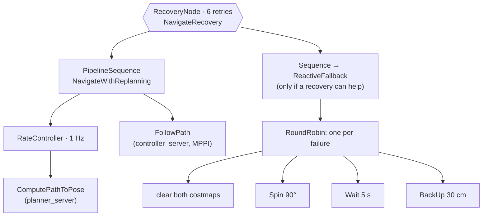
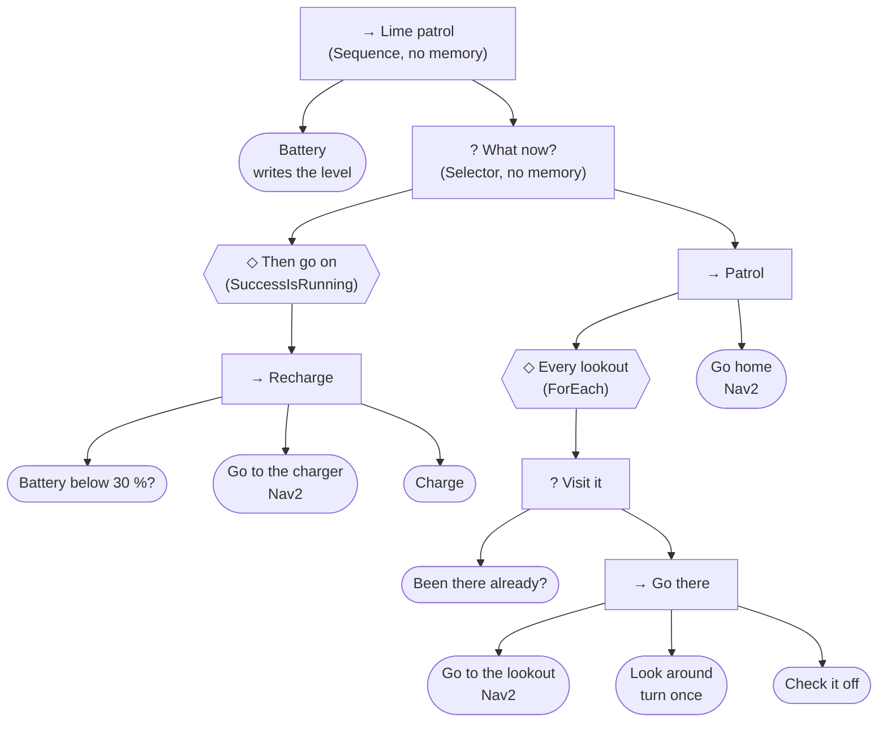

# 15 · ビヘイビアツリー { #15-behavior-trees }

<p class="tutorial-meta">⏱ 40 分 · レベル：中級 · スクリプト：<code>isaac/15_behavior_tree.py</code> · ROS：<code>navigation.launch.py</code>、<code>patrol</code></p>

**目標：** **ビヘイビアツリー**を学びます。ビヘイビアツリーは、Nav2 をはじめ多くのロボットが判断を組み立てるのに使っている仕組みです。まず Nav2 の中で動いているツリーを読み、その動きを観察します。次に、**py_trees** で自分のツリーを書きます。lime_room をパトロールし、（仮想の）バッテリーが少なくなると中断して、充電後に続きを再開するツリーです。チュートリアル 16 では、同じ部品を使ってもっと長い仕事をこなします。

<figure class="result" markdown>
<video controls autoplay loop muted playsinline>
  <source src="../../../assets/video/tutorial15_patrol.mp4" type="video/mp4">
</video>
<figcaption>パトロールの様子：見回り地点 1〜3 では、ロボットがそれぞれの場所で周りを見回します。見回り地点 4 へ向かう途中でバッテリーが 30 % を下回ると、ツリーがパトロールを中断し、ロボットは西側で充電してからパトロールを終えて帰ってきます。カラーコーンには一度も触れません。</figcaption>
</figure>

## なぜツリーなのか？ { #why-a-tree }

チュートリアル 13 のミッションはスクリプトです。ステップ 1、ステップ 2、ステップ 3 と進み、どこかで失敗したら止まります。バナナ 1 本ならこれで十分です。もっと長い仕事には、さらに次のようなことが必要になります。

- 何かが失敗したら**もう一度試す**（把持し損ねたとき）。
- **別のことを試す**（その見回り地点にたどり着けないなら、飛ばす）。
- もっと重要なこと（バッテリー残量が少ない）のために今していることを**中断**し、あとで**続きを再開する**。

これを `if` とフラグで書くと、すぐに読みにくくなります。ビヘイビアツリーはこうしたパターンのそれぞれに名前を付けるので、ミッションは小さく再利用できる部品のツリーになります。

## 考え方 { #concepts }

ツリーは 1 秒に約 10 回 **tick** されます。tick はルートから始まり、するべき仕事があるビヘイビアまで下りていきます。tick されたビヘイビアは、次の 3 つの言葉のどれかで答えます。

| ステータス | 意味 |
|---|---|
| **SUCCESS** | 完了、うまくいった |
| **FAILURE** | 完了、うまくいかなかった |
| **RUNNING** | まだ終わっていない：もう一度 tick してほしい |

葉（リーフ）は仕事をするか（*充電器まで走る*）、何かを確かめます（*バッテリー残量は少ないか？*）。その上にあるノードは、どの葉を tick するかを決めます。

| ノード | 記号 | 動作 |
|---|---|---|
| **Sequence** | → | 子を順番に tick します。1 つでも失敗したら、その時点で失敗します。*「これをして、次にあれをする」* |
| **Selector**（Nav2 では **Fallback**） | ? | 子を順番に tick します。1 つでも成功したら、その時点で成功します。*「これを試して、だめならあれ」* |
| **デコレーター** | ◇ | ただ 1 つの子が返す答えを変えます：*Retry*（失敗したらもう一度試す）、*Repeat*、*Inverter*（SUCCESS と FAILURE を入れ替える）、*ForEach*（リストの要素ごとに 1 回）など |

子の順番が、そのまま**優先度**になります。*メモリ*（memory）ありの Sequence や Selector は、前回の tick で RUNNING だった子から続けます。メモリなしの場合は、tick のたびに最初の子からやり直します。そのため、優先度の高い子が今度は成功すると（*バッテリー残量が少ない*）、実行中だった優先度の低い子（*見回り地点まで走る*）を**中断**できます。ツリーはこうして状況に反応します。

ビヘイビアどうしは**ブラックボード**を通してデータを共有します。ブラックボードは、どのビヘイビアからも読み書きできる辞書です。バッテリー残量、次の見回り地点、拾い上げる物などを入れます。

## パート 1：Nav2 の中のツリー { #part-1-the-tree-inside-nav2 }

実は、チュートリアル 11 からずっとビヘイビアツリーを使っています。Nav2 の **bt_navigator** は、ゴールごとにツリーを 1 つ実行します。ツリーは **BehaviorTree.CPP** 用の XML で書かれていて、Jazzy にはいくつも同梱されています。`NavigateToPose` のデフォルトは `navigate_to_pose_w_replanning_and_recovery.xml` です。



- **PipelineSequence** は、プランナーとコントローラーを*同時に* tick します。`FollowPath` がロボットを現在の経路に沿って動かし続ける一方で、**RateController** は 1 秒に 1 回、`ComputePathToPose` に新しい経路を計画させます。チュートリアル 11 のカラーコーンを LiDAR が捉えると、Nav2 がすぐにそれを避けて進むのはこのためです。
- **RecoveryNode** は、子を 2 つ持つデコレーターに似たノードです。1 つ目の子が失敗すると、2 つ目の子（リカバリー）を tick してから 1 つ目をもう一度試します。これを最大 6 回繰り返します。
- **RoundRobin** は、呼ばれるたびに*次の*リカバリーを選びます。最初はコストマップをクリアし、次はその場で回転し、次は待機し、その次は後退します。

??? example "XML：`nav2_bt_navigator/behavior_trees/navigate_to_pose_w_replanning_and_recovery.xml`"
    ```xml
    <!--
      This Behavior Tree replans the global path periodically at 1 Hz and it also has
      recovery actions specific to planning / control as well as general system issues.
      This will be continuous if a kinematically valid planner is selected.
    -->
    <root BTCPP_format="4" main_tree_to_execute="MainTree">
      <BehaviorTree ID="MainTree">
        <RecoveryNode number_of_retries="6" name="NavigateRecovery">
          <PipelineSequence name="NavigateWithReplanning">
            <ControllerSelector selected_controller="{selected_controller}" default_controller="FollowPath" topic_name="controller_selector"/>
            <PlannerSelector selected_planner="{selected_planner}" default_planner="GridBased" topic_name="planner_selector"/>
            <RateController hz="1.0">
              <RecoveryNode number_of_retries="1" name="ComputePathToPose">
                <ComputePathToPose goal="{goal}" path="{path}" planner_id="{selected_planner}" error_code_id="{compute_path_error_code}"/>
                <Sequence>
                  <WouldAPlannerRecoveryHelp error_code="{compute_path_error_code}"/>
                  <ClearEntireCostmap name="ClearGlobalCostmap-Context" service_name="global_costmap/clear_entirely_global_costmap"/>
                </Sequence>
              </RecoveryNode>
            </RateController>
            <RecoveryNode number_of_retries="1" name="FollowPath">
              <FollowPath path="{path}" controller_id="{selected_controller}" error_code_id="{follow_path_error_code}"/>
              <Sequence>
                <WouldAControllerRecoveryHelp error_code="{follow_path_error_code}"/>
                <ClearEntireCostmap name="ClearLocalCostmap-Context" service_name="local_costmap/clear_entirely_local_costmap"/>
              </Sequence>
            </RecoveryNode>
          </PipelineSequence>
          <Sequence>
            <Fallback>
              <WouldAControllerRecoveryHelp error_code="{follow_path_error_code}"/>
              <WouldAPlannerRecoveryHelp error_code="{compute_path_error_code}"/>
            </Fallback>
            <ReactiveFallback name="RecoveryFallback">
              <GoalUpdated/>
              <RoundRobin name="RecoveryActions">
                <Sequence name="ClearingActions">
                  <ClearEntireCostmap name="ClearLocalCostmap-Subtree" service_name="local_costmap/clear_entirely_local_costmap"/>
                  <ClearEntireCostmap name="ClearGlobalCostmap-Subtree" service_name="global_costmap/clear_entirely_global_costmap"/>
                </Sequence>
                <Spin spin_dist="1.57" error_code_id="{spin_error_code}"/>
                <Wait wait_duration="5.0"/>
                <BackUp backup_dist="0.30" backup_speed="0.15" error_code_id="{backup_code_id}"/>
              </RoundRobin>
            </ReactiveFallback>
          </Sequence>
        </RecoveryNode>
      </BehaviorTree>
    </root>
    ```

### tick の様子を見る { #watch-it-tick }

bt_navigator は、ステータスが変わるたびに `/behavior_tree_log` にパブリッシュします。チュートリアル 11 を起動し（Isaac Sim と `navigation.launch.py`）、3 つ目のターミナルで次を実行します。

```bash
./docker/run_ros.sh ros2 topic echo /behavior_tree_log nav2_msgs/msg/BehaviorTreeLog
```

チュートリアル 11 のゴールを送り、ノードが変化する様子を見てみましょう。各メッセージには、1 回の tick でステータスが変わったノードが並んでいます。*ノード：変化前 → 変化後*の形に要約すると、最初の 1 秒間は次のようになります。

```text
# t = 12.77 s   the goal arrives
NavigateRecovery         IDLE     -> RUNNING
RateController           IDLE     -> RUNNING
ComputePathToPose        IDLE     -> RUNNING      (the planner starts)
NavigateWithReplanning   IDLE     -> RUNNING
# t = 12.80 s
ComputePathToPose        RUNNING  -> SUCCESS      (a path)
RateController           RUNNING  -> SUCCESS
FollowPath               IDLE     -> RUNNING      (the controller starts driving)
# t = 13.77 s   one second later
ComputePathToPose        IDLE     -> RUNNING      (plan again, while FollowPath keeps RUNNING)
# t = 13.78 s
ComputePathToPose        RUNNING  -> SUCCESS
```

これが PipelineSequence の働きです。*FollowPath* は走行中ずっと RUNNING のままで、RateController が 1 秒に 1 回 *ComputePathToPose* を再実行させます。（`ComputePathToPose` という名前のノードは 2 つあります。それを囲む RecoveryNode も同じ名前です。）このトピックがまだパブリッシュされていないときは、コマンドラインでメッセージ型を指定する必要があります。

!!! tip "ツリーを図で見る"
    **Groot2**（BehaviorTree.CPP の作者たちが無料で配布しています）を使うと、これらの XML ファイルを図として開き、編集できます。Nav2 は*自分で書いた* XML を実行することもできます。ゴールの `behavior_tree` フィールドにそのパスを入れるか、`nav2_params.yaml` で `default_nav_to_pose_bt_xml` を設定します。

## パート 2：py_trees で自分のツリーを作る { #part-2-your-own-tree-with-py_trees }

Nav2 のツリーは、ロボットを *1 つ*のゴールまで走らせます。その上位にある*ミッション*が、どのゴールにどの順番で向かうか、何かがうまくいかなかったらどうするかを決めます。ミッションはナビゲーションよりも頻繁に変わるので、このチュートリアルではミッションを Python と **py_trees**（ROS 2 Jazzy のパッケージ `ros-jazzy-py-trees`。コンテナに導入済み）で書きます。

仕事の内容：4 つの見回り地点を回って、帰ってきます。Lime のバッテリーは仮想のもので、1 m 走るごとに 5 % 減ります。30 % を下回ると、ロボットはパトロールを中断して充電器まで走り、充電してから続きを再開します。



ツリーが tick される順に、上から読んでいきましょう。

1. **Battery** は tick のたびに実行され、バッテリー残量をブラックボードに書き込みます。これは判断ではなくセンサーなので、常に SUCCESS を返します。
2. **What now?**（次は何をする？）は**メモリなし**の Selector です。tick のたびに、左の子から順に改めて問い合わせます。*Recharge*（充電）が最初にあるので、こちらが優先されます。バッテリーに問題がない間は *Battery below 30 %?*（バッテリーは 30 % 未満か？）が失敗するので *Recharge* も失敗し、Selector は *Patrol* に進みます。
3. **Patrol** はすべての見回り地点を回り（**ForEach** が見回り地点を 1 つずつ順番に `lookout` としてブラックボードに置きます）、それから帰ります。
4. バッテリーが 30 % を下回ると、*Recharge* は最初の子が成功し、RUNNING を返します。Selector はそちらに切り替え、**実行中のパトロールを止めます**。py_trees が *Go to the lookout*（見回り地点へ行く）の `terminate()` を呼び、それが Nav2 のゴールをキャンセルします。
5. 充電が終わると *Recharge* は成功します。**Then go on**（そのあと続ける）がその SUCCESS を RUNNING に変えるので、ツリーは終了しません。次の tick で Selector が改めて問い合わせると *Recharge* は失敗し（バッテリーは満タン）、*Patrol* が最初の見回り地点からやり直します。**Been there already?**（もう行った？）がチェック済みの見回り地点を飛ばすので、パトロールは中断したところから続きます。

### 時間のかかるアクション：アクションごとにスレッドを 1 つ { #long-actions-a-thread-per-action }

tick はすばやく終わらなければなりませんが、見回り地点まで走るには 1 分ほどかかります。そこで、時間のかかるアクション (`Action`) はどれもバックグラウンドのスレッドで実行します。最初の tick でアクションを開始し、以降の tick では毎回*「もう終わった？」*と尋ね（終わるまでは RUNNING）、ツリーがアクションを中断するときは `terminate()` で停止を求めます。

??? example "`lime_isaac_bringup/scripts/lime_bt.py` の `Action`、`TurnAround`、`NavigateTo`"
    ```python
    --8<-- "ros2_ws/src/lime_isaac_bringup/scripts/lime_bt.py:action"
    ```
    ```python
    --8<-- "ros2_ws/src/lime_isaac_bringup/scripts/lime_bt.py:navigate"
    ```

バッテリーと見回り地点は、1 回の tick で終わる小さなビヘイビアです。

??? example "`patrol.py` の `Battery`、`Charge`、`BeenThere`、`CheckOff`"
    ```python
    --8<-- "ros2_ws/src/lime_isaac_bringup/scripts/patrol.py:battery"
    ```
    ```python
    --8<-- "ros2_ws/src/lime_isaac_bringup/scripts/patrol.py:lookouts"
    ```

そして、ツリー本体です。上の図のとおりに組み立てています。

```python
--8<-- "ros2_ws/src/lime_isaac_bringup/scripts/patrol.py:tree"
```

`run_tree()` は、ルートが成功または失敗するまで、ツリーを 1 秒に 10 回 tick します。そして、開始した (`...`)、成功した (`ok`)、失敗した (`FAIL`)、ツリーに中断された (`stop`) ビヘイビアをすべて表示します。

??? example "`lime_bt.py` の `run_tree()`"
    ```python
    --8<-- "ros2_ws/src/lime_isaac_bringup/scripts/lime_bt.py:run_tree"
    ```

### 実行してみる { #run-it }

ターミナル 1 では Isaac Sim を起動します（チュートリアル 11 のワールド：地図を作成済みの部屋とカラーコーン）。

```bash
source scripts/isaac_env.sh
python isaac/15_behavior_tree.py
```

ターミナル 2 では Nav2 + RViz を起動します（チュートリアル 11 のまま、変更なし）。

```bash
./scripts/build_ws.sh lime_isaac_bringup     # once: installs the patrol
./docker/run_ros.sh ros2 launch lime_isaac_bringup navigation.launch.py
```

ターミナル 3 ではパトロールを起動します（ターミナル 2 に*「Managed nodes are active」*と表示されるまで待ってください）。

```bash
./docker/run_ros.sh ros2 run lime_isaac_bringup patrol
```

パトロールは、最初にツリーを 1 回表示します（py_trees の記号：`[-]` は Sequence、`[o]` は Selector、`{-}` はメモリありの Sequence、`-^-` はデコレーター、`-->` はビヘイビア）。その後、開始した (`...`)、成功した (`ok`)、失敗した (`FAIL`)、中断された (`stop`) ビヘイビアをすべて表示します。

```text
[-] Lime patrol
    --> Battery
    [o] What now?
        -^- Then go on
            {-} Recharge
                --> Battery below 30 %?
                --> Go to the charger
                --> Charge
        {-} Patrol
            -^- Every lookout
                [o] Visit it
                    --> Been there already?
                    {-} Go there
                        --> Go to the lookout
                        --> Look around
                        --> Check it off
            --> Go home
```

```text
[bt] ok   Battery: 100 %
[bt] FAIL Battery below 30 %?
[bt] FAIL Been there already?
[bt] ... Go to the lookout
[bt] ok   Go to the lookout (20 s)
[bt] ... Look around
lookout (3.2, -1.8) checked, battery 80 %
[bt] ok   Look around (20 s)
[bt] ok   Check it off
[bt] ... Go to the lookout
[bt] ok   Go to the lookout (16 s)
[bt] ... Look around
lookout (3.3, 1.9) checked, battery 62 %
[bt] ok   Look around (20 s)
[bt] ok   Check it off
[bt] ... Go to the lookout
[bt] ok   Go to the lookout (30 s)
[bt] ... Look around
lookout (0.5, 1.9) checked, battery 40 %
[bt] ok   Look around (19 s)
[bt] ok   Check it off
[bt] ... Go to the lookout
[bt] ok   Battery below 30 %?
[bt] ... Go to the charger
[bt] stop Go to the lookout (interrupted)
[bt] ok   Go to the charger (8 s)
[bt] ... Charge
battery full
[bt] ok   Charge (4 s)
[bt] FAIL Battery below 30 %?
[bt] ok   Been there already?
[bt] FAIL Been there already?
[bt] ... Go to the lookout
[bt] ok   Go to the lookout (10 s)
[bt] ... Look around
lookout (-1.3, -1.8) checked, battery 91 %
[bt] ok   Look around (19 s)
[bt] ok   Check it off
[bt] ... Go home
[bt] ok   Go home (13 s)
patrol complete
```

中断の流れを追ってみましょう。見回り地点 4 へ向かう途中で *Battery below 30 %?* が成功します。Selector は *Recharge* に切り替え、実行中の *Go to the lookout* は止められます（その Nav2 のゴールはキャンセルされます）。充電後、パトロールは最初の見回り地点からやり直します。*Been there already?* は見回り地点 1〜3 では成功し（tick ごとに 1 つずつ。ログにはステータスが変わったときだけ表示されます）、見回り地点 4 では失敗するので、ロボットはそこへ向かいます。

## 自動チェック { #automatic-check }

`python isaac/15_behavior_tree.py --headless --test` は、シミュレーションの正解（ground truth）を使ってパトロールを追跡します。ロボットがたどり着いた見回り地点と充電器をすべて記録し、その順番をチェックします。`tools/run_all_checks.sh 15` は Nav2 とパトロールを起動します。

```text
[15] at lookout 1, t = 29 s
[15] at lookout 2, t = 63 s
[15] at lookout 3, t = 108 s
[15] at charger, t = 146 s
[15] at lookout 4, t = 160 s
[15] back home, t = 192 s
[15][check] ok   the four lookouts in order (lookout 1, lookout 2, lookout 3, charger, lookout 4)
[15][check] ok   one stop at the charger, between two lookouts
[15][check] ok   back home at the end
[15][check] ok   cone not touched (moved 0.0 cm)
[15][test] PASS
```

??? example "Isaac Sim 側：`isaac/15_behavior_tree.py`"
    ```python
    --8<-- "isaac/15_behavior_tree.py"
    ```

??? example "パトロール全体：`lime_isaac_bringup/scripts/patrol.py`"
    ```python
    --8<-- "ros2_ws/src/lime_isaac_bringup/scripts/patrol.py"
    ```

## トラブルシューティング { #troubleshooting }

| 症状 | 対処 |
|---|---|
| `RuntimeError: Executor is already spinning` | 2 つのアクションが同時にロボットの ROS ノードを使いました。py_trees は、中断されたアクションを止める前に新しいアクションを開始します。`Action` はロック (`Action.robot`) を取るので、新しいアクションは、古いアクションが Nav2 のゴールをキャンセルし終えるまで待ちます。 |
| 充電後、パトロールが最初の見回り地点からやり直す | ツリーはそのように動作します。*Been there already?* が訪問済みの見回り地点を飛ばす必要があります。*Check it off* が実行されているか確かめてください（*Go there* の最後の子です）。 |
| `ModuleNotFoundError: No module named 'py_trees'` | コンテナイメージが、py_trees を追加したチュートリアル 15 より古いものです。イメージを再ビルドし、コンテナを再起動してください。`docker build -t lime_ros_jazzy:latest docker/ros_jazzy` を実行してから `docker stop lime_ros` を実行します（次の `./docker/run_ros.sh` で新しいコンテナが起動します）。 |
| 開始時からパトロールがずっと待ち続ける | Nav2 がまだアクティブになっていません。*「Managed nodes are active」*と表示されるまで待ってください。シミュレーションは再生中ですか？ |

**次へ：** [16 · 総仕上げ：部屋を片付ける](16-tidy-room.md)
