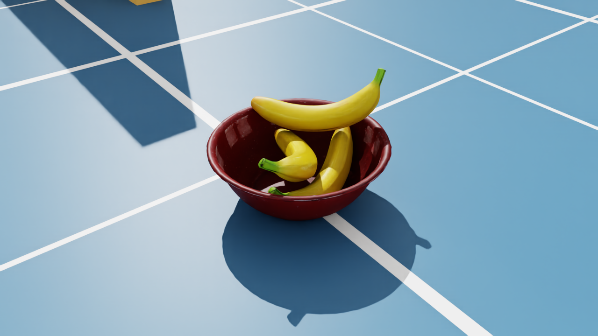
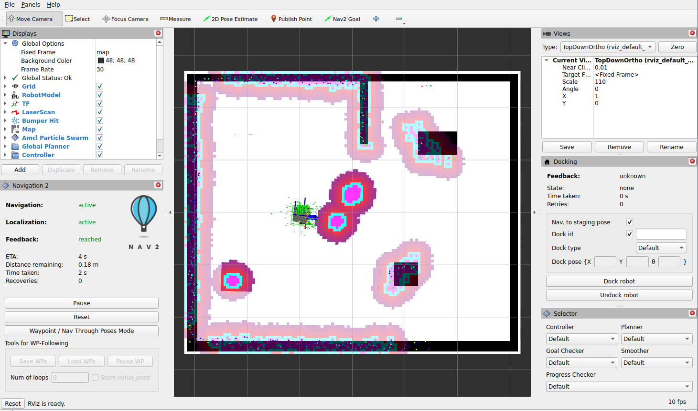
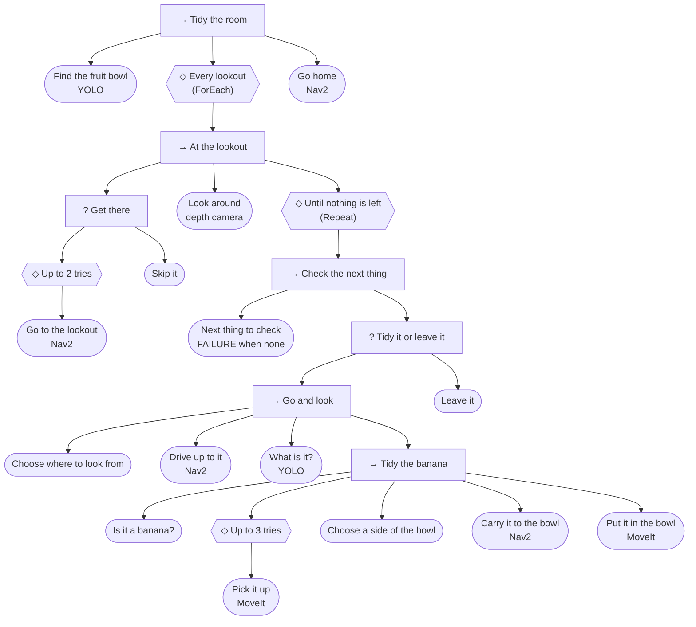

# 16 · 総仕上げ：部屋を片付ける { #16-all-together-tidy-the-room }

<p class="tutorial-meta">⏱ 60 分 · レベル：上級 · スクリプト：<code>isaac/16_tidy_room.py</code> · ROS：<code>tidy.launch.py</code>、<code>tidy</code></p>

**目標：** チュートリアル 06〜15 のすべてを一度に使って、Lime に本物の仕事をさせます。lime_room のあちこちに 3 本のバナナが置かれていますが、ロボットはその場所を知りません。ロボットは**すべてのバナナを見つけて拾い上げ、フルーツボウルに入れて、ホームに戻る**必要があります。Nav2 が見回り地点から見回り地点へロボットを走らせ、深度カメラが床の上の物を見つけ、YOLO がそれが何かを判定し、MoveIt がピック＆プレースを行い、**ビヘイビアツリー**（チュートリアル 15）が次に何をするかを決めます。

<figure class="result" markdown>
<video controls autoplay loop muted playsinline>
  <source src="../../../assets/video/tutorial16_tidy.mp4" type="video/mp4">
</video>
<figcaption>仕事の全体です。シミュレーション時間で約 7 分半かかるところを、約 8 倍速にしています。カメラはロボットを追いかけます。ロボットは 1 本目のバナナを拾ってボウルに入れ、隅のマグカップをチェックし（そのままにします）、柱の陰のバナナを見つけ、ボトルをチェックし（そのままにします）、仕切りの陰のバナナを見つけて、ホームに戻ります。</figcaption>
</figure>

{ .full }

*最後のフルーツボウル：3 本のバナナがすべて入っています。*

## 仕事の内容 { #the-job }

チュートリアル 13 では、スタート地点のロボットから見えるバナナを 1 本拾いました。このチュートリアルでは次のようになります。

| | チュートリアル 13 | チュートリアル 16 |
|---|---|---|
| バナナ | 1 本、ロボットの前 | 3 本：1 本は前、1 本は柱の陰、1 本は仕切りの陰 |
| 置き場所 | スタート時点で YOLO に見えている | 不明：ロボットが探す必要がある |
| マグカップとボトル | バナナのすぐ隣にあり、邪魔になる | 邪魔にならないよう隅のほうに置く：見つけて、チェックして、そのままにしておく物 |
| 走行 | オドメトリ。Nav2 は駐車のときだけ | すべての場所の間は Nav2、センチメートル単位の移動はオドメトリ |
| ミッション | スクリプト：ステップ 1、ステップ 2、... | ビヘイビアツリー：探す、チェックする、やり直す、そのままにする |

ロボットが知っているのは、地図（チュートリアル 11）と 3 つの**見回り地点**です。見回り地点とは、部屋の大部分を見渡せる場所です。

## 考え方 { #concepts }

### 物を見つける：地図にないもの { #finding-things-what-is-not-in-the-map }

*「バナナはどこ？」*に答えるなら、YOLO を使うのが当然に思えます。しかし、床から 5.8 cm の高さにある Lime のカメラから見ると、横たわったバナナは細い黄色の線にすぎません。1 本のバナナをさまざまな距離と角度から見たときに、YOLO (`yolo11m.pt`) が出す答えは次のとおりです。

| 距離 | 端から（end-on） | 30° | 60° | 真横から（side-on） |
|---|---|---|---|---|
| 0.5 m | banana 0.89 | banana 0.93 | banana 0.92 | banana 0.90 |
| 0.75 m | sports ball 0.68 | banana 0.85 | frisbee 0.48 | frisbee 0.83 |
| 1.0 m | sports ball 0.75 | tennis racket 0.47 | tennis racket 0.26 | frisbee 0.36 |
| 1.5 m | sports ball 0.69 | sports ball 0.25 | frisbee 0.27 | frisbee 0.33 |
| 2.0 m | sports ball 0.62 | — | frisbee 0.34 | frisbee 0.50 |

そこで、探索には代わりに**深度カメラ**を使い、YOLO は近くからだけ使います。

1. **見つける**（見回り地点から）：深度画像の各ピクセルを 3D の点にします（チュートリアル 13 のカメラモデルと TF）。床を取り除き、**地図**にすでにあるもの、つまり壁、柱、箱、仕切りもすべて取り除きます。残ったものは*新しい*もの、つまり床の上の物です。隣り合う点をまとめて、それぞれ 1 つの物にします。
2. **チェックする**（近くから）：Nav2 がそれぞれの物から 55 cm の位置までロボットを走らせ、YOLO がそれが何かを判定します。
3. **行動する**：バナナならボウルに入れます。それ以外はその場に残します。

ここでもチュートリアル 11 のルールが当てはまります。*地図には動かないものを載せる*。地図にないものは、障害物か仕事のどちらかです。

### Nav2 は LiDAR より低いものも見る { #nav2-sees-what-is-lower-than-the-lidar }

チュートリアル 11 では、Nav2 のコストマップは障害物を LiDAR から得ていました。LiDAR は床から 16 cm の高さをスキャンします。バナナ (4 cm)、マグカップ (8 cm)、ボウル (8 cm) は LiDAR には見えないので、Nav2 はその上をそのまま走ってしまいます。実際のロボットは深度カメラもコストマップに加えます。このチュートリアルでも同じようにします。

- **Isaac Sim** は、深度カメラから小さな点群をパブリッシュします。同じカメラの 2 つ目のレンダープロダクト（render product）で、160 × 120 ピクセル、毎秒 10 回です（`create_depth_cloud_graph`、`graphs.py` に新しく追加）。
- **Nav2** (`config/nav2_params_tidy.yaml`) では、両方のコストマップにレイヤー `depth_layer` を 1 つ追加します。

??? example "`isaac/common/graphs.py` の `create_depth_cloud_graph()`"
    ```python
    --8<-- "isaac/common/graphs.py:create_depth_cloud_graph"
    ```

```yaml
depth_layer:
  plugin: nav2_costmap_2d::VoxelLayer
  enabled: true
  publish_voxel_map: false
  origin_z: 0.0
  z_resolution: 0.05
  z_voxels: 10
  max_obstacle_height: 0.5
  mark_threshold: 0
  observation_sources: depth
  depth: {topic: /camera/camera/depth/color/points, data_type: PointCloud2, marking: true, clearing: true,
    min_obstacle_height: 0.015, max_obstacle_height: 0.5, obstacle_min_range: 0.35, obstacle_max_range: 2.5,
    raytrace_min_range: 0.35, raytrace_max_range: 2.5}
```

| パラメーター | 理由 |
|---|---|
| 専用のレイヤー | LiDAR のレイヤーは、ビームが通過したすべてのセルを*クリア*します。ビームはバナナの上を通過するので、レイヤーを共有すると、カメラがマークしたものが消されてしまいます |
| `VoxelLayer`、5 cm のボクセル 10 個 | 3D：マグカップの奥の壁に向かうカメラの光線は、マグカップの*上*を通過し、実際に通過したボクセルだけをクリアします。平面 (2D) のレイヤーでは、マグカップの向こうを見るたびにマグカップが消され、最後に見えた側面だけが残ります |
| `min_obstacle_height: 0.015` | 床から 1.5 cm 以上の高さにあるものはすべて障害物です。床そのものは障害物ではありません |
| `obstacle_min_range`、`raytrace_min_range: 0.35` | 35 cm より近い範囲では、カメラはマークせず（そこに見えるのは、把持するときのロボット自身のアームとグリッパーです）、クリアもしません（もっと遠くから見たものが残ります） |
| `obstacle_max_range`、`raytrace_max_range: 2.5` | 同じ値にします。カメラがクリアできる範囲では、マークもできます |

**ロボットが知っていることは Nav2 に伝える：** カメラに見えるのは、いつも物の手前側だけです。このチュートリアルの最初のバージョン（[シーン](#the-scene)を参照）では、ロボットはマグカップを西側から見つけたので、コストマップにはマグカップの西側だけが入り、東側から通りかかった Nav2 はマグカップの残りの部分に突っ込みました。しかし、ミッションはマグカップ全体を知っています。マグカップは物のリストに入っているからです。そこでミッションは、知っているすべての物を円として 2 つ目の地図 `/known_things`（`/map` と同じ大きさ）に描き込み、両方のコストマップがそれをもう 1 つのレイヤーとして読み込みます（`things_layer`、`StaticLayer`、最大値で結合）。バナナを拾うと、その円は消えます。マグカップとボトルの円は残ります。ここでもチュートリアル 11 のルールです。`/map` には動かないものを、`/known_things` にはロボットが床の上で見つけたものを入れます。

```yaml
things_layer: {plugin: 'nav2_costmap_2d::StaticLayer', map_topic: /known_things, map_subscribe_transient_local: true, use_maximum: true}
```

<div class="callouts" markdown>
{ .full }
<span class="callout" style="left: 41.1%; top: 47.5%" aria-hidden="true">1</span>
<span class="callout" style="left: 47.2%; top: 59.1%" aria-hidden="true">2</span>
<span class="callout" style="left: 54.1%; top: 45.2%" aria-hidden="true">3</span>
<span class="callout" style="left: 36.6%; top: 64.9%" aria-hidden="true">4</span>
<span class="callout" style="left: 68.4%; top: 34.8%" aria-hidden="true">5</span>
</div>

*RViz (`tidy.launch.py`) の、最初の見回りのあとのグローバルコストマップ：*

1. **ロボット**：バナナをチェックするために近づいているところです。
2. **1 本目のバナナ**：円（マゼンタ）とそのインフレーションです。
3. **ボウル**も同じです。
4. 隅にある**マグカップ**も同じです。ここからでは Nav2 のセンサーが届く範囲をはるかに超えています。コストマップに入っているのは、ミッションが Nav2 に知らせたからです。
5. **地図**：壁、仕切り、箱（ここ）、柱です。

**Lime の形に合わせた衝突チェック：** MPPI の `CostCritic` は通常、`base_footprint` を中心とする円で衝突をチェックします (`consider_footprint: false`)。Lime の `base_footprint` は車輪の間、つまり前寄りにあります。台車は前方には 7.5 cm しか張り出していませんが、**後方には 20.5 cm** 張り出しています。最初のバージョンでは、マグカップの横で旋回したときに、ロボットの後部がマグカップにぶつかりました。さらに、何かがロボットに触れると、それは LiDAR の最小距離 12 cm よりも、カメラの 35 cm よりも近くなります。もう何もそれをマークしないので、Nav2 はボトルを部屋の中で 1.8 m も押していきました。`consider_footprint: true` にすると、MPPI はフットプリント全体をチェックします。

!!! warning "インフレーション半径はフットプリントより大きくする"
    フットプリントのチェックが機能するのは、`inflation_radius` (0.30 m) がフットプリントの外接円の半径より大きい場合だけです。Lime の外接円の半径は、標準の 1 cm の `footprint_padding` で 0.28 m です。最初のバージョンでは、フットプリントに 5 cm のパディングを付けていました (0.33 m)。すると Nav2 は「*The inflation radius (0.300000) is smaller than the circumscribed radius (0.333542)*」というログを毎秒 20 回出しながら、ひっそりと円によるチェックに戻っていました。代わりにインフレーションを 0.45 m に上げると、最初のバージョンの散らかった隅からバナナを運び出す動きが、のろのろになるか失敗するようになりました。MPPI はほとんど動かなかったのです（よくても 45 秒で 1.1 m）。そこでパディングは標準に戻し、マグカップとボトルのまわりの余裕は、本来あるべきところ、つまり `/known_things` に描いたそれぞれの円から取るようにしました。

!!! info "`nav2_params_tidy.yaml`"
    チュートリアル 11 の `nav2_params.yaml` に、ちょうど 3 つの変更を加えたものです。両方のコストマップの `depth_layer` と `things_layer`、そして MPPI の `consider_footprint` です。`tidy.launch.py` は、チュートリアル 13 の `lime_full.launch.py` でこのパラメーターファイルを使うようにしたものです。

## シーン { #the-scene }

`16_tidy_room.py` は、チュートリアル 13 の部屋に置いたチュートリアル 13 のロボットです（実体のある物体、1.5 倍の大きさのボウル、滑りにくい指）。変更点は 3 つです。マグカップとボトルを邪魔にならないよう隅のほうへ移したこと、バナナを 2 本追加したこと、そして深度の点群です。

最初のバージョンでは、マグカップとボトルをチュートリアル 13 と同じ場所、つまり 1 本目のバナナから 30 cm のところに置いていました。この 2 つがバナナを囲い込んでしまい、把持できる方向は 1 方向しか残らず、Nav2 はボウルへ運ぶたびに 2 つの間をすり抜けなければなりませんでした。[うまくいかなかったこと](#things-that-went-wrong-while-building-this-and-the-fixes)の問題のほとんどは、ここから来ています。実際の家でも、ロボットに拾わせたいバナナのすぐ隣にカップを置いたりはしないでしょう。今ではこの 2 つはおとりです。ロボットは探索中にこれらを見つけ、YOLO でチェックし、そのままにしておきます。

??? example "`isaac/common/scene.py` の `setup_tidy_room()`"
    ```python
    --8<-- "isaac/common/scene.py:setup_tidy_room"
    ```

## ツリー { #the-tree }



チュートリアル 15 の各パターンが、ここでそれぞれの役割を果たします。

- **ForEach** は見回り地点を順にたどります。各地点で、**Look around** が見つけたものを物のリストに追加します。
- **Repeat until nothing is left**：*Next thing to check* は、まだチェックしていない物のうち一番近いものを選び、1 つもなければ失敗します。この失敗でループが終わり（*FailureIsSuccess*）、ツリーは次の見回り地点に進みます。
- **Tidy it or leave it** は Selector です。*Go and look* の中で何かが失敗すると（バナナではなかった、把持に 3 回失敗した、Nav2 がそこに行けない）、**Leave it** がその物をチェック済みにします。そのため、ロボットが 1 つの物から先に進めなくなることはありません。
- **Retry**：把持に失敗したら、新たに見直してからもう一度試します（全部で 3 回まで）。把持に失敗するとたいていバナナが少し動くので、次の試行ではバナナが違って見えます。
- **Skip it**：Nav2 がたどり着けない見回り地点は飛ばします。

```python
--8<-- "ros2_ws/src/lime_isaac_bringup/scripts/tidy.py:tree"
```

葉（リーフ）は、チュートリアル 13 の `Lime` を呼び出す `Action`（チュートリアル 15）です：`locate()`、`drive_to()`、`turn_to()`、`move_arm()`、`gripper()`、`top_down_ik()`、`long_object()`、`round_object()`。新しいスキルは床のスキャンだけです。

### ロボットが知っていること { #what-the-robot-knows }

`World` は、地図（Nav2 と同じく `/map` から）、ボウル、そして**物**を保持します。物はそれぞれ、位置（チュートリアル 13 と同じく odom フレーム）、YOLO が判定した種類、状態（*new*：新規、*tidied*：片付け済み、*left*：そのまま）を持ちます。`free()` は*「ロボットはここに立てるか？」*に答えます。Lime のフットプリントが、地図とも、既知のどの物とも重なっていてはいけません。ツリーはこれを使って、どこから見るか、どちら側から把持するか、ボウルのところでどこに立つかを選びます。

??? example "`lime_isaac_bringup/scripts/tidy.py` の `Thing` と `World`"
    ```python
    --8<-- "ros2_ws/src/lime_isaac_bringup/scripts/tidy.py:things"
    ```

### 見回す：床のスキャン { #look-around-the-floor-scan }

```python
--8<-- "ros2_ws/src/lime_isaac_bringup/scripts/tidy.py:floor"
```

??? example "`LookAround`：60° ずつ向きを変えて 6 回見る"
    ```python
    --8<-- "ros2_ws/src/lime_isaac_bringup/scripts/tidy.py:look_around"
    ```

### 物をチェックする { #check-a-thing }

*Choose where to look from* は、物のまわりの 24 方向を、ロボットに近い側から順に試し、物から 55 cm 離れていてロボットが収まる最初の場所を選びます。Nav2 がそこまで走り（Nav2 はゴールから 25 cm 以内で止まるので、最後の部分はオドメトリで動きます）、*What is it?* が 3 秒分の YOLO の検出結果を集めます。検出の 3D の点（チュートリアル 13 の `points()`）が物から 15 cm 以内にあれば、その検出はその物のものとみなします。

YOLO がいつも答えを出せるとは限りません。隅にあって、すぐ後ろに壁があるマグカップは、ほとんどの場合まったく認識されません（ロボットの側からの 12 通りのテスト視点のうち、*cup* が 0.5 を超えたのは 1 つだけでした）。その場合、物は *unknown* になります。それで問題ありません。*Is it a banana?* が失敗し、ロボットが確信を持てないものには、安全なデフォルトである *Leave it* が使われます。

??? example "`NextThing`、`ChooseViewpoint`、`WhatIsIt`、`IsBanana`、`LeaveIt`"
    ```python
    --8<-- "ros2_ws/src/lime_isaac_bringup/scripts/tidy.py:check"
    ```

### 拾い上げる { #pick-it-up }

チュートリアル 13 の把持ですが、視点は固定ではなく**選びます**。チュートリアル 13 は、いつも 55° 回り込んだ位置からもう一度見ていました。それが合っていたのは、あの 1 本のバナナをあの 1 つのスタート地点から拾う場合だけです。

1. **1 回目の観察**：Nav2 がロボットを運んできた場所（55 cm 離れた位置）から見ます。
2. **2 回目の観察は、45〜135° 回り込んだ位置から**行います（90° が最適です）。1 回の観察ではバナナの手前側しか見えません。ほぼ端から見ると、曲がったバナナの向きは約 25° ずれて求まり、その後のすべての判断がその誤差の上に積み重なってしまいます。`long_object()` は、すべての観察の点をまとめて受け取ります。
3. **把持する側を選ぶ**：バナナの長軸からできるだけ離れた方向、最低でも 24° 離れた方向を選びます。それより端寄りだと、バナナの手前の端がロボットの前部の下に入ってしまいます。ロボットは 60 cm の位置から把持位置まで、何にも触れずにまっすぐ進入できなければなりません。Nav2 は 60 cm の地点に 10 cm の余裕を必要とします。把持のあと、そこから Nav2 が引き継ぐからです。その側が新しい場所なら、ロボットはそこからもう一度見ます。
4. **把持**はチュートリアル 13 とまったく同じです。そのあと、**来た道をそのまま後退して** 60 cm の位置まで戻ります。マグカップのすぐ隣から Nav2 で動き出したときは、Nav2 がロボットの後部をマグカップにぶつけてしまいました。

（チュートリアル 13 のようにマグカップとボトルが 1 本目のバナナから 30 cm のところにあると、使える良い側は、チュートリアル 13 が使った約 225° の側しか残りませんでした。）

??? example "`PickUp`"
    ```python
    --8<-- "ros2_ws/src/lime_isaac_bringup/scripts/tidy.py:pick"
    ```

### ボウルに入れる { #put-it-in-the-bowl }

ボウルは最初に一度だけ見つけます（チュートリアル 13 と同じく、スタート地点から YOLO に見えます）。バナナごとに、*Choose a side of the bowl* が、ほかのどの物とも 30 cm の余裕がある空いた側のうち最も近い側を選び、Nav2 がバナナをそこまで運びます。*Put it in the bowl* はチュートリアル 13 のリリースと同じです。ボウルに向きを合わせ、バナナをロボットに対して横向きにして、ボウルの中心の上（またはアームが届くできるだけ近い位置）でグリッパーを開き、アームを折りたたんで後退します。

ボウルには 3 本のバナナがすべて入ります。バナナは積み重なり、3 本目はほかの 2 本の上に載ります。

??? example "`FindBowl`、`ChooseBowlSide`、`PutInBowl`"
    ```python
    --8<-- "ros2_ws/src/lime_isaac_bringup/scripts/tidy.py:bowl"
    ```

## 実行してみる { #run-it }

ターミナル 1 では Isaac Sim を実行します。

```bash
source scripts/isaac_env.sh
python isaac/16_tidy_room.py
```

ターミナル 2 では ROS 2 スタックを実行します。チュートリアル 13 の `lime_full.launch.py` を `nav2_params_tidy.yaml` で起動するものです（「*Managed nodes are active*」と「*You can start planning now!*」が表示されるまで待ちます）。

```bash
./scripts/build_ws.sh lime_isaac_bringup
./docker/run_ros.sh ros2 launch lime_isaac_bringup tidy.launch.py
```

ターミナル 3 ではミッションを実行します。

```bash
./docker/run_ros.sh ros2 run lime_isaac_bringup tidy
```

ミッションは、見つけたものを表示し、ツリーのビヘイビアが成功 (`ok`) または失敗 (`FAIL`) するたびに、その名前とかかった時間を表示します（時間は実時間の秒数です。テスト用 PC では、シミュレーションは実時間の約半分の速さで動きました）。1 本目のバナナを含む、最初の部分です。

```text
YOLO: bowl (0.67) at (0.99, 0.40)
[bt] ok   Find the fruit bowl (3 s)
[bt] ok   Go to the lookout
things to check: thing at (0.75, -0.12) (331 points), thing at (-1.18, -1.37) (111 points)
[bt] ok   Look around (34 s)
[bt] ok   Next thing to check: thing at (0.75, -0.12)
[bt] ok   Choose where to look from: (0.22, 0.02)
[bt] ok   Drive up to it (4 s)
YOLO: banana at (0.75, -0.12) (0.87)
[bt] ok   What is it? (14 s)
[bt] ok   Is it a banana?
banana pointing 16 deg from 2 looks (the first alone: 47 deg)
YOLO: banana at (0.798, -0.121), pointing 17 deg from 3 looks; grasp from 270 deg
holding the banana (gripper at -0.5 mm)
[bt] ok   Pick it up (112 s)
[bt] ok   Choose a side of the bowl: 292 deg
[bt] ok   Carry it to the bowl (16 s)
tidied: the banana at (0.74, -0.11)
[bt] ok   Put it in the bowl (59 s)
[bt] ok   Drive up to it (23 s)
YOLO: unknown at (-1.18, -1.37)
[bt] ok   What is it? (13 s)
[bt] FAIL Is it a banana?
leave the unknown at (-1.18, -1.37)
[bt] ok   Leave it
[bt] FAIL Next thing to check
```

一番近いので、まずバナナ、次にマグカップです。マグカップは、ここからでは YOLO が認識しません (*unknown*)。バナナではないので、そのまま残します。*Next thing to check* が失敗し、ここにはもう何も残っていないので、ツリーは次の見回り地点に進みます。

```text
[bt] ok   Go to the lookout (32 s)
things to check: thing at (3.39, 0.88) (304 points), thing at (2.69, -1.66) (171 points)
...
YOLO: banana at (2.731, -1.693), pointing 113 deg from 3 looks; grasp from 0 deg
...
tidied: the banana at (2.71, -1.66)
[bt] ok   Put it in the bowl (54 s)
[bt] ok   Drive up to it (21 s)
YOLO: bottle at (3.39, 0.88) (0.85)
[bt] ok   What is it? (7 s)
[bt] FAIL Is it a banana?
leave the bottle at (3.39, 0.88)
[bt] FAIL Next thing to check
[bt] ok   Go to the lookout (22 s)
things to check: thing at (1.60, 2.04) (136 points)
...
tidied: the banana at (1.60, 2.05)
[bt] FAIL Next thing to check
[bt] ok   Go home (28 s)
room tidy: 3 bananas in the bowl, 898 s
```

1 本目のバナナの実際の位置は (0.80, −0.12) で、向きは 20° です。最初の場所からだけ、ほぼ端から見たときは、向きが 47° と求まりました。約 90° 回り込んだ位置からの 2 回目の観察を加えると、16° になりました。

## 自動チェック { #automatic-check }

`python isaac/16_tidy_room.py --headless --test` は、シミュレーションの正解（ground truth）を使ってミッションを追跡します。各バナナが持ち上げられた時刻とボウルの中で静止した時刻、ロボットがホームに戻ったかどうか、マグカップやボトルに触れたかどうかを調べます。バナナは、その中心がボウルの中心から 10 cm 以内にあり（縁は 12 cm のところです）、そこで静止していれば、ボウルに入ったとみなします。`tools/run_all_checks.sh 16` は `tidy.launch.py` とミッションを起動します。

```text
[16] ground truth: banana at (0.80, -0.12), pointing 20 deg
[16] ground truth: banana2 at (2.70, -1.70), pointing 120 deg
[16] ground truth: banana3 at (1.60, 2.05), pointing 10 deg
[16] banana lifted at t = 86 s
[16] banana in the bowl, 3.7 cm from its centre at t = 121 s
[16] banana2 lifted at t = 243 s
[16] banana2 in the bowl, 1.6 cm from its centre at t = 279 s
[16] banana3 lifted at t = 399 s
[16] banana3 in the bowl, 6.9 cm from its centre at t = 435 s
[16] robot back home, arm folded at t = 453 s
[16][check] ok   banana in the bowl at the end (3.6 cm from its centre)
[16][check] ok   banana2 in the bowl at the end (1.5 cm from its centre)
[16][check] ok   banana3 in the bowl at the end (6.9 cm from its centre)
[16][check] ok   robot back home with the arm folded (within 0.3 m)
[16][check] ok   mug not bumped into (moved 0.0 cm)
[16][check] ok   bottle not bumped into (moved 0.0 cm)
[16][test] PASS
```

仕事全体には、シミュレーション時間で約 7 分半かかります。

??? example "Isaac Sim 側：`isaac/16_tidy_room.py`"
    ```python
    --8<-- "isaac/16_tidy_room.py"
    ```

??? example "launch ファイル：`lime_isaac_bringup/launch/tidy.launch.py`"
    ```python
    --8<-- "ros2_ws/src/lime_isaac_bringup/launch/tidy.launch.py"
    ```

??? example "ミッション全体：`lime_isaac_bringup/scripts/tidy.py`"
    ```python
    --8<-- "ros2_ws/src/lime_isaac_bringup/scripts/tidy.py"
    ```

## 作る過程でうまくいかなかったこと（とその対処） { #things-that-went-wrong-while-building-this-and-the-fixes }

これらのほとんどは、マグカップとボトルが 1 本目のバナナから 30 cm のところにあった最初のバージョンで起きました。対処はそのまま残してあります。物が近くに集まっている場所ではどこでも、これらの対処がロボットを慎重にしてくれます。

??? info "11 個の問題とその対処"

    | 症状 | 原因 | 対処 |
    |---|---|---|
    | YOLO が 1 m 先のバナナを *frisbee* や *sports ball* と判定した | 床から 5.8 cm の高さから見ると、横たわったバナナは細い黄色の線にすぎない | 深度カメラで物を見つけ、YOLO は 55 cm の距離からチェックする |
    | Nav2 が各ゴールに向かってのろのろ進み、最後に諦めた：「*Failed to make progress*」 | ゴールの許容誤差が 10 cm だった。MPPI が最後の数センチメートルをゆっくり進むため、進捗チェッカー（10 s で 0.5 m）に引っかかった | Jazzy の 25 cm にする。最後の数センチメートルはミッション自身がオドメトリで動く |
    | 把持の直後、ロボットがマグカップを小突いた | マグカップのすぐ隣で Nav2 に引き継いだ | 来た道を後退してから Nav2 に任せる |
    | Nav2 がボトルを部屋の中で 1.8 m 押していった | MPPI は `base_footprint` を中心とする円しかチェックしていなかった。一度触れると、ボトルは LiDAR (12 cm) にもカメラ (35 cm) にも近すぎた | `consider_footprint: true`、そして余裕として `/known_things` に物の円を描く |
    | ロボットがボウルにバックでぶつかり、動けなくなった | カメラは 35 cm 以内のセルを*クリア*した（壁に向かう光線は、2D ではボウルの上を通過する）が、*マーク*はしなかったので、ボウルがコストマップから消えた | `raytrace_min_range: 0.35` も設定する。カメラの近くではマークもクリアもしない |
    | それでも Nav2 は、カメラが一度も見ていない側から来てマグカップをかすめた | カメラは物の見えた側しかマークしない | ミッションが知っている物を、コストマップのレイヤーである `/known_things` に描き込む |
    | ミッションが選んだ場所から Nav2 が出られなかった | ミッションが選んだ場所は、素のフットプリントなら空いていたが、Nav2 にとっては狭すぎた | Nav2 が出発または停止するすべての場所のまわりに 10 cm の余裕を取る |
    | 散らかった隅からバナナを運び出すとき、Nav2 がほとんど動かず、諦めた | 5 cm のフットプリントのパディングには 0.45 m のインフレーション半径が必要で、それがその隅のほとんどにコストを載せた。MPPI はのろのろ進む（よくても 45 s で 1.1 m）か、止まった | パディングとインフレーションは標準に戻し、余裕は `/known_things` から取る。最終的には、マグカップとボトルを邪魔にならない場所に移した（運び出しは 14〜27 s になった） |
    | 柱の角に「物」が見つかった | 柱の縁にある少数の深度の点 | 2 m 先までしか見ない。また、1 つの物と認めるには深度の点が 40 個以上必要 |
    | バナナがグリッパーから滑り落ちた、または指が何もないところで閉じた | 2 回目の観察が 1 回目とほぼ同じ方向からだった。端から見ると、バナナの向きが 25° ずれて求まり（20° ではなく 41°）、把持が斜めになった | 45〜135° 回り込んだ位置から 2 回目の観察を行い、すべての観察の点をまとめて使う (18°)。最大 3 回試す |
    | ミッションのメモリが 1.1 GB まで増えた | チュートリアル 13 の `Lime` が、すべての検出結果を深度画像ごと保持していた | 最新の 60 個だけを保持する |

## この先へ { #where-to-go-from-here }

- **もっと多くの種類の物：** `WhatIsIt` はすでにボトルとバナナを見分けています。クラスごとに置き場所を決めましょう。ボトルはリサイクルへ、おもちゃはおもちゃ箱へ。ツリーには Selector が 1 つ増えます：*「これはどの仕事か？」*
- **ツリーをリアルタイムで見る：** py_trees 自身のものではなく `py_trees_ros.trees.BehaviourTree` でツリーを tick します（`py_trees_ros` はコンテナに入っています）。これはツリーをパブリッシュするので、ミッションの実行中に `py-trees-tree-watcher` コマンドで、すべてのステータスとともにツリーを表示できます。
- **巡回ではなく探索する：** 見回り地点は固定です。実際のロボットなら、まだ見ていない場所をもとに次の見回り地点を選ぶでしょう（*フロンティア探索*）。
- **SLAM：** 先にチュートリアル 14 で地図を作り、チュートリアル 11 の地図の代わりに Nav2 に渡します（`lime_full.launch.py` の Nav2 の include の `map` 引数）。
